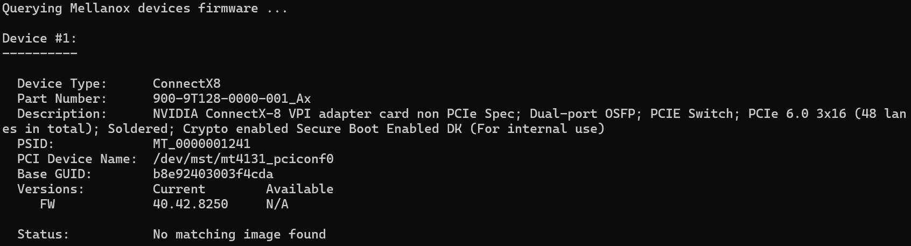
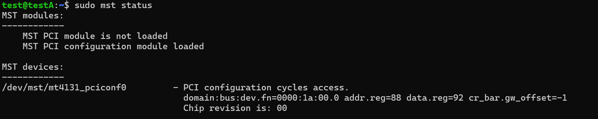
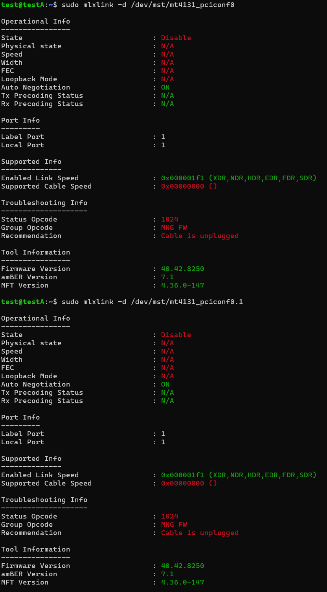

> [!TIP]
> 本页为 **Astro + Mizuki** 自动导入预览版；若需查看原始手写排版（含原版内联 SVG 与附件下载），可访问 [原版 HTML 正文](/legacy-posts/connectx8-pcie-nvdata-recovery.html)。

> 

我原本只是照 ConnectX-8 官网手册研究 `mlxconfig` 的 PCIe hierarchy、width 和 speed。参数写完、冷启动之后，CX8 直接从 PCIe 总线上消失。最终结论并不是“固件坏了”，而是错误配置留在 FS5 的双份 `NV_DATA` 中；普通重刷会保留它们，所以固件能烧、verify 能过，卡依然起不来。 
 
- 1. 前情提要 
- 2. 硬件与软件信息 
- 3. 故障症状 
- 4. 处理过程 
- 5. 下游设备导致 POST 卡 92 的后续问题 
- 6. 经验总结 
 

## 1. 前情提要

 

此前主要依据 ConnectX-8 官网手册研究并修改 `mlxconfig` 的 PCIe 参数。修改后冷启动，主机不再枚举 CX8，`lspci` 中设备消失，常规 `/dev/mst/*pciconf*` 管理路径也随之消失。 

这类故障的本质是：`mlxconfig` 修改的是持久化 NVConfig。PCIe hierarchy、width、speed、ASPM、PERST 或 switch 拓扑配置错误时，固件可能在建立 PCIe 静态配置之前失败。此时系统看不到设备，正常的 `mlxconfig reset`、`mlxfwreset` 和驱动路径都无法工作。 

## 2. 硬件与软件信息

 

### 2.1 卡与固件

 
 
- 型号：`900-9T128-0000-001_Ax` 
- 描述：ConnectX-8 VPI，PCIe Switch，PCIe 6.0 3x16，内部开发用途 
- PSID：`MT_0000001241` 
- 固件：`40.42.8250` 
- 固件日期：`30.10.2024` 
- 镜像类型：FS5 
- 安全属性：`secure-fw, dev` 
- Flash：ISSI `IS25LPxxx`，64 MiB，JEDEC `0x20709d` 
- 问题卡 GUID：`7c8c090300dc2b96` 
- 问题卡 MAC：`7c8c09dc2b96` 
- 正常参考卡 GUID：`b8e92403003f4cda` 
- 正常参考卡 MAC：`b8e9243f4cda` 
 

下图是卡本身的 `mlxup` 身份信息：设备类型 ConnectX8、部件号 `900-9T128-0000-001_Ax`、PSID `MT_0000001241`、Base GUID `b8e92403003f4cda`、固件 `40.42.8250`。`No matching image found` 表示 `mlxup` 的公开仓库没有与该内部开发 PSID 匹配的升级镜像。 [



](/assets/cx8-repair/mlxup-device-info.png)ConnectX-8 型号、PSID、GUID 与固件基线 

### 2.2 管理环境

 
 
- 测试机：经内网 SSH 跳板连接 
- MFT：`4.36.0-147`，Git SHA `7a24adf8c` 
- MTUSB：Diolan U2C-12，USB ID `0abf:3370`，MST Serial `0x27F1` 
- I²C 地址：`0x48` 
- FNP 恢复态 PCI ID：`15b3:021e` 
- FNP 恢复节点：`/dev/mst/mt542_pciconf0` 
- MTUSB 节点：`/dev/mst/mtusb-1_0x48-ConnectX8` 
 

本文不记录任何登录凭据。 

## 3. 故障症状

 

正常启动但 PCIe 不枚举时： 
 
- `lspci` 无 NVIDIA/Mellanox CX8。 
- MST 只能经 MTUSB/I²C 看见设备。 
- `mcra ... 0x1a00000` 返回 `0x00000000`。 
- `mcra ... 0x0a0304` 返回 `0xc0000000`。 
- `flint --no_fw_ctrl q` 报 `ICMD interface is not supported`。 
- `mlxconfig` 返回 rc 524，表现为 ICMD 版本无效/固件尚未初始化。 
 

这说明问题发生在固件完成 PCIe 静态配置之前，不是 Linux 驱动故障。 

## 4. 处理过程

 

### 4.1 尝试 CH347 作为 I²C 中继

 

最初没有 MTUSB，使用 CH347 连接 CX8 的 I²C。普通 Linux CH347 驱动会把常见的 write-then-read 拆成带 STOP 的两次事务，而 CX8 寄存器/ICMD 访问需要 repeated START。因此修改了驱动： 
 
- 增加组合 write-read 事务。 
- 增大缓冲区。 
- 修正读取返回长度。 
- 适配 Linux 6.8 的 remove 回调。 
 

CH347 最终可以完成基础 I²C 访问，但与 MFT 私有设备访问层的兼容性和事务时序仍不足以可靠完成 CX8 恢复，因此后续改用 MTUSB。 

### 4.2 MTUSB 探测与 MFT 信号量问题

 

插入 MTUSB 后，需要先卸载会占用适配器的内核驱动： 

```text
sudo modprobe -r i2c-diolan-u2c
sudo mst restart
sudo mst status -v
```

 

随后识别到： 

```text
/dev/mst/mtusb-1
/dev/mst/mtusb-1_0x48-ConnectX8
```

 

在正常卡上，原版 MFT 经 MTUSB 访问 CX8 出现 rc 529，调查发现开源 mstflint 的 `device_supports_sem_lock_verify()` 未包含 ConnectX-8。补丁 `cx8-mtusb-sem-verify.patch` 增加 `DeviceConnectX8_HwId`。此外，保留了修改版 `mlxconfig-cx8`，原系统 `/usr/bin/mlxconfig` 未覆盖。 

该补丁解决的是 MTUSB 二次信号量校验问题；它不能解决问题卡的 rc 524，因为后者是固件根本没有建立 ICMD。 

### 4.3 FNP 强制进入 Flash Recovery

 

将 FNP 短接后完全断电再上电，卡进入恢复态： 

```text
/dev/mst/mt542_pciconf0
18:00.0 [15b3:021e] ConnectX-8 Flash Recovery
```

 

恢复态可以绕过运行固件，直接访问 Flash。这一步是后续备份和修复的关键。 

### 4.4 从正常卡导出固件

 

正常卡在 FNP/PCI recovery 下导出 FS5 镜像： 

```text
flint -d /dev/mst/mt542_pciconf0 --no_fw_ctrl \
  ri /home/test/cx8-backups/cx8-fnp-pci-fs5-40.42.8250.bin
```

 

镜像信息： 
 
- 大小：7,540,736 字节 
- SHA-256：`0dddea1124fb20dde0613141ca0d74133e83b861d301537a5a8062073b5f48ca` 
- `flint -i ... verify`：成功，镜像可启动 
 

注意：这是 FS5 reduced image，不包含设备专属数据；镜像查询中 GUID/MAC 为 `N/A`。 

### 4.5 首次重刷固件没有解决问题

 

问题卡的型号、PSID、Flash 和固件版本与参考卡一致，因此执行： 

```text
flint -d /dev/mst/mt542_pciconf0 --no_fw_ctrl \
  -i cx8-fnp-pci-fs5-40.42.8250.bin -y burn
```

 

烧录和完整 verify 均成功，问题卡 GUID/MAC 被保留。但解除 FNP、冷启动后仍然不枚举，关键寄存器仍为： 

```text
0x1a00000 = 0x00000000
0x0a0304  = 0xc0000000
```

 

原因是普通 FS5 固件烧录保留了 DToC 中的设备数据，verify 输出也显示两个 `NV_DATA` 区域 CRC ignored： 

```text
0x03e60000-0x03e7ffff  NV_DATA
0x03e80000-0x03e9ffff  NV_DATA
```

 

因此，固件代码已经更新，但错误 PCIe NVConfig 仍然存在。 

### 4.6 备份正常卡与问题卡 NV_DATA

 

正常卡两份 NV_DATA： 
 
- `0x03e60000`，长度 `0x20000` 
- `0x03e80000`，长度 `0x20000` 
- 两份内容完全一致 
- SHA-256：`f7a8c143f0f2bde6da9fdf2eba60c8552cc5dcf6833c18ae5283b3b62ae06602` 
 

问题卡修复前两份 NV_DATA 不一致： 
 
- 第一份：`c6f1e1e3af2ef884ccb494808e5a12de27a9d8e17168d490e9162b408865ae55` 
- 第二份：`b5a41c3758763bbec72769fab4a2533bf2db0b6312d93d25a695f9e4b9e02260` 
- 与正常卡第一份相比约有 130,472 个字节不同 
 

问题卡修复前还进行了完整 64 MiB 原始 Flash 备份： 
 
- `problem-7c8c09dc2b96-full-before-nv-repair-20260715.bin` 
- SHA-256：`3148001b641bceeabe6a31553b627de9c099b509f217fd944a26a9a1c7015ace` 
 

### 4.7 尝试非 failsafe 参数及其失败原因

 

曾按建议尝试： 

```text
--ignore_dev_data --nofs -ocr --no_flash_verify
```

 

结果： 
 
- `flint -ocr hw query` 确认 Flash 写保护已经是 `Disabled`，BP=`0000`、SRWD=`0`。 
- 当前发行版 `flint` 只开放 `hw query`，`hw set` 报未知选项，因此没有执行写操作。 
- `--ignore_dev_data` 被拒绝：`ignore_dev_data flag is not applicable with the given reduced image`。 
- MFT 帮助明确标注 `--ignore_dev_data` 为 FS3 only；CX8 使用 FS5。 
- 将 64 MiB 原始 Flash dump 替换 NV 后交给 `flint -i`，又因物理 Flash dump 不是标准 FS5 镜像容器而报 `Invalid Image signature`。 
 

上述失败均发生在真正写入之前，没有额外破坏 Flash。 

### 4.8 最终修复：只写两个 NV_DATA 分区

 

由于已有完整 Flash 和原 NV_DATA 恢复点，最终使用 `flint wb` 只擦写两个目标区域： **危险：**`flint wb` 会直接擦写持久化 Flash。没有完整备份，或尚未核对地址、长度、板型、PSID、固件和 FNP 状态时，不要执行下面的命令。 

```text
flint -d /dev/mst/mt542_pciconf0 -ocr \
  wb nv_data_1-0x03e60000.bin 0x03e60000

flint -d /dev/mst/mt542_pciconf0 -ocr \
  wb nv_data_2-0x03e80000.bin 0x03e80000
```

 

写入后用 `rb` 读回，并用 `cmp` 与正常卡文件逐字节比较。两份读回文件 SHA-256 都是： 

```text
f7a8c143f0f2bde6da9fdf2eba60c8552cc5dcf6833c18ae5283b3b62ae06602
```

 

问题卡自己的 GUID/MAC 没有被覆盖，因为 DEV_INFO 区域未写入。 

### 4.9 冷启动恢复

 

操作顺序： 
 
- 完全断电。 
- 解除 FNP 短接。 
- 重新给 CX8 和主机上电。 
 

修复后： 

```text
/dev/mst/mt4131_pciconf0    1a:00.0    mlx5_0
/dev/mst/mt4131_pciconf0.1  1a:00.1    mlx5_1
```

 

下图记录了卡正常枚举时的 MST PCI 配置节点。截图当时显示 `/dev/mst/mt4131_pciconf0` 对应 `0000:1a:00.0`，证明主机已经能够通过 PCI configuration cycles 访问 CX8。 [



](/assets/cx8-repair/mst-pci-node.png)ConnectX-8 恢复后的 MST 与 PCI 节点 

关键寄存器： 

```text
0x1a00000 = 0x11a02000
0x0a0304  = 0x00000000
```

 

与故障态相比，固件已经完成启动和 PCIe 静态配置，两个 PF 重新枚举。 

当前非 FNP 状态下 `flint` 对 PCI 节点返回 `MFE_NO_FLASH_DETECTED`；这不否定修复结果，FNP recovery 下的 Flash 查询、固件 verify 和原始读回均已成功。 

### 4.10 卡上网络端口状态基线

 

下图分别查询 `/dev/mst/mt4131_pciconf0` 和 `.1`。两者固件均为 `40.42.8250`、MFT 为 `4.36.0-147`，端口 State 为 `Disable`，Supported Cable Speed 为 0，诊断建议为 `Cable is unplugged`。这说明截图时没有插网络线；它是端口介质状态，不是 PCIe 修复失败。 [



](/assets/cx8-repair/mlxlink-port-status.png)ConnectX-8 两个逻辑设备的 mlxlink 端口状态 

## 5. 下游设备导致 POST 卡 92 的后续问题

 

修复后发现：CX8 switch 下游接 NVIDIA GPU 可以启动；接 NVMe SSD、Broadcom PCIe switch 或构造回环时，主机可能卡在 POST 92。 

判断： 
 
- POST 92 是 BIOS PCI Bus 初始化阶段，故障发生在 OS 启动之前。 
- PCIe 必须是无环树；switch 下游接回自身是非法拓扑，不应继续测试。 
- 当前正常卡 NV_DATA 很可能针对 NVIDIA GPU/x16 DSP 拓扑；它不是 GPU、SSD、级联 switch 都通用的配置。 
- SSD 需要正确的 x4/x4×4 bifurcation、PERST 和参考时钟。 
- 级联 Broadcom switch 还需要足够 bus number、MMIO、Segment/AER/DPC 和正确 subordinate bus 配置。 
- 固件 `40.42.8250` 是较早的开发版。NVIDIA 后续固件专门修过 PCIe switch 手工改 width/speed/ASPM 后 PERST# 未正确断言、导致下游设备掉线的问题。 
 

官方静态资料： 
 
- ConnectX-8 用户手册 PDF，第 72 页附近： 

[https://docs.nvidia.com/networking/display/nvidia-connectx-8-supernic-user-manual.pdf](https://docs.nvidia.com/networking/display/nvidia-connectx-8-supernic-user-manual.pdf) 
- ConnectX-8 固件 40.49.1014 Release Notes PDF，第 36 页，Bug `4823907 / NVbug 5742181`： 

[https://docs.nvidia.com/nvidia-connectx-8-supernic-firmware-release-notes-v40-49-1014.pdf](https://docs.nvidia.com/nvidia-connectx-8-supernic-firmware-release-notes-v40-49-1014.pdf) 
 

官方给旧固件的 PERST 临时方案为： 

```text
mlxconfig -d <device> set PCI_BUS10_CONTROL_EN=1
mlxconfig -d <device> set PCI_BUS10_PERST_SOURCE=2
mlxconfig -d <device> set PCI_BUS10_PERST_GPIO=8
```

 

但本卡是内部开发 OPN/PSID，不能在未核对原理图 GPIO 和当前配置前直接照抄。也不能盲刷公开量产固件。实测没用。 

## 6. 经验总结

 
 
- 改 CX8 PCIe hierarchy/width/speed 前，必须先备份完整 `mlxconfig -e q`、raw NVConfig、NV_DATA 和固件。 
- 必须保留 OOB 管理路径；PCIe 配错后，正常 PCI 节点会完全消失。 
- `flint burn` 成功不代表 NVConfig 已恢复；FS5 的设备数据默认会被保留。 
- reduced image 不包含 GUID/MAC/NV_DATA，不能配合 FS3 的 `--ignore_dev_data` 思路。 
- FNP + PCI recovery 是最可靠的 Flash 恢复路径。 
- 原始写 NV_DATA 前，必须备份完整 Flash，并确认地址、长度、PSID、固件和板型全部匹配。 
- 正常卡 NV_DATA 只适合同板型、同 PSID、同目标拓扑的恢复；不同下游场景应分别保存配置。 
- 不要构造 PCIe switch 回环。
