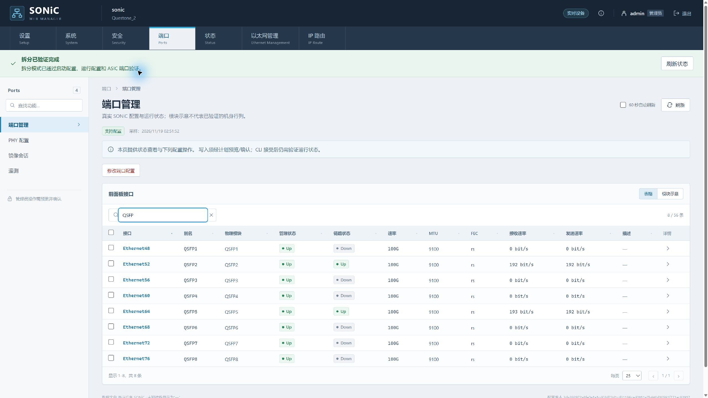
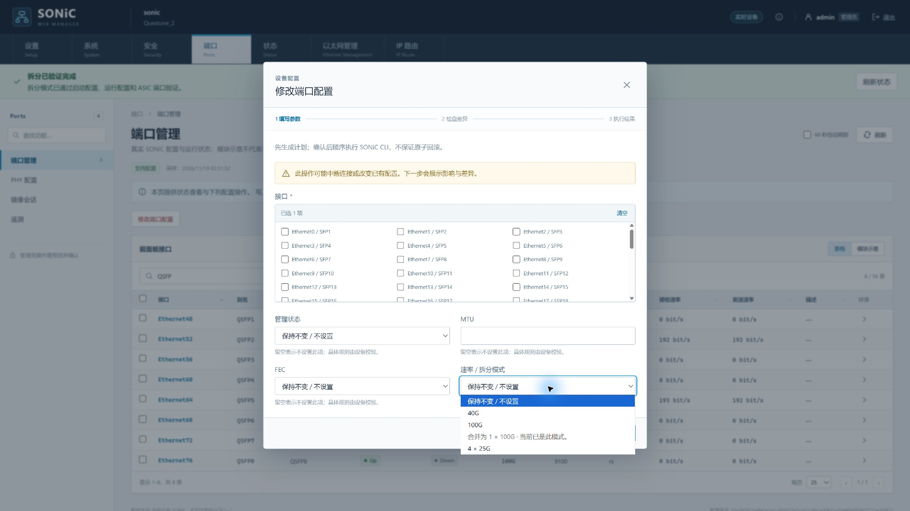
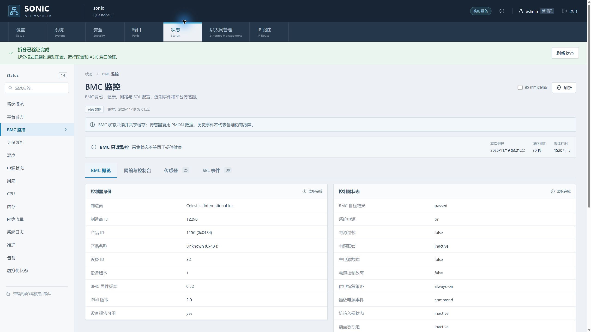
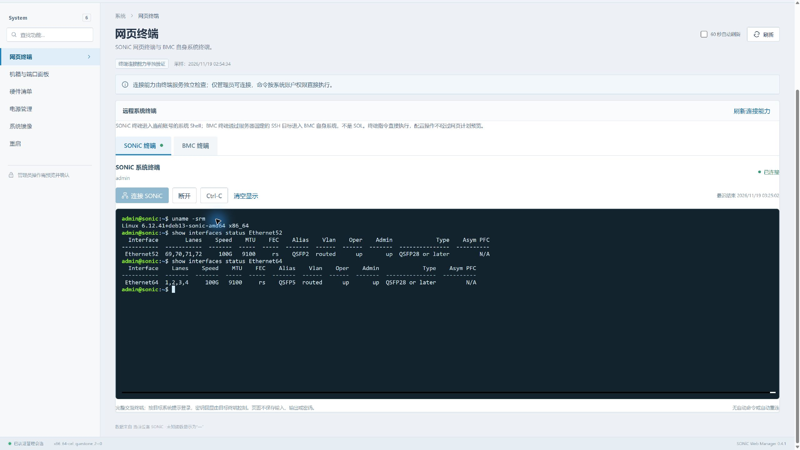

> [!TIP]
> 本页为 **Astro + Mizuki** 自动导入预览版；若需查看原始手写排版（含原版内联 SVG 与附件下载），可访问 [原版 HTML 正文](/legacy-posts/hpe-r1n26a-sonic-adaptation.html)。

[项目源码与使用说明：sonic-web-manager ↗](https://github.com/aosudh/sonic-web-manager) 

这次折腾从一句“给这台 48×25G、8×100G 的惠普交换机装个合适的 SONiC”开始，最后落到了平台驱动、Broadcom 端口分类、面板 LED、端口拆分、Web 管理和 BMC 自身终端上。机器最终运行带本机适配的 Kamel SONiC 202611 RC4 candidate .77，保留 202411-690 回退项；两个已接线的 QSFP28 端口完成了 100G 与 4×25G 的拆分、合并和灯位验证。Web 管理与两个真实终端已经工作，BMC 连接走机内 USB，不依赖另一根管理网线。 

本文记录的是一台 **HPE R1N26A / Celestica D3030 / Questone_2** 的过程，不是所有 HPE、Celestica 或 SONiC 设备的通用刷机包。RC4 是预发布候选；本文中的“通过”均有具体范围。尤其没有做全端口线速压力测试，也没有做 BMC 完整冷启动或整机断电测试。命令中的尖括号内容均为占位符；配置、身份材料和原始私人备份不随文章公开。 

配图说明：以下网页与终端截图均从这台交换机的真实 Web 服务采集；本轮未下发端口配置或重启设备。历史命令输出另标明版本与采集阶段，代码块来自实际修复文件。 

## 先纠正型号：R1N26A、D3030 和 Questone_2

 

最初凭记忆把机器称为 R1N25A，OEM 型号也只记得像 D4020。真正开始之前，先读串口启动信息、EEPROM、SONiC 元数据和 ASIC 标识，得到的组合却是下面这一组。后面的补丁全部按这组证据限定，不能因为端口数量相同就套到另一块板上。           

| 层次 | 本机确认值 | 用途 |
| --- | --- | --- |
| EEPROM 标签 / OEM 板卡 | HPE R1N26A / Celestica D3030 | 决定是否启用 HPE 专用适配 |
| SONiC platform / HwSKU | `x86_64-cel_questone_2-r0` / `Questone_2` | 选择平台包、端口表与 SDK 配置 |
| ASIC 实际识别 | `BCM56873_A0` | 核对 SDK 初始化和端口映射 |
| 主机 | Atom C3538、4 核、16 GB 内存 | 约束 Web 服务与采样成本 |
| BMC | AMI 固件 0.32；厂商编号 12290、产品编号 1156 | 约束带内监控及 USB 适配范围 |
| 默认前端端口 | 48×25G + 8×100G，56 个逻辑口、80 条物理 lane | 所有迁移和拆分验收的基线 |

 

初始系统是 `202211-kamel.467-0b721a149`，ONIE 已经存在且可用。因此没有重刷 ONIE，也没有碰 BIOS、BMC、CPLD 或 ASIC PCIe 固件。可用的启动环境不必为了“刷机完整”而再刷一次。 

```text
# 先只读核对；不同发行版先确认对应命令的 --help
show version
show platform summary
sudo show platform syseeprom
sonic-cfggen -d -v DEVICE_METADATA.localhost.hwsku
sudo sonic-installer list
lsblk -f

# 有 Broadcom 诊断工具的镜像中，再读实际芯片与端口
sudo bcmcmd 'show unit'
sudo bcmcmd 'ps'
```

 

还要同时检查 `default_sku`、`platform.json`、`platform_components.json` 和 LED 文件链接。运行数据库显示 Q2，不代表启动时所有平台文件也在使用 Q2。本机就出现过这两层不一致。值得保留的细节是：镜像初始化脚本本来已经包含 R1N26A 识别，不能把“上游完全不认识这个标签”写成根因。  

实机记录节选｜RC4 第三次启动验收时的版本输出；只摘录版本字段。 

```text
show version

SONiC Software Version: SONiC.test_rc4-candidate-kamel.77-837e6f735
SONiC OS Version: 13
Distribution: Debian 13.7
Kernel: 6.12.41+deb13-sonic-amd64
Build commit: 837e6f735
```

  

## 把回退做实，再安装新镜像

 

版本路线是先从 467 升到相对成熟的 [202411-690](https://github.com/kamelnetworks/sonic-buildimage/releases/tag/build-202411-690)，解决并验收本机平台问题；完整备份这个已工作的系统后，再尝试 [202611 RC4 candidate .77](https://github.com/kamelnetworks/sonic-buildimage/releases/tag/202611-rc4-candidate.77)。选择候选版本是一次有回退的适配实验，不意味着它已经获得该硬件的正式支持。 

备份分成三类，恢复方式也不同： 
 
- **原始安装包：**保留下载的 `sonic-broadcom.bin` 与 SHA256，便于重新安装干净系统；它不包含后续本机补丁。 
- **已工作系统目录：**在维护窗口停止相关运行服务后，归档 690 的 SquashFS、可写层、平台包、容器层、内核和启动资料。本次约 1.02 GB；这是安装目录归档，不能直接当作 ONIE installer 使用。 
- **配置及引导资料：**单独保存 CONFIG_DB、平台文件、启动配置，以及已确认分区的 ONIE/EFI 备份。含身份和密钥的内容只留在私有恢复资料中。 
 

文件复制到电脑后重新计算哈希，并检查压缩包和内部清单。只看到“下载完成”不足以证明以后能恢复。 

```text
sha256sum /path/to/sonic-broadcom.bin
gzip -t /path/to/working-image-backup.tar.gz
tar -tzf /path/to/working-image-backup.tar.gz > /path/to/private-file-list.txt

# 安装前先审阅当前版本帮助、空间及包迁移影响
sudo sonic-installer install --help
sudo sonic-installer list

# 本次在完成配置/包迁移审阅后使用的安装形式
sudo sonic-installer install --skip-package-migration -y /path/to/sonic-broadcom.bin
```

 

两个公开原始安装包的核对值为：690 的 SHA256 `a94e20df8df29c39b439451dbe348b6643f9775bb9b9129bfb05e9c7128f7afe`；RC4 的 SHA256 `ee4646f6be348b69f0438b8a8494059c52186469b2bd22aa10437ea16d9836bd`。这些是当次下载文件的身份记录，不是对未来同名文件的保证。 

第一次启动新系统时，先保留旧版为默认，单独指定下一次启动到新镜像。只有串口、ASIC、端口、传感器和服务验收完成后，再把新版设为默认。RC4 安装器后来清理了 467，因此最终可直接启动的回退项是 690，不能继续宣称三个旧版本都还在。 

```text
sudo sonic-installer list
sudo sonic-installer set-default '<KNOWN_GOOD_IMAGE>'
sudo sonic-installer set-next-boot '<NEW_IMAGE>'
# 在维护窗口通过串口观察这次完整重启
sudo reboot

# 新版验收后再提交默认启动选择
sudo sonic-installer set-default '<VERIFIED_NEW_IMAGE>'
```

 

467 到 690 还存在一次端口 `index` 迁移：原来的 0–55 改为新平台端口表要求的 1–56。操作前逐口比较接口集合和 lane，只改 56 个 index，其余字段保留。进入 RC4 时不再重复加 1。迁移脚本如果没有版本和源文件校验，很容易把正确配置再改错一次。  

安装器原始输出节选｜RC4 初始验收结束时，690 仍保留在可启动镜像列表中。 

```text
Current: SONiC-OS-test_rc4-candidate-kamel.77-837e6f735
Next: SONiC-OS-test_rc4-candidate-kamel.77-837e6f735
Available: 
SONiC-OS-test_rc4-candidate-kamel.77-837e6f735
SONiC-OS-202411-kamel.690-da59f7734
```

  

## 风扇、Ethernet 位图与首次启动的平台包

 

### 风扇转着，平台却说不存在

 

690 启动后，机箱和 PSU 风扇全部显示 Not Present，但真实转速、温度和供电信息并不支持“十个风扇同时消失”。检查 IPMI 原始回复发现，正常值实际是带前导空格的 `' 00'`，平台代码却在直接比较 `output == '00'`。最小修复是先去除首尾空白，保持读失败的处理不变。  

实际提交代码｜PR #30864 的 fan.py diff。只修正报告值，不调整真实 PWM 或热阈值。 

```text
diff --git a/platform/broadcom/sonic-platform-modules-cel/questone2/sonic_platform/fan.py b/platform/broadcom/sonic-platform-modules-cel/questone2/sonic_platform/fan.py
index 6a1faa4..18e0879 100644
--- a/platform/broadcom/sonic-platform-modules-cel/questone2/sonic_platform/fan.py
+++ b/platform/broadcom/sonic-platform-modules-cel/questone2/sonic_platform/fan.py
@@ -133,7 +133,8 @@ class Fan(FanBase):
             rpm_speed = int(raw_speed, 16) * multiplier
             speed = int((rpm_speed/self.max_speed) * 100)
 
-        return speed
+        # Measured RPM may exceed the nominal maximum at full fan speed.
+        return min(100, max(0, speed))
 
     def get_target_speed(self):
         """
@@ -288,7 +289,8 @@ class Fan(FanBase):
 
         cmd = IPMI_GET_PRESENCE.format(self._fan_status_offset)
         status, output = self._api_helper.run_command(cmd)
-        if status and output == "00":
+        # ipmitool prefixes each byte with a space; getstatusoutput keeps it.
+        if status and output.strip() == "00":
             presence = True
 
         return presence
```

  

第二个问题紧接着出现：实测 RPM 略超驱动的标称最大值，换算出 101% 或 103%，违反 SONiC 平台 API 的范围要求，导致 thermalctld 更新中断、FAN_INFO 字段不全。限制报告百分比解决的是数据契约，不是降低真实转速；没有调整风扇 PWM，也没有提高任何告警或关机阈值。等价修复同时进入 host 平台代码、PMON 使用的 wheel 和持久包，避免只修运行中容器、下次启动又恢复。 

最初的满速噪音也不是靠手动曲线解决的。两只 PSU 都接通后，BMC 自行降速，噪音恢复正常。后来的 Web 界面虽然有风扇控制能力模型，但本机缺少经过验证的写入、读回及恢复自动模式链路，因此手动调速保持不可用。DEMO 里的 40% 演示不算实机能力。 

### 十二个 25G 端口被分类成 HiGig2

 

只看 Linux 接口名会漏掉另一层问题。SDK 的 `ps` 中有十二个 25G 端口被标成 HG/HIGIG2。检查 Q2 的 BCM 配置后，定位到 `pbmp_xport_xe` 未包含这些已配置的 SDK 逻辑端口。 

这里没有凭直觉重新发明位图，而是追溯到 Christian Svensson / bluecmd 的 [历史 D3030 修复](https://github.com/kamelnetworks/sonic-buildimage/commit/e3af4dc61ad1eee68183ad2a12a380298c9e1952)，以及本机原来确实工作的 467 配置，恢复它们采用的值： 

```text
pbmp_xport_xe=0xffffffffffffffffffffffffffffffffe
```

 

这个位图用于分类已经存在的端口映射，不会单凭置位就创建 131 个前面板端口。端口创建仍由 `portmap` 决定，CPU 和 loopback 也有各自处理路径。完整重启后重新核对 56 个前端端口，全部为 IEEE Ethernet，两个已接 100G 口保持 Up。该数值只适用于已核实的 D3030/Q2 配置，不是建议给任意 Broadcom 平台都填全 1。 

### RC4 的补丁不能只放在 overlay 中

 

RC4 的平台包已经提供匹配 `6.12.41+deb13-sonic-amd64` 的内核模块，因此没有盲目重编译驱动。需要解决的是首次启动安装顺序：`/etc/rc.local` 发现新镜像的 `platform/firsttime` 标记后，会从镜像自己的平台包仓库安装 .deb；其 postinst 再安装 wheel。只提前改可写层中的 fan.py 或 wheel，会被这一步覆盖。 

于是离线适配同时覆盖新镜像专属的 overlay 和平台 .deb：更新 fan.py、wheel 的 RECORD、deb 的 md5sums，以及 Packages.gz 中该包的大小和校验字段。其他包、内核模块和旧 690 镜像保持原状。应用工具默认只生成计划，校验固定版本、SquashFS 和源文件哈希，拒绝正在运行的目标镜像或缺少首次启动标记的目录。 

另一个独立问题是 PMON 的动态字符设备 major 与容器 cgroup 规则。这里采用了已有 [Kamel PR #204](https://github.com/kamelnetworks/sonic-buildimage/pull/204) 的固定版本思路：规则变化才重建容器，不扩大为 privileged。三次实机启动 major 都没有变化，真正验证的是正常分支；异常分支由 24 项本地模拟与 patcher 测试支持，不能写成已在本机复现 major 漂移。 

时间同步也分版本处理：690 的 DHCP 管理接口触发了旧 ntpsec 模板问题，修复后再验收；RC4 使用自己的 chrony 路径，没有把旧模板补丁硬搬过去。某次采样的微秒级偏差，只说明那次读数，不能当作长期精度承诺。 

## LED 错位：80 条 lane 的映射问题

 

插入两条 DAC 后，一个 QSFP28 的灯跑到了 SFP28 区域。修正 Q2/Q2A 的默认链接后，错位形式变了，但并没有彻底消失。这说明“加载了名称正确的文件”与“文件适配这块 OEM 面板”是两件事。 

进一步核对 SDK 的 LED 软件输入寄存器，亮起的位与真实物理 lane 对应正确；十二个 HiGig 分类问题不能解释这两个 QSFP 的灯位偏移。问题落到了 LED 程序的输入表和串行输出布局。原 Q2 的程序为 248 字节，而 Q2A 的 308 字节程序在 HPE 面板上表现出正确的部分输出布局。 

最终方案保留 Q2A 程序前 228 字节代码和输出布局，只替换末尾 80 字节 lane 表：先按同名 Ethernet 端口关联两份官方 port_config，再按 lane 序号逐项转换。48 个 SFP 各一条 lane，8 个 QSFP 各四条 lane，总计 80 项；QSFP 输出顺序保持 Q5、Q6、Q7、Q8、Q1、Q2、Q3、Q4。80 项里有 72 字节变化，代码区完全不变。  

实际生成器节选｜PR #206 核心映射逻辑；TABLE_OFFSET = 228。完整程序还包含输入与输出哈希校验，不能只复制此片段运行。 

```text
    old_ports = read_lanes(platform / "Questone_2A/port_config.ini")
    new_ports = read_lanes(platform / "Questone_2/port_config.ini")
    translation = {}
    for name in PORT_ORDER:
        require(len(old_ports[name]) == len(new_ports[name]), f"Lane count changed for {name}")
        for before, after in zip(old_ports[name], new_ports[name]):
            require(before not in translation, f"Duplicate source lane {before}")
            translation[before] = after
    source_table = bytes(lane for name in PORT_ORDER for lane in old_ports[name])
    require(len(source_table) == 80 and len(set(source_table)) == 80, "Invalid source lane table")
    require(original[TABLE_OFFSET:] == source_table, "Source table order changed")
    target_table = bytes(translation[lane] for lane in source_table)
    require(len(set(target_table)) == 80, "Duplicate target lane")
    result = original[:TABLE_OFFSET] + target_table
```

  

生成器可以重复得到 SHA256 `6af4180b7f4a8bda9833a0536b1dd6a00bfac7cd055e225fbdadeb28398ea73b`。两次独立推导得到相同结果；热载后观察已接端口，再持久化并跨系统重启验证。Q1/Q5、Q2/Q5 的 100G 灯位，以及 Q2/Q5 拆成八个 25G 子口时的灯位都经过人工确认。但完整 56 口的映射中，未接线部分仍属于依据端口表推导，不能称为逐口硬测。 

最终上游方案为 R1N26A 增加独立 LED 文件和精确选择逻辑，保留通用 Q2/Q2A 程序。不应因为借用了 Q2A 的输出布局，就把整台机器的 HwSKU 改成 Q2A。生成器与适用范围见 [HPE LED PR #206](https://github.com/kamelnetworks/sonic-buildimage/pull/206)。 

## 100G 与 4×25G：配置成功还不够

 

本机两个测试 cage 的关系非常具体：       

| 机身标识 | 100G 父口 | index | 物理 lanes | 4×25G 子口 |
| --- | --- | --- | --- | --- |
| QSFP2 | Ethernet52 | 50 | 69, 70, 71, 72 | Ethernet52–55 |
| QSFP5 | Ethernet64 | 53 | 1, 2, 3, 4 | Ethernet64–67 |

 

原 RC4 platform.json 只声明 1×100G，SDK 配置也没有为这次操作准备可用的动态拆分资源。即使 CLI 有 `config interface breakout` 命令，也不等于这台设备可以在线执行。这里最终实现的是**静态拆分，需要整机完整重启**，不是动态 FlexPort。 

每次计划同步准备五份文件：启动 CONFIG_DB、port_config.ini、platform.json、hwsku.json 和 BCM SDK 配置。拆分保留父口原有 L3 字段，新子口只复制合适的端口属性，不擅自复制路由；合并前检查新增子口是否被接口、VLAN、LAG、ACL 或镜像会话引用。已有未保存配置先处理，避免拆分悄悄替用户保存全部其他变更。 

应用过程做成持久任务：保存原始文件及候选文件，校验 revision 和源哈希，逐文件原子替换，锁住其他写操作，再由独立 worker 发起重启。重启后网页能重新加入同一任务，显示 verifying、succeeded 或 failed。任务尚未确认时，普通配置保存不能覆盖已准备好的启动文件；失败恢复也必须识别已知 before/after 状态，不能覆盖外部未知改动。 

第一次 RC4 拆分还发现了验收器自己的 bug：它假设每条 ASIC PORT 对象都提供 HW_LANE_LIST，而实际对象没有这个字段。设备已经有 59 个端口，配置与链路都正常，验收却报失败。修复不是删掉硬件检查，而是改用实机存在的映射链： 

```text
COUNTERS_PORT_NAME_MAP: Ethernet 名称 → SAI VID
VIDTORID:                VID → ASIC RID
ASIC_DB LANES:           物理 lane → RID
ASIC PORT:               speed / FEC / admin
SDK show portmap + ps:   再独立核对端口与速率
```

 

0.2.1 验收器据此检查端口名称集合、VID/RID 唯一性、全部 80 条 lane、每口速率/FEC/admin，以及 SDK 读回。之后完成四轮同一产品 worker 的真实操作：         

| 轮次 | 操作 | 逻辑口数量 | 结果 |
| --- | --- | --- | --- |
| 1 | Q2：1×100G → 4×25G | 56 → 59 | 配置与真实 ASIC 验收通过 |
| 2 | Q5：1×100G → 4×25G | 59 → 62 | 八个 25G 子口 Up，灯位确认 |
| 3 | Q2：4×25G → 1×100G | 62 → 59 | 合并与配置恢复通过 |
| 4 | Q5：4×25G → 1×100G | 59 → 56 | 恢复两条 100G Up |

 

最后通过真实 HTTPS 接口重新生成了两个 4×25G 预览，能力返回 available、hardware_verified 和 reboot_required，但没有再次应用。四轮实机操作走的是产品同一 worker，不把它们描述成四次浏览器点击。这里的“完整重启”是 SONiC 非 warm/fast 的系统重启，不是拔掉电源再开机。  

历史 CLI 记录｜690 阶段，Q2/Q5 拆分后的八个 25G 子口为 Up。保留原记录中 QSFP3/QSFP4 的 Down 行；这不是 RC4 四轮验收的命令截图。 

```text
 Ethernet52               69      25G   9100     rs  QSFP2/1  routed      up       up  QSFP28 or later         N/A
 Ethernet53               70      25G   9100     rs  QSFP2/2  routed      up       up  QSFP28 or later         N/A
 Ethernet54               71      25G   9100     rs  QSFP2/3  routed      up       up  QSFP28 or later         N/A
 Ethernet55               72      25G   9100     rs  QSFP2/4  routed      up       up  QSFP28 or later         N/A
 Ethernet56  121,122,123,124     100G   9100     rs    QSFP3  routed    down       up              N/A         N/A
 Ethernet60  125,126,127,128     100G   9100     rs    QSFP4  routed    down       up              N/A         N/A
 Ethernet64                1      25G   9100     rs  QSFP5/1  routed      up       up  QSFP28 or later         N/A
 Ethernet65                2      25G   9100     rs  QSFP5/2  routed      up       up  QSFP28 or later         N/A
 Ethernet66                3      25G   9100     rs  QSFP5/3  routed      up       up  QSFP28 or later         N/A
 Ethernet67                4      25G   9100     rs  QSFP5/4  routed      up       up  QSFP28 or later         N/A
```

  [



](/assets/images/sonic/01-live-100g.jpg)实机端口管理：QSFP2 与 QSFP5 均为 100G、RS FEC、链路 Up。截图采于本文配图阶段，仅查看状态；页面上的拆分完成提示来自此前的验收任务。 点击图片查看原图。 

## 把 Onyx 的管理组织方式带到 SONiC

 

用户希望保留熟悉的 Onyx Web 操作方式，因此界面采用七个管理视角：设置、系统、安全、端口、状态、以太网管理、IP 路由。初版 68 页，增加 BMC 与终端后为 70 页。实现采用独立名称和原创代码，参考的是 [Onyx 的信息组织](https://networking-docs.nvidia.com/onyxum/3102002/web-interface-overview)，没有移植 NVIDIA 原程序，也不宣称功能完全等价。 

```text
React / TypeScript 界面与随包静态资源
              ↓ HTTPS / PAM / 会话 / CSRF
Python 标准库 HTTP 服务
              ↓ 计划、差异、确认、串行应用、读回
SONiC adapter ─ CONFIG_DB / STATE_DB / COUNTERS_DB / 已验证 CLI
              └ 机型 profile：cage / index / lanes / geometry
```

 

这层结构允许界面跨机型复用，但端口位置不能靠猜。`Ethernet52`、`QSFP2`、index 50、物理 lane 69–72 和面板行列是不同维度。当前 profile 精确匹配 platform、HwSKU 和 R1N26A 标签，再校验 index/lane；未匹配的平台回退到逻辑端口列表。HPE 的全机身行列没有逐口标定，因此画面明确是逻辑示意图。 

端口表单把速率与拆分模式放在同一选择入口：普通速率来自真实支持能力，拆分模式带整机重启提示，批量操作取所选端口能力的交集。VLAN/LAG、接口地址、PFC 和镜像会话使用真实接口下拉，同时显示 Ethernet 名称及 SFP/QSFP 标识，降低手输错口的概率。 [



](/assets/images/sonic/02-live-speed-selector.jpg)实机速率／拆分下拉菜单：40G、100G 和 4×25G 来自设备能力。本图只展开选项，未提交配置；40G 选项存在不等于完成了 40G 接线验收。静态拆分仍需计划确认并整机重启。 点击图片查看原图。 

配置操作先生成服务器端计划，再确认应用。计划绑定配置修订与有效期；后端拒绝过期计划、并行写入、未知参数和依赖冲突，写前备份，写后重新读取。`pending_save` 由运行与启动配置规范化比较得出，不是进程内一个会随重启丢失的布尔值。保存命令退出 0 也要读回确认，不能直接弹“保存成功”。 

读取使用共享缓存，页面刷新不会让每个浏览器各跑一轮 IPMI。能力不足时说明是硬件/发行版缺失、当前后端尚未实现，还是已有接口尚未验证。多 ASIC 的 namespace 写入没有完成，就明确禁用；菜单中出现 XML Gateway、WJH 或许可管理，并不意味着 SONiC 自动拥有这些专有功能。 

还有一些不显眼但实际重要的适配：读取 MAC 表直接调用 `fdbshow`，避免大 CLI 导入时隐含的 sudo 探测；接口 IP 删除保留原 CLI 的路由保护，在当前服务权限无法完成前置检查时不开放；导出配置按表上下文遮蔽 MACsec CAK、NTP_KEY.value、SNMP 和 AAA 密钥，而不只寻找名称里带 password 的字段。 

### 从源码构建、传输到交换机，再安装 Web 服务

 

这部分可以独立于镜像适配完成。先在 Linux 开发机或 WSL 上准备 Python 3.10+、Node.js 24.13.0 和 npm 11，按[项目 README](https://github.com/aosudh/sonic-web-manager)构建；交换机只接收 Python 后台与编译后的静态页面，不需要安装 Node.js： 

```text
git clone https://github.com/aosudh/sonic-web-manager.git
cd sonic-web-manager
cd ui
npm ci
npm test
npm run build
cd ..
python3 -m unittest discover -s tests -v
SOURCE_DATE_EPOCH=0 python3 deploy/build_release.py \
  --output-dir ../sonic-web-release

# 使用 VERSION 对应的运行包，不是 source.zip
web_version="$(cat VERSION)"
scp "../sonic-web-release/sonic-web-manager-${web_version}.tar.gz" \
  <SONIC_USER>@<SONIC_MGMT_IP>:/tmp/
```

 

把占位符换成目标设备的管理地址和现有 SSH 账户，核对 SSH 主机公钥；该账户需要安装服务所需的 sudo 权限。记录打包输出的 SHA256，登录 SONiC 后与上传文件比较。下面的 `<VERSION>` 应与刚才源码中的 `VERSION` 一致： 

```text
ssh <SONIC_USER>@<SONIC_MGMT_IP>
cd /tmp
sha256sum sonic-web-manager-<VERSION>.tar.gz
tar -xzf sonic-web-manager-<VERSION>.tar.gz
cd sonic-web-manager-<VERSION>
sudo python3 deploy/install.py --port 8443
sudo systemctl status sonic-web-manager --no-pager
sudo journalctl -u sonic-web-manager -n 50 --no-pager
```

 

安装成功后，访问 `https://<SONIC_MGMT_IP>:8443`，按本地流程核验应用独立生成的 TLS 证书，使用已有 SONiC 本地账户登录。服务默认只绑定启动时 `eth0` 的 IPv4 管理地址；管理地址变化后要重新绑定并更新证书 SAN。先检查端口、传感器和采样时间，不把“服务 active”当成硬件验收。 

实机登录走 PAM，管理权限由账户的 UID/组判定。网页 SONiC 终端还要求可用的本地登录账户，以该账户自身权限运行；安装 Web 不会自动赋予 sudo 权限。BMC 系统终端需要另外配置并核验固定 SSH 目标，USB 附件也不会随普通安装自动执行。 

应用版本保存在 `/host/sonic-web/releases`，状态和证书保存在 `/host/sonic-web/state`。升级保留上一应用版本；已有可用的 previous 版本时，可以这样回退： 

```text
sudo python3 /host/sonic-web/current/deploy/install.py --rollback
```

 

这个回退只处理 Web 应用，不回退 SONiC 镜像、业务配置或 BMC 设置。更换 SONiC 镜像后，还要在新系统中重新安装服务并验证接口兼容性。 

## CPU、温度和 BMC 监控中的数据语义

 

CPU 使用率最初被页面缓存和采样窗口影响，出现缺值或切换页面后不更新。修正后由服务后台每两秒共享读取 `/proc/stat`，首个值建立约 200ms 的窗口；计数器回退、读失败或样本过期时显示未知。全机平均忙碌百分比维持在 0–100%，不会把四核累计值误当成单一百分比。 

温度修正则是单位、类型和采样语义：统一摄氏度，正确处理 N/A、过期样本，以及 PSU 发布的 Unix 秒时间戳。没有改硬件温度值、校准系数或告警阈值。`ASIC External` 仍明确表示 ASIC 外部传感器，不把它包装成芯片核心结温。最终读到 13 项新鲜温度、10 个风扇和双电源正常；这只是当时的状态，不是永远健康的承诺。 

BMC 页独立展示身份、自检、机箱状态、网络/SOL 能力和最近 30 条 SEL。固定只读命令经本地 KCS 执行，普通命令预算 5 秒，SEL 预算 20 秒，整次采集最多 25 秒，共享缓存 30 秒。最初 `sel elist` 额外解析 SDR 名称太慢，改用 `sel list last 30`，保留事件的原始传感器类型/ID。传感器本身复用 PMON，不再直接重复轮询 IPMI。 

采集成功与硬件健康分别展示。SEL 中一条历史 Asserted 后面可能已经有 Deasserted，不能看到旧事件就给当前 CPU 或电源判故障。RC4 启动早期 FAN_INFO 部分字段缺失引起的 fanshow 异常也是同样道理：先查数据发布时序和守护进程，再判断硬件。该 CLI 问题已有 [sonic-utilities PR #4715](https://github.com/sonic-net/sonic-utilities/pull/4715)，本次没有重复提 PR。 [



](/assets/images/sonic/04-live-bmc-monitor.jpg)实机 BMC 只读监控：控制器身份、固件版本、自检与机箱状态来自带内 IPMI；采集成功和硬件健康分开显示。该页是监控画面，不是 BMC shell 或 SOL 会话。 点击图片查看原图。 

## SONiC 网页终端与 BMC 系统终端

 

“控制台”至少包含三个不同入口：SONiC 主机 shell、BMC 自身操作系统 shell，以及通过 SOL 转接到主机串口。浏览器连接本地 USB 串口又是第四种传输方式。BMC 报告 SOL enabled，只能说明相关能力/配置存在，不能当作 BMC Linux shell 已经可用。 

SONiC 网页终端使用随包分发的 xterm.js 和真实 PTY。登录者通过 PAM 验证后，以该本地账号启动 shell，保留账号原有 sudo 权限，不直接把网页登录变成 root shell。主 Web 服务继续保留 NoNewPrivileges；终端由固定参数的 systemd 临时服务启动，绑定父服务生命周期并限制资源，避免把主服务的安全限制悄悄取消。 

每个 Web 会话最多两个终端，全局最多四个；无输入五分钟或累计三十分钟关闭。输出采用有界环形缓冲与游标轮询，输入限制单次大小和速率，resize 校验行列。登出、导航离开和服务停止会回收进程组。审查中还修复了两个竞态：PTY fd 被关闭后重新分配造成串会话读写，以及 systemd 单元尚未注册时立即关闭造成的迟到残留。 

BMC 自身终端只接受服务器配置中的固定 SSH 目标、用户名和主机公钥。浏览器不能传任意 host、命令行或 SSH 选项。密码在真实 SSH 交互中输入，不存进目标文件或应用日志。应用禁用 SONiC shell 的普通历史，但不承诺关闭设备自身的审计、sudo 或用户程序记录。 [



](/assets/images/sonic/03-live-sonic-terminal.jpg)真实 SONiC 网页终端：本轮只读执行 uname -srm 和两个 show interfaces status，读到 Linux 6.12.41，两个端口均为 100G、RS、Admin/Oper Up。此图是 SONiC 主机 shell。 点击图片查看原图。 

## 机内 USB、持久配置与有限自愈

 

### 找到真实 BMC shell，再解决传输

 

本机 BMC 外部 LAN 没有可用 IPv4，DHCP 实验没有拿到地址。SMBIOS 的管理接口记录只描述 KCS，不能从中推导出 Redfish 服务地址。主机却能看到 AMI `046b:ffb0` 的 USB 网络功能。公开的 [MegaRAC CE 配置脚本](https://github.com/opencomputeproject/OCP-HM-MegaRAC_Community_Edition/blob/a7584dca1fb709e557b9393ecfcaa2df00e00788/meta-ami/meta-common/recipes-ami/host-interface/host-interface/configure_usb_gadget.sh)提供了同类设备的链路本地地址线索，但跨 OEM 的地址只能作为有限候选，不能当作本机事实。 

首次只在主机配地址仍然收不到数据。随后在核实这块 D3030 的 CPLD 驱动定义后，临时把已经接好的外部串口复用到 BMC，设置自动恢复并在结束时切回 SONiC。寄存器位置和位意义依赖具体板卡，本文不提供可粘贴到其他机器的 raw 写命令。这个串口只用来诊断和初始化，最终网页连接不依赖电脑串口。 

实际登录后确认，普通管理登录走的是 AMI 的管理 shell，而维护账户可以进入 BMC 系统。BMC 的 `usb0` 原来处于 DOWN 且没有 IPv4，SSH 已经监听。之后只调整既有维护账户的 shell 为 `/bin/sh`，保留其他账户设计；没有创建 UID 0 别名，也不把 IPMI 账号与 Linux 维护账户说成同一个账号。文章不列任何设备密码或未经核实的默认口令。 

### 双端持久化只管理这条内部链路

 

最终 BMC 使用一个专用链路本地 /30，SONiC 主机使用其中的对端 /32。公开示例用 `<BMC_USB_IP>` 和 `<HOST_USB_IP>` 表示。主机服务按已核实的 USB VID/PID、序列、物理路径和驱动匹配设备，使用独立策略路由表：只允许本机产生的流量访问 BMC；转发流量或 USB 消失时不能落回默认路由。它不改管理口默认路由、DNS 或业务端口。 

BMC 根文件系统是只读 cramfs，`/conf` 是可写 JFFS2；`/etc/network/interfaces` 指向 `/conf/interfaces`。保留原有物理网口配置，追加 usb0 stanza，再利用已有 cron 的启动和每分钟任务运行独立 guard： 

```text
# 示例：由本机 profile 确定地址；不要直接覆盖完整 interfaces 文件
auto usb0
iface usb0 inet static
    address <BMC_USB_IP>
    netmask 255.255.255.252

# 只向原 crontab 追加受管块，保留所有 OEM 原任务
@reboot <BMC_MAINT_USER> /bin/sh /conf/sonic-web-usb.sh
* * * * * <BMC_MAINT_USER> /bin/sh /conf/sonic-web-usb.sh
```

 

上面的 cron 是这台已验证设备的持久化结构示意；公开仓库中的 BMC USB 脚本是默认禁用的模板（`BMC_USB_ADAPTER_REVIEWED=0`），需要按 README 逐项核对平台、路径与示例地址后再明确启用。普通 Web 安装不会部署或启用这一适配。 

guard 在 IP、掩码和 UP 状态正确时不重复 ifconfig；遇到其他非空地址则报冲突。SSH 只监听这条 USB 地址。如果 gadget 晚出现导致 sshd 首次绑定失败，guard 还检查真实监听状态；只有完全没有 22 端口监听时，才核对原厂配置布局、空的启动附加参数、NCML 服务状态、`sshd -t` 和有效监听地址，再调用已有启动入口。它不会触发原厂脚本的默认配置迁移，也不会遇到陌生监听就重启服务。 

### USB 传输挂起需要与 SSH 服务故障分开

 

串口中出现过 `Previous Write Pending`、`TxData=0`、`Ready=0`。AMI [公开驱动](https://github.com/ami-megarac/OSSW/blob/f85e00204c85c79b9555db581b42443bab472e10/SPX-12/usbe-src/coreusb.c#L548)显示，USB bus reset 会清理 endpoint 的发送状态；后续版本也记录了相近的挂起症状。对已识别的 USB 网络功能精确复位后，本机 SSH 恢复，SONiC 没有重启。 

据此增加的自愈是有边界的：大约每十秒做一次一秒预算的 TCP/SSH 探测；连续三次连接超时才考虑复位，连接被拒绝、已连接但 banner 异常不算 USB 挂死。每次复位前再次验证具体设备、configuration 2 与打开 fd 的字符设备号；至少间隔五分钟，每小时最多三次。进程崩溃或复位结果不明时保留阻塞标记，不无限重试，也不重启整个 BMC。 

实际验收使用临时故障规则阻断这条内部链路的新建 SSH SYN，并设置自动清理保护。服务观察到三次超时后，只请求了一次目标 USB 复位，约 57.3 秒恢复 SSH；随后再次通过真实网页进入 BMC ARM Linux，测试窗口缩放和关闭清理。另一次测试停止 BMC sshd 后，guard 恢复了仅绑定 USB 地址的监听。两个 100G 链路在验收时保持 Up，临时故障规则与维护会话都已清理。 

这证明的是运行态恢复、服务重启和一次自动故障恢复。持久文件已经写入，但本次没有重启 BMC，也没有做整机断电；固件升级是否保留这些设置仍由厂商策略决定。不能把这些结果扩写成“所有冷启动和断电场景都已验证”。 

## 把修复拆成三个上游 PR

 

上游提交只带可以独立解释和回归的最小改动，不上传运行配置、整机镜像、私人诊断日志或账号材料。已有的 PMON 和 fanshow 修复先去重，静态拆分实验也没有塞进平台小修复里。        

| 提交 | 范围 | 验证与保留边界 |
| --- | --- | --- |
| [sonic-net #30864](https://github.com/sonic-net/sonic-buildimage/pull/30864) | Questone2 fan presence 空白处理、转速报告限幅 | 5 个回归测试方法；690/RC4 等价补丁实机通过，不声称构建过完整 master 镜像 |
| [sonic-net #30865](https://github.com/sonic-net/sonic-buildimage/pull/30865) | 恢复历史 D3030 Ethernet 位图的一行改动 | 保留原作者归属；56 口分类与已接链路核对，SDK 跨版本仍需维护者审查 |
| [Kamel #206](https://github.com/kamelnetworks/sonic-buildimage/pull/206) | R1N26A 专用 LED、生成器和精确选择逻辑 | 8 项选择逻辑测试、生成器与语法检查；不改通用 Q2/Q2A，不声称 R1N25A 已验证 |

 

发布前重新核对，三个 PR 仍为 Open、尚未合入。两项 sonic-net 提交的 DCO 已通过，EasyCLA 机器人也分别确认了 [#30864](https://github.com/sonic-net/sonic-buildimage/pull/30864#issuecomment-6977647142) 和 [#30865](https://github.com/sonic-net/sonic-buildimage/pull/30865#issuecomment-6977711327) 的签署；后续状态以各 PR 页面为准。DCO 与 CLA 是不同流程，补丁可用、单元测试通过、PR 已公开、全镜像 CI 通过、维护者接受，也分别是不同的里程碑。 

## 验收范围、限制与复现顺序

           

| 项目 | 本次已验证 | 不能外推的部分 |
| --- | --- | --- |
| 系统 | RC4 初始三次启动验收，后续四轮拆分重启；690 回退项保留 | RC4 正式支持、其他硬件同样兼容 |
| 端口 | 56 口/80 lane；Q2/Q5 四轮静态拆分与合并；最终两口 100G Up | 全端口线测、线速吞吐、动态 breakout、零丢包 |
| LED | 已接 Q1/Q2/Q5 的 100G 与 Q2/Q5 八个 25G 灯位 | 所有 56 口均经过人工插线验证 |
| 风扇与传感器 | presence/百分比 API 修复、BMC 自动温控、双 PSU、新鲜温度采样 | 手动 PWM、人工温控曲线、提高热阈值 |
| Web | 真实只读页面、白名单计划、持久拆分 worker、两个真实 PTY 终端 | 与 Onyx 全功能等价、所有业务写动作均已实机验证 |
| BMC USB | 固定 SSH 目标、私有路由、guard、精确复位和一次自动恢复 | BMC 冷启动、整机断电、固件升级后持久性 |

 

软件验证也保留层次：Web 0.4.1 后端 185 项回归、前端 46 项测试及构建通过；BMC guard 26 项 mock 测试，主机 USB 服务 31 项测试，另有隔离 Linux 网络命名空间验证。这些测试支持输入边界、失败恢复和状态机，不替代实机接线或协议吞吐认证。历史拆分采样出现过少量 RX_DRP，原因没有完成追查，因此文章不使用“零丢包”结论。 

如果在另一台机器复现，顺序应当是：核实 EEPROM、平台和 ASIC；记录正在工作的配置与启动项；准备可验证的备份和串口恢复路径；在维护窗口只安装到新槽位；先解决平台读数和映射，再开放配置能力；每一阶段保留明确的读回与回退条件。对前面板位置、动态拆分和 BMC 网络保留未知状态，比用看似完整的界面掩盖缺口更容易维护。 

本次保留下来的成果不只是能启动的 RC4，还包括可复现的平台补丁、LED 生成器、跨层硬件验收、与机型配置分离的 Web 后端，以及已公开的最小上游修复。后续需要补的工作也有明确位置：更多端口线测、真实业务流量与压力测试、其他机型 profile，以及完整断电后的恢复验证。
