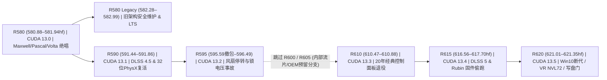

从 2025 年 7 月底的 `580.88 WHQL`（Linux `580.65.06`）到 2026 年 11 月 20 日紧急救火的 **`621.35 Hotfix`**（`621.24 WHQL` / Linux `620.73.04`），NVIDIA 驱动在短短 16 个月里跨越了 6 个主干大分支。如果只看官网下载页那几句宣传摘要，你会以为这只是按部就班的日常迭代；但只要把所有底层文档拉下来做一次全量文本比对，里面藏着一整部从未写进新闻稿的暗黑编年史。

**本次全量审计一手语料规模**：
- **Windows 消费级主线与遗产分支**：全量拉取并逐页解析 **32 份官方 Release Notes PDF**（共约 **1,190 页**，覆盖 `580.88` 至 `621.24`，含 `582.28` / `582.78` 旧架构安全专版）
- **Windows 紧急救火与撤包驱动**：追踪 **1 个光速撤包正式版**（`595.59`）与 **10 个官方 Customer Care Hotfix**（`581.94`、`591.67`、`595.76`、`596.02`、`610.52`、`610.82`、`616.86`、`617.70`、`621.12`、`621.35`）
- **Linux x86_64 & ARM64 驱动**：全量比对 **33 个版本**（`580.65.06` 至 `620.73.04`）的 `supportedchips.html`（2,335 条 PCI ID 逐行 Diff）、`README` 配置文档变化，以及 GitHub `open-gpu-kernel-modules`（`ctrl2080mc.h` 等内核头文件）
- **Data Center / Tesla 企业分支**：全量解析 **20 份企业级 Release Notes**（`580.65.06` 至 `620.70.06` / Windows `621.14`），其中包含大量 NVIDIA 工程师**未脱敏直接粘贴进发行说明的内部提交日志（Commit Logs）**
- **Studio 驱动与 Vulkan 1.4 Developer Beta**（至 `597.33` / `595.44.16`）

> [!IMPORTANT]
> 本文所有结论均来自上述官方一手 PDF、PCI 设备表与开源内核模块头文件的交叉比对，所有 Bug 均附带 NVIDIA 内部追踪编号 `[Bug ID]` 或精确版本号与十六进制设备码 `0xXXXX`。

---

## 一、版本演进全景与“消失的 R600”之谜

从 R580 到 R620，NVIDIA 直接跳过了外界原本预期会作为大里程碑的整数版本号 **`R600`** 与 **`R605`**：



### 全分支核心模块与里程碑总表

| 主干分支 | Windows 代表版本范围 | Linux 代表版本范围 | CUDA | PhysX 版本 | 音频驱动 | 藏在版本线里的关键暗线 |
| :--- | :--- | :--- | :--- | :--- | :--- | :--- |
| **R580** | `580.88` – `581.80` (`581.94hf`)；遗产版 `582.28` / `582.78` | `580.65.06` – `580.196.07` | 13.0 | `9.23.1019` | `1.4.5.0` → `1.4.5.7` | **GTX 750/900/10 系与 Volta 最后一版主线驱动**；`581.08` 下放 Smooth Motion 给 RTX 40 系；`581.15` 新增 `RTX 5090 D v2`；OpenCL 默认切换 NVVM 7.0 编译器 |
| **R590** | `591.44` – `591.86` (`591.67hf`) | `590.44.01` – `590.48.01` | 13.1 | `9.23.1019` | `1.4.5.6` → `1.4.5.7` | 正式剔除 Maxwell/Pascal/Volta；**强制淘汰旧版 NVENC 预设导致老推流/转码软件报错**；在 RTX 50 系上秘密复活经典游戏 32-bit GPU PhysX；`591.74` 首发 **DLSS 4.5**（二代 Transformer 模型） |
| **R595** | `595.59(撤包)` – `596.49` (`595.76hf` / `596.02hf`) | `595.45.04` – `595.112.07` | 13.2 | `9.23.1019` | `1.4.5.7` | `595.59` 因风扇停转几小时内紧急下架；`595.71` 修好风扇却锁死超频电压；`596.36` 悄悄加入 **RTX 5070 (12GB) 笔记本显卡**；Linux 默认开启 `nvidia-drm modeset=1` |
| *R600 / R605* | *未公开发布* | *未公开发布* | — | — | — | **直接从 596/597 跳到 610**（内部并行分支号被预留给下一代硬件早期 Bring-up 验证，未向公众推送） |
| **R610** | `610.47` – `610.88` (`610.52hf` / `610.82hf`) | `610.43.02` – `610.57.04` | 13.3 | `9.23.1019` | `1.4.5.7` | **服役 20 年的经典 NVIDIA 控制面板宣布退役**（干净安装不再自带）；Linux 彻底移除 Xinerama；`610.57.04` 意外泄露华硕 **RTX Spark N1X** 核心数后在下个分支紧急删表 |
| **R615** | `616.56` – `617.42` (`616.86hf` / `617.70hf`) | `615.71.09` – `615.78.08` | 13.4 | **`9.26.0703`** | `1.4.6.3` | 停更近三年的 **PhysX 突然大版本跃迁至 9.26**；`616.64` 首发 **DLSS 5（3D-Guided Neural Rendering）**；Linux 固件包偷跑 **Rubin 架构 `gsp_gr10x.bin`**；修复 Blackwell 嵌套线程分歧静默算错与 TMA 多播挂卡大雷 |
| **R620** | `621.01` – `621.24` (`621.12hf` / `621.35hf`) | `620.70.06` – `620.73.04` | **13.5** | **`9.26.0904`** | `1.4.6.6` | **`621.01` 成为史上最后一版支持 Win10 的 GeForce 驱动**；`621.14` PDF 改名 `-geforce-win11-x64-` 为 ARM64 铺路，静默升至 CUDA 13.5；Linux 偷跑首颗 **Vera Rubin `VR NVL72` (`0x3041`)**；爆发后台狂写 SSD 30GB/小时的 `nvlog.nvlgstg` 丑闻 |

---

## 二、硬件表里的绝密情报：混晶换核、特供撤回、泄密删表与 Vera Rubin 现身

普通用户只看正文里的“新增支持某某显卡”，但真正的情报全藏在 Linux 驱动 `supportedchips.html` 的 **PCI Device ID 十六进制变动**、Windows PDF 附录表格差异，以及 `open-gpu-kernel-modules` 的 `ctrl2080mc.h` 宏定义里（全量静态映射可对照站内另一篇 [NVIDIA GPU PCI Device ID 全量对照](/posts/nvidia-gpu-pci-device-ids/)）。我们对 `575.64.05` 至 `620.73.04` 做了全量逐行版本间 Diff，抓出了 **6 个动态演进秘密**：

### 1. 消费级“混晶换核（摸奖卡）”实锤：GB205 版 RTX 5060 与 GB203 版 RTX 5070
NVIDIA 在 RTX 50 系中后期悄悄往驱动里塞入了**跨核心降级屏蔽版（Harvested Die）**，外包装名字一字不改，但芯片代号完全不同：
- **RTX 5060 出现两套硅片**：
  - 原版 RTX 5060 设备码为 `0x2D05`（标准 **GB206** 核心）。
  - 在 **`595.112.07`** 中，驱动悄悄新增了 **`0x2F06 | NVIDIA GeForce RTX 5060`**——而 `0x2Fxx` 段属于更高一级的矩形核心 **GB205**（原版 RTX 5070 `0x2F04` 所用芯片）。
- **RTX 5070 同样出现两套硅片**：
  - 原版 RTX 5070 设备码为 `0x2F04`（标准 **GB205** 核心）。
  - 在 **`615.71.09`（2026 年 9 月）** 中，驱动又悄悄塞入了 **`0x2C09 | NVIDIA GeForce RTX 5070`**——而 `0x2Cxx` 段属于次旗舰 **GB203** 核心（RTX 5080 `0x2C02` 与 RTX 5070 Ti `0x2C05` 同款大核心）。

### 2. “先泄密、慌忙删表、再正式加回”的 Windows-on-ARM 杀器：NVIDIA RTX Spark N1X
在 PC 处理器跨界领域（架构背景可参考站内 [Spark vs Thor 对比实测](/posts/spark-vs-thor/)），驱动 PCI ID 历史完整记录了一次**教科书级的“临时工提前泄密 → 紧急封口”事故**：
1. **`610.57.04`（2026 年 8 月）意外泄密**：驱动硬件表突然出现 4 条未发布芯片记录，甚至把**精确 CUDA 核心数**和**首发 OEM 厂商（Subvendor `0x1043` = 华硕 ASUS，板卡号 `1484` 与 `3309`）**写得明明白白：
   - `2E03 1043 1484 / 3309` → **`NVIDIA RTX Spark N1X (6144-core Blackwell RTX GPU)`**（满血 48 SM 版）
   - `2E06 1043 1484 / 3309` → **`NVIDIA RTX Spark N1X (5120-core Blackwell RTX GPU)`**（次旗舰 40 SM 版）
2. **`615.71.09`（2026 年 9 月）紧急抹除**：R615 首版发布时，NVIDIA 发现 `610.57.04` 把核心规格与 OEM 板号全漏光了，**一口气把这 4 条 `RTX Spark N1X` 记录删得干干净净**。
3. **`620.70.06` & Windows `621.14`（2026 年 11 月）全面解禁**：随着搭载 20 核 Grace ARM CPU + Blackwell GPU（NVLink-C2C 互联）的 **RTX Spark** 平台正式登场，`620.70.06` 重新加回了通用版 `0x2E03`、`0x2E06`，还多出了一个新的步进/衍生版 **`0x2E13`（6144-core）**；与此同时，Windows `621.14` 的修复列表 `[6979343]` 直接点名 `GeForce RTX 50 Series GPUs/RTX Spark`，并将 PDF 文件名首次从 `-win11-win10-` 改名为 **`621.14-geforce-win11-x64-release-notes.pdf`**——特意加上 `-x64-`，正是为了与 `arm64` 版 Windows on ARM 驱动做区分。

### 3. 下一代架构 **Vera Rubin（GR100 / GR102）** 在 R580–R620 里的潜伏轨迹
虽然消费级仍在 Blackwell 周期，但驱动底层早已分四步完成了对下一代 **Rubin** 的铺垫：
- **机密计算证明泄露（`580.196.07` & `595.112.07`）**：修复日志不经意提到 *`a minor fix to remove the profile tag from the GR100 Driver CoRIM`*。
- **GSP 固件偷跑（`615.71.09`）**：Data Center 发行说明第 1.2 节直接写明：*`The nvidia-firmware package is updated to include /lib/firmware/nvidia/615.23/gsp_gr10x.bin`*——**`gr10x`（Rubin GSP 固件）在 R615 就已随包分发**。
- **首颗真身 PCI ID 落地（`620.70.06`，2026 年 11 月 4 日）**：`supportedchips.html` 正式写入首款 Vera Rubin 机柜级产品 **`3041 10DE 221A | NVIDIA VR NVL72`**。
- **开源内核头文件实锤两颗硅片（`620.73.04`）**：`ctrl2080mc.h` 中除了 Blackwell Ultra 的 `GB110` (`0x03`) 和 `GB112` (`0x04`)，已正式定义 Rubin 家族架构宏 **`ARCHITECTURE_GR100 (0x000001C0)`** 及两颗芯片实现 **`IMPLEMENTATION_GR100 (0x00)`** 与 **`IMPLEMENTATION_GR102 (0x02)`**。

### 4. 特供版“改名与撤回大戏”：`5090 D v2`、活了一版就消失的 `RTX PRO 6000D` 与 `RTX 6000D`
- **`GeForce RTX 5090 D v2` (`0x2B8C`)**：在 `580.95.05`（Linux）与 `581.15`（Windows，2025 年 8 月底）加入，用于应对进一步收紧的出口管制。
- **仅存活一个月就被全表抹除的 `RTX PRO 6000D Blackwell`**：在 `580.95.05` 中，NVIDIA 一口气添加了戴尔、惠普、联想和公版共 8 个子系统 ID 的 **`RTX PRO 6000D Blackwell Workstation Edition` (`0x2BB2`)** 与 **`Max-Q` (`0x2BBC`)**；结果到了下一个版本 **`580.126.09`**，这 8 款型号**被全部删除**，仅保留了去掉“PRO”和“Blackwell”字样的 **`NVIDIA RTX 6000D` (`0x2BB9`)**（关于 `2BB9` 的 ~37% Tensor 占空比硬件限速实测，详见站内 [RTX PRO 6000 vs RTX 6000D 实测报告](/posts/rtx-6000d-vs-pro-6000/)），同期还追加了 **`H20 NVL16` (`0x230E`)** 与 **`H20 BFX`**。

### 5. 闷声补齐短板的新工作站与移动端型号
- **`GeForce RTX 5070 (12GB) Laptop GPU`**：首发 8GB 显存的 RTX 5070 笔记本版饱受争议后，NVIDIA 在 **`596.36`（2026 年 4 月 28 日）** 悄悄新增了采用单颗 3GB GDDR7 颗粒的 **12GB 显存版 RTX 5070 Laptop GPU**。
- **单卡 72GB 显存的 `RTX PRO 5000 72GB Blackwell` (`0x2BB3` Sub `227A`)**（`580.126.09` 新增，384-bit 位宽搭配 3GB GDDR7 颗粒）以及 **`RTX PRO 5500 Blackwell Workstation Edition` (`0x2BBD`)**（`620.70.06` 新增，84GB GDDR7）。
- **桌面驱动里混进来的自动驾驶板卡**：`580.95.05` 往通用驱动里塞入了 **`29BB | NVIDIA DRIVE P2021`**，Data Center 文档甚至单独为它列出了 Ubuntu 24.04 验证章节。

### 新增/异动关键硬件 PCI ID 速查表

| 首次出现版本 | PCI Device ID | 官方登记名称 | 背后隐藏门道 |
| :--- | :--- | :--- | :--- |
| `580.95.05` / `581.15` | `0x2B8C` | `NVIDIA GeForce RTX 5090 D v2` | 二次削减规格的合规特供旗舰 |
| `580.95.05` | `0x2BB2` / `0x2BBC` | `RTX PRO 6000D Blackwell (Max-Q) Workstation` | **仅存活一版即在 `580.126.09` 被彻底移除**，改推 `0x2BB9` `RTX 6000D` |
| `580.95.05` | `0x3182` / `0x31C2` | `NVIDIA B300 SXM6 AC` / `NVIDIA GB300` | Blackwell Ultra 数据中心产品线（后续追加 `0x31C3` `GB300-252`） |
| `580.126.09` | `0x2BB3` (Sub `227A`) | `NVIDIA RTX PRO 5000 72GB Blackwell` | 单颗 3GB GDDR7 颗粒实现的 72GB 大显存工作站卡 |
| `580.126.09` | `0x2E12` | `NVIDIA GB10` | DGX Spark 核心（**在 `590.44.01` 因分支漏合一度丢失**，`590.48.01` 补回） |
| `596.36` (Win) | 移动版子设备 ID | `GeForce RTX 5070 (12GB) Laptop GPU` | 3GB GDDR7 颗粒救场，悄悄解决移动端 8GB 爆显存痛点 |
| `595.112.07` | `0x2F06` | `NVIDIA GeForce RTX 5060` | **隐藏混晶卡**：用 GB205 核心屏蔽而成的 RTX 5060（原版为 `0x2D05` GB206） |
| `610.57.04` → `620.70.06` | `0x2E03` / `0x2E06` / `0x2E13` | `NVIDIA RTX Spark N1X (6144 / 5120-core)` | 8 月泄密华硕板卡号 → 9 月 `615.71.09` 慌忙全删 → 11 月 `620.70.06` 正式上线 |
| `615.71.09` | `0x2C09` | `NVIDIA GeForce RTX 5070` | **隐藏混晶卡**：用次旗舰 GB203 核心屏蔽而成的 RTX 5070（原版为 `0x2F04` GB205） |
| `620.70.06` | `0x2BBD` | `RTX PRO 5500 Blackwell Workstation Edition` | 2026 年 11 月新增的 84GB 显存工作站卡 |
| `620.70.06` | `0x3041` | `NVIDIA VR NVL72` | **首颗公开进入驱动支持列表的 Vera Rubin 机柜级 GPU** |

---

## 三、五大史诗级翻车事故与紧急救火（Hotfix 暗黑编年史）

如果只看 WHQL 正式版的宣传页，一切岁月静好；但把撤包记录与 `nvidia.custhelp.com` 上的紧急 Hotfix 串起来，580 到 621 堪称一部抢险实录：

> [!CAUTION]
> 如果你当前正好停留在 **`621.14`** 或 **`621.24` WHQL**，请务必立即升级至 **`621.35 Hotfix`**！这两版正式驱动存在严重的后台日志死循环写入 Bug，待机状态下每小时可向系统盘 SSD 狂写 **3 GB 至 30 GB+** 无效数据。

### 1. `621.14` / `621.24` → `621.35 Hotfix`（2026 年 11 月）：“待机偷吃 SSD 寿命门” `[7116722]`
- **真相还原**：2026 年 11 月初 `621.14` 和 `621.24` 发布后，大量用户发现哪怕电脑完全空载挂机，系统盘 NVMe SSD 的写入量也在飙升。罪魁祸首是 `NVDisplayContainer.exe` 服务在后台陷入死循环，反复重写二进制暂存日志文件 **`nvlog.nvlgstg`**，实测每小时静默写入 **3 GB 甚至高达 30 GB 以上**。
- **紧急灭火**：11 月 20 日，NVIDIA 紧急放出 **`621.35 Hotfix`**，官方说明仅用轻描淡写的一句带过：*`Excessive writes to file nvlog.nvlgstg may occur in the background [7116722]`*。

### 2. `595.59` → `595.71` → `595.76 Hotfix`（2026 年 2 月底—3 月初）：“风扇停转撤包 + 锁死电压”连环车祸
1. **第一幕（2 月 26 日 `595.59 WHQL` 光速撤包）**：驱动上线仅数小时，多风扇显卡用户集体反馈 MSI Afterburner、HWiNFO、GPU-Z、Fan Control 等工具只能识别出 1 个风扇甚至 0 RPM，自定义风扇曲线全部失效，**高负载下部分显卡风扇干脆停转烤机**。NVIDIA 当天紧急撤回安装包，连 CDN 上的 `595.59-win11-win10-release-notes.pdf` 都被彻底销毁，成为全系 32 份 PDF 之外唯一的“404 幽灵”。
2. **第二幕（3 月 2 日 `595.71 WHQL` 救火再翻车）**：`595.71` 承认并修复了 `[5934264]`（监控软件无法识别全部风扇）和 `[5934333]`（升级后一个或多个风扇不转）——但为了保安全用力过猛，引入了新 Bug **`[5934973]`**：只要用户对显卡进行了超频，**GPU 核心电压就会被强行锁死在低档位（如 0.95V–1.095V 封顶）**，越超频性能反而越倒吸。
3. **第三幕（3 月 4 日 `595.76 Hotfix` & 3 月 10 日 `595.79 WHQL`）**：两天后紧急发布 `595.76 Hotfix` 才解除了超频电压封印 `[5934973]`。

### 3. `581.80` → `581.94 Hotfix`（2025 年 11 月）：与微软 Win11 补丁 `KB5066835` 撞车导致帧率暴跌 `[5561605]`
- 2025 年 10–11 月，许多玩家升级 Windows 11 累积更新 `KB5066835` 后发现游戏帧率莫名大跌。直到 `581.94 Hotfix`（后合入 `591.44`），NVIDIA 才在 `[5561605]` 确认：**R580 分支（`58x.xx`）及以上驱动与微软 `KB5066835` 内核改动发生底层冲突**。

### 4. `616.56` 连环爆破（2026 年 8–9 月）：远程桌面黑屏、虚拟显示器报废、世嘉全家桶打不开
- R615 首版 `616.56` 升级后，**Windows 远程桌面（RDP）直接黑屏 `[6687328]`**、串流/VR 常用的**虚拟显示器无法创建 `[6674464]`**、浏览网页间歇闪烁 `[6673430]`（逼出 `616.86 Hotfix`）；同时《审判之眼》《湮灭的记忆》《VR 战士 5 R.E.V.O.》**直接无法启动 `[6681537]`**，三星 Odyssey G95NC 接 HDMI 直接无信号 `[6771206]`，《刺客信条：影》玩久了必闪退 `[6685219]`，前后花了 `616.92`、`617.14`、`617.42` 三个正式版才把坑填平。

### 5. `620.10` / `621.01` → `621.12 Hotfix`（2026 年 10 月）：着色器缓存冲突与 RTX 50 / Spark 视频死机
- R620 初期重构了着色器缓存（Shader Cache）管理逻辑，结果与 Windows 自带的“DirectX 着色器缓存清理”机制打架；同时 `621.01` 导致部分 RTX 50 系与 RTX Spark 设备**播放视频直接画面冻结或黑屏 `[6979343]`**，以及虚幻引擎 5.8 开启 Hit Lighting Mode 崩溃 `[6914378]`，迫使官方 6 天后火速推出 `621.12 Hotfix`。此外在 Linux 安全侧，`610.43.02` / `610.57.04` 还曾曝出代号 **"NvRoot"** 的高危本地提权与容器逃逸漏洞，直至 `615.71.09` 才紧急堵上。

---

## 四、数据中心 Release Notes 泄密现场：工程师忘了脱敏的芯片级大雷

绝大多数人从不看 Data Center（Tesla）版 Release Notes，但 NVIDIA 企业团队在整理 `580.65.06` 至 `620.70.06` 文档时，**多次把内部内核/微码工程师写的原始修复提交说明原封不动贴了上去**，暴露出了一批极其硬核的底层硅片与微码缺陷：

> [!WARNING]
> **Blackwell 最隐蔽的算力正确性大雷（直至 2026 年 9 月 R615 才修复）**：在 `615.71.09` / Windows `616.92` 之前，如果 CUDA 核函数存在 **2 层及以上嵌套线程分歧（Nested Thread Divergence）** 且未使用 NVCC 13.2.2+ 重新编译，Blackwell GPU 的线程重收敛（Reconvergence）可能静默失效，直接导致**计算结果错误**！

1. **Blackwell 嵌套分支重收敛硬件勘误 + 驱动偷偷塞入“15 秒启动期 JIT 重编译器”**（`595.91.07` & `615.71.09`）：
   - Blackwell (`sm_100` / `sm_120`) 重构了独立线程调度的收敛屏障机制，引入双层 `.RECONVERGENT` / `.RELIABLE` 屏障与新版 `BSYNC` / `BREAK` 语义。在 `595.91.07` 中先出现了一行神秘记录：`BSYNC/BREAK NOP WAR is now enabled by default`（同期 `595.71.05` 修复了 `function patching` 时的显存泄漏）。
   - 到了 `615.71.09` 真相大白：Blackwell 执行两层及以上嵌套分支分歧时重收敛可能失败！为了挽救市面上已编译好的存量二进制程序，NVIDIA 在 R615 驱动里内置了一套**运行时重编译+机器码热补丁机制**，并新增隐藏环境变量 `CUDA_SELECTIVE_DEVICE_CODE_RECOMPILE`：
     - 默认（`DEFAULT`）会在进程启动时**花最多 15 秒对受影响模块做 JIT 重编译**，15 秒预算内没编完的代码再由驱动在运行时强行打 SASS 补丁（插 `NOP` 规避，伴随一定性能损耗）！
2. **Blackwell 上“NVLink / 系统内存跨源 TMA Multicast 挂死整机”真有其事！**（`615.71.10`，2026 年 10 月 19 日）：
   - 之前我们在站内 [NVLink-C2C × TMA Multicast：从一条 folklore 到真相](/posts/nvlink-c2c-tma-multicast/) 中实测证明：在 **Hopper（GH200 / H100）** 上跨 NVLink 做 TMA multicast 并不会挂卡，社区传言在 Hopper 上其实是 `mbarrier` 未正确 `expect_tx` 的协议误用。
   - **然而戏剧性的反转来了**：2026 年 10 月 19 日发布的 **`615.71.10`** 专门只修了一条重磅 Bug——在 **Blackwell GPU 系统**上，当 kernel 向 cluster 内 2 个及以上 CTA 发起 **TMA multicast**，且源地址位于**另一张 GPU 显存（NVLink）或系统内存**时，**Blackwell 的内存子系统真的存在低概率硬件/驱动死锁，一旦触发直接挂死应用并必须重启整台节点（require a node reboot）**！Hopper 上的 folklore，在 Blackwell 初代驱动里竟然成真了。
3. **敲一行 `nvidia-smi -q` 居然能把显卡震掉线（Fallen Off the Bus）！**（`580.196.07` / `595.112.07` / `615.71.09`）：
   - 排查过 `Xid 79` 掉卡的人（参见站内 [H100 ES 掉卡排查](/posts/h100-es-fallen-off-the-bus/)）通常怀疑硬件链路或供电，但官方在此亲口承认：NVML 和 `nvidia-smi -q` 在高频查询扩展 PCI 信息字段时调用了某个底层库，在特定条件下**会直接引发 `GPU fallen off bus` 掉卡故障**！监控巡检越勤快，越容易把卡查死，最终驱动被迫将该库调用从 `nvidia-smi -q` 高频路径中彻底摘除。
4. **CPU“乱序投机执行”误触 GPU 硬件写保护区（WPR），直接引发 Linux 内核恐慌（Kernel Panic）**（`580.178.04` / `610.57.04`）：
   - 在自托管统一内存系统（Grace-Hopper / Grace-Blackwell）上，RM 驱动把 GPU 的写保护区（WPR）映射进了保留内存；哪怕 **CPU 代码从不主动读写这段映射**，CPU 硬件的**投机执行预取（CPU speculative access）**也会跨界触碰该物理区间，瞬间引爆硬件安全异常导致整机 Kernel Panic！
5. **官方亲口承认 GB300 所用 12 层堆叠 HBM3e 存在硬件缺陷**（`580.178.04` / `580.196.07` / `595.112.07`）：
   - 文档原话直言不讳：*`There are some defects with HBM3e 12H that cause higher than expected interruptions for the GB300 product`*（HBM3e 12H 存在缺陷导致多存储体故障中断高于预期），驱动被迫改为在同一伪通道出现第 2 次不可纠正错误（UCE）时立即触发通道热修复（Channel Repair）。
6. **Blackwell `<128KB` TMA 张量描述符第 85 比特错乱，官方教开发者“手搓指针位运算”改私有结构体**（`590.48.01` 至 `620.70.06` 仍挂在 Known Issues）：
   - 在 Blackwell 上，当底层内存分配小于 128KB 且非稠密不重叠张量时，调用 `cuTensorMapEncodeTiled()` 会配错 TMA 描述符引发 `Xid 13` MMU 故障。NVIDIA 直接在文档里给了一段极具黑客气息的临时方案——强转不透明的 `CUtensorMap` 指针手动清零第 85 bit：
     ```cpp
     CUtensorMap tensorMap;
     cuTensorMapEncodeTiled(&tensorMap, ...);
     ((uint64_t*)&tensorMap)[1] &= ~((uint64_t)1 << 21); // Workaround: clear bit 85
     ```
7. **在 CUDA 里写 `printf` / `assert` 触发非法指令，按 `Ctrl+C` 让显卡永远卡死 100% 占用率，禁用显卡时调 `cuGetDeviceCount` 直接炸调用栈**：
   - `580.196.07` 披露：`printf` 和 `assert` 系统调用因寄存器占用超标会触发 `CUDA illegal instruction`（被迫压回 32 个寄存器）；用 `SIGINT`（`Ctrl+C`）强杀 CUDA 任务后 GPU 占用率会假死在 **100%**，直到修改 **FECS 微码（ucode）** 在上下文保存序列末尾强制复位才解决；而 `582.16` / `580.126.09` 则承认当 GPU 被禁用返回 `cudaErrorNoDevice` 时，反初始化路径竟把仍在调用栈上的 `hybrid_runtime` 给释放了，导致返回地址失效引发栈损坏（Stack Corruption）。

---

## 五、消费级驱动里藏着的“离谱、搞笑与跨界”神级 Bug 大赏

逐条翻完 32 份 Windows PDF 的修复记录后，以下 **12 个真实案例**最让人大开眼界：

| 序号 | 修复版本 | Bug ID | 真实症状与幕后原理拆解 |
| :--- | :--- | :--- | :--- |
| **1** | `616.56` | `[6468260]` | **Claude Desktop 被显卡驱动当成 3D 游戏运行！** — `Claude Desktop: Driver incorrectly detects application as a 3D app`。打开 Claude 桌面端写代码聊天，驱动启发式检测把它当成全屏 3D 大作，自动挂上 3D 高频状态、G-SYNC 刷新率同步（打字时屏幕忽明忽暗）乃至游戏滤镜。 |
| **2** | `581.57` | `[5537563]` | **游戏装在中文路径下，开 Smooth Motion 必闪退！** — `Games may crash if the installed game directory contains Chinese characters while Smooth Motion is enabled`。2025 年底依然出现了经典的宽字符/UTF-8 路径未转义 Bug，装在 `D:\游戏\` 直接崩。 |
| **3** | `581.80` | `[5509161]` | **2025 年 11 月专门为 2007 年的酷睿 2 双核/四核修 Vulkan 崩溃！** — `Vulkan apps crash when launched on Core 2 Duo / Core 2 Quad CPUs`。因编译器生成了老酷睿不支持的 `SSE4.2` / `POPCNT` 指令；在彻底停止支持 GTX 750 Ti / GT 1030 前的最后一个月，NVIDIA 居然真给 Q6600 钉子户修好了。 |
| **4** | `580.88` | `[5368524]` | **开着 Cloudflare WARP 代理，笔记本独显直连（Advanced Optimus）切不过去！** — WARP 客户端持有了旧显示适配器图形句柄不释放，直接把笔记本硬件 MUX 动态切换卡死。 |
| **5** | `610.74` & `581.42` | `[6329207]` `[5515256]` | **全局开启 Smooth Motion，给《腾讯会议》强行 AI 插帧闪屏，把 Premiere / AE 直接插崩！** — 全局驱动插帧不分青红皂白往视频会议和剪辑软件窗口里塞生成帧，连配合 RivaTuner 锁帧都会触发帧率暴跌 `[5476266]`。 |
| **6** | `610.88` | `[6244021]` | **RTX Dynamic Vibrance（AI 动态数字振动）对着 Wallpaper Engine 桌面壁纸疯狂套滤镜！** — 把动态壁纸识别成游戏画面，桌面饱和度被 AI 拉爆。 |
| **7** | `581.42` | `[5401959]` | **打开“视频降噪”，彩色视频秒变黑白默片！** — `When Video Noise Reduction is enabled the chroma is grayscale`，降噪管线直接把色度通道抹零了。 |
| **8** | `610.47` | `[5976295]` | **近四万块的 Apple Studio Display XDR 插上只剩 `480p`！** — EDID/DisplayID 解析翻车，6K 视网膜屏一夜回到 VGA 分辨率；同期 `610.62` 还修了大量显示器被误识别成 `"NVIDIA NV-Failsafe"` `[6005508]`。 |
| **9** | `610.88` | `[5366537]` | **开着 NVIDIA Surround 多屏拼接，启动画图软件 `Paint.NET` 直接崩溃！** |
| **10** | `617.70hf` / `621.01` | `[6408986]` | **360Hz G-SYNC Pulsar 旗舰电竞屏被偷偷锁在 320 FPS！** — 底层脉冲同步上限计算出错，360Hz 显示器硬生生少掉 40Hz。 |
| **11** | `616.56` | `[6061475]` | **DLSS 多帧生成开到 3x / 4x 时，V-SYNC 垂直同步拦不住帧率了！** — 在《毁灭战士：黑暗时代》与《夺宝奇兵》中，3x 以上多帧生成直接冲破 V-SYNC 上限。 |
| **12** | `621.24` | `[6996250]` | **Windows 照片/媒体播放器硬解大疆 DJI D-Log H.265 素材严重偏色**，外加 `595.71` `[5671098]` Blackmagic 达芬奇解码单包多 OBU 的 AV1 视频崩溃。 |

---

## 六、官方文档里的“穿帮镜头”、分支失忆症与“幽灵 Bug”

用脚本对 32 份 PDF 和 Linux 文档做归一化全文 Diff 时，还抓到了一批平时根本没人注意的内部穿帮细节：

### 1. 穿越时空的内部版本号笔误：`610.62` 里惊现不存在的 `615.47`
在 2026 年 6 月 16 日发布的 **`610.62 WHQL`** PDF 第 14 页第 3.1.1 节中，赫然印着：
> `Users may observe DLSS settings being grayed out in certain games after updating to display driver 615.47 [6262805]`

当时 R615 分支（8 月底才发布 `616.56`）在公开世界根本不存在，上一版正式驱动叫 **`610.47`**！这是因为提交修复的工程师当时正在内部 `615` 开发分支上干活，顺手把 `610.47` 敲成了 `615.47`，审稿一路绿灯放进了正式版 PDF。

### 2. 霸榜 8 个版本后“人间蒸发”的头号幽灵 Bug：`[6007998]`
对全部 32 份 PDF 的 `Open Issues` 做生命周期追踪后发现，其他已知问题都在后续 `Fixed Issues` 中有始有终，唯独 **`[6007998]`** 成了悬案：
- **内容**：`“Prefer Maximum Performance” Power Management Mode may not be applied correctly [6007998]`（电源管理模式中的“最高性能优先”可能无法正确生效）。
- **诡异轨迹**：从 `610.47`（2026 年 5 月）一直挂到 `617.42`（2026 年 10 月），**连续横跨 8 个正式版长达近半年**；更黑色幽默的是，就在 `617.70 Hotfix` 里，官方还在建议 360Hz QHD 闪黑屏玩家“开启最高性能优先作为临时规避手段”——哪怕此时最高性能优先本身还挂在已知失效列表里！
- **无声消失**：到了 `621.01`（R620 首版），`[6007998]` **从 Open Issues 里彻底消失，却既没出现在 `621.01` 的 Fixed Issues，也没出现在任何 Hotfix 修复列表里**。

### 3. 同一条 Bug 修两次、新加的显卡转头丢：典型的“多分支合并失忆症”
- **Premiere 硬件编码导出卡死 `[5431822]` 被公开宣布“修好了”两次**：先在 `581.42`（9 月 30 日）宣布修复，结果 R590 分支拉得太早漏合补丁，在 `591.44`（12 月 4 日）又重新修了一遍。
- **Linux 新硬件与 X.Org 26.1 反复横跳**：`580.126.09` 刚加好的 `RTX PRO 5000 72GB`、`GB10`、`GB300-252` 到了 **`590.44.01` 居然全丢了**，直到 `590.48.01` 才紧急补回；`595.112.07` 在 `minimumrequirements.html` 加上了对 **X.Org xserver `26.1`** 的支持，结果 `610.57.04` 和 `615.78.08` 又把它退回去了，直到 `620.73.04` 才二次找回。

### 4. PDF 里的“活化石”与精神分裂式复制粘贴
- **在老卡专属驱动里吹嘘支持 RTX 5090 D v2**：`582.28` 与 `582.78` 第 2.4.2 节明确写着 *`This release is only for Maxwell, Volta, and Pascal-based GeForce GPUs`*（安装包也删光了新卡），结果紧挨着的下一行 **第 2.5 节居然原封不动保留着 `> Support for GeForce RTX 5090 D v2`**！
- **笔记本支持表漏印 `RTX 5070 Laptop GPU` 整整 9 个月**：从 `580.88` 到 `596.21`，PDF 附录表 3 不仅漏了 RTX 50 全系的 `Laptop GPU` 后缀，还把 `RTX 5070 Laptop GPU` 整个漏掉了，直到 `596.36` 加 12GB 版时才顺手补齐。
- **文件名切纯 Win11，内文还在怀念 Win10 1709 与 2014 原型头显**：`621.14` 和 `621.24` 安装包与 PDF 文件名（`geforce-win11-x64`）已正式断供 Windows 10，但 PDF 封面、第 1 章、第 2.1 节、第 6.1 节依然写着支持 Windows 10（1803+）；第 6.2 节 OpenCL 3.0 支持列表仍停留在 `Maxwell, Pascal, Volta, Turing, and NVIDIA Ampere`（既没删老卡也没写 Ada 和 Blackwell）；R610 宣布退役经典控制面板后，直到 `621.24` 第 2.3 节依然躺着版本号纹丝未动的 `DCH NVIDIA Control Panel — 8.1.969.0`，第 3.5 节还挂着 **2017 年 Win10 秋季创意者更新**的彩电 12bpc 花屏提示 `[2007663]` 和 **2014 年 Oculus Crescent Bay 原型机**警告。

---

## 七、暗度陈仓的功能生死簿：悄悄埋葬了谁，又偷偷复活了谁？

> [!TIP]
> **老游戏玩家福音**：用 RTX 50 系显卡玩《蝙蝠侠：阿卡姆之城/起源》《无主之地 2》《镜之边缘》《黑手党 2》《地铁 2033/最后的曙光》《爱丽丝：疯狂回归》等经典老游戏时，升级到 **`591.44` 及以上（推荐 `616.56+` 搭载新版 PhysX `9.26`）** 即可重新开启硬件 GPU PhysX 加速！

### 悄悄复活与下放的特性
1. **RTX 50 系 32-bit GPU PhysX 奇迹复活 + 沉寂三年的 PhysX `9.26` 重启更新**：RTX 50 首发砍掉 32 位 CUDA 引发抗议后，`591.44`（2025 年 12 月）针对十余款经典 32 位 PhysX 游戏专门打通了底层兼容加速；随后在 **`616.56`（`9.26.0703`）** 和 **`621.14`（`9.26.0904`）** 两次更新了自 2023 年起一直冻结在 `9.23.1019` 的 PhysX 系统软件。
2. **Smooth Motion 下放 RTX 40 系（`581.08`）与 DLSS 一年三级跳**：从 R580 的 **DLSS 4** → `591.74` 的 **DLSS 4.5（二代 Transformer 超分）** → `610.62` 的 **DLSS 4.5 动态多帧生成（Dynamic MFG）** → `616.64` / `621.14` / `621.24` 的 **DLSS 5（3D-Guided Neural Rendering，3D 引导神经渲染）**。
3. **Linux / Proton 隐藏参数大礼包**：
   - **R580**：新增 `RmEnableAggressiveVblank=1`（削减显示中断延迟）、默认启用 `RMIntrLockingMode` 消除 VR 卡顿、新增 HDMI 2.1 强制 FRL 模式令牌 `"PreferHDMIFrlMode"`（专治低带宽回退 TMDS 引起的黑屏闪屏），并将 `nvidia-smi` 频率显示对齐为与 Windows 一致的“降频前目标频率”。
   - **R595**：首发 `VK_EXT_descriptor_heap` 与 `VK_EXT_present_timing`，大幅降低 VKD3D-Proton 转译开销。
   - **R610**：接入 Linux 6.19+ 原生 DRM `COLOR_PIPELINE` 硬件 HDR 管线（若部分桌面混成器黑屏，可用隐藏模块参数 **`nvidia_drm.color_pipeline=0`** 救回）。
   - **R615**：连升两版 `VK_NV_low_latency2`（rev 2 & rev 3）让 Proton 游戏原生支持 Reflex；默认开启 `NVreg_UseKernelSuspendNotifiers=1` 改善休眠唤醒；新增多屏待机省电参数 **`RmDisableDisplayGlitchPerfLimit`** 与 `cgroups` 显存隔离。

### 被静默拔管的时代遗产
1. **NVIDIA 3D Vision 最后的火种在 2026 年 11 月彻底熄灭**：消费级早在 2019 年 R418 就砍掉了 3D Vision，但极少有人知道 **Linux 专业卡（Quadro / RTX）一直保留着 `Stereo="10"`（3D Vision）和 `Stereo="11"`（3D VisionPro）多活了整整 7 年**——直到 **`620.70.06` / `620.73.04`**，这整段配置与支持被静默清空。
2. **旧版 NVENC 编码预设被硬断头（R590 起）**：未迁移至 Video Codec SDK 10.0+ 新预设的老旧录屏、推流与监控转码软件，升上 `591.44+` 后直接报错停摆。
3. **Xinerama（R610 移除）与 DP 隔行扫描令牌 `AllowDpInterlaced`（R595 移除）作古**，Linux 自 R615 起软件源也不再默认提供闭源内核模块包，全面转向 OpenRM。
4. **Blackwell 高带宽多屏物理限制首次写明（`610.74`）**：在 RTX 50 系上运行超高带宽显示模式（像素时钟 > 1620 MHz，如 8K@60Hz）且连接多屏时，受限于显示管线带宽，驱动会强制锁定为显示器缩放（Display Scaling）并禁用 GPU 缩放。

---

## 八、全网交叉检索验证：除了本文，还有别人提过这些吗？

把上述发现放回中、英、日、德文科技媒体、Reddit、GitHub 及硬件爆料圈做一轮全网盲搜（含 `-site:nvidia.com` 过滤），可以看到非常清晰的**“三级信息断层”**：

| 信息层级 | 具体发现项 | 全网公开讨论现状 |
| :--- | :--- | :--- |
| **第一档：全网零报道 / 真正的一手无人区** | • GB300 `defects with HBM3e 12H` 官方承认硬件缺陷<br/>• CPU 投机执行误触 GPU WPR 引发 Kernel Panic<br/>• `nvidia-smi -q` 调扩展库把显卡震掉线（`fallen off bus`）<br/>• Blackwell `<128KB` TMA 第 85 bit 手搓清零方案、`Ctrl+C` 卡 100% 占用改 FECS 微码、`cuGetDeviceCount` 炸栈<br/>• Blackwell 嵌套分支重收敛静默算错 → `BSYNC/BREAK NOP WAR` → 15 秒启动 JIT 重编译完整链路<br/>• `RTX Spark N1X`（`610` 泄密 → `615` 紧急删表 → `620` 恢复）与 `RTX PRO 6000D`（活一版即删表）动态封口过程<br/>• Linux 专业卡 `3D Vision` 在 `620.70.06` 最终断气<br/>• 幽灵 Bug `[6007998]` 霸榜 8 版后无记录蒸发、`610.62` 穿越笔误 `615.47`、`582.78` 老卡专版吹嘘支持 `5090 D v2`、笔记本表漏印 `5070 Laptop` 9 个月、`"PreferHDMIFrlMode"` | **几乎 0 媒体解读**。企业级芯片勘误 100% 仅躺在 `docs.nvidia.com` 原文页里无人问津（仅 `9to5linux` 机械摘抄过一句 R615 环境变量）；跨版本增删与 PDF 穿帮则必须靠全量脚本逐行 Diff 才能抓出。 |
| **第二档：极客圈单点留痕，未破圈串联** | • `0x2F06`（GB205 版 RTX 5060）与 `0x2C09`（GB203 版 RTX 5070）混晶卡<br/>• `0x3041` `VR NVL72` / `gsp_gr10x.bin` / `GR102`<br/>• 酷睿 2 Vulkan 崩溃修复 `[5509161]`、G-SYNC Pulsar 锁 320FPS `[6408986]`、`Claude Desktop` 被当 3D 游戏 `[6468260]`、中文路径崩溃 `[5537563]` | VideoCardz 抓过混晶 ID 与 Pulsar 热修，Tom's Hardware 写过酷睿 2 趣闻，`devicehunt` / GitHub 录入了 Rubin ID；其余奇葩 Bug 仅在 Reddit 更新帖列表里一闪而过，中文互联网基本空白。 |
| **第三档：主流头版热点** | • `621.14` / `621.24` 后台狂写 `nvlog.nvlgstg`（`621.35hf`）<br/>• `595.59` 风扇停转撤包与 `595.71` 锁超频电压<br/>• `591.44` 复活 RTX 50 系经典 32-bit PhysX<br/>• GTX 10 系绝唱、控制面板退役、Win10 断代 | 海内外主流硬件媒体与玩家社区广泛报道（但“最后一版支持 Win10 的其实是 `621.01` 而非 R615”以及 PhysX 静默升至 `9.26` 极少有人注意）。 |

---

## 九、实用排雷建议：当下（2026 年 11 月底）该装哪一版？

- **RTX 20 / 30 / 40 / 50 & RTX Spark Windows 11 主力玩家/创作者**：
  - **首选 `621.35 Hotfix`**（基于 `621.24`，兼顾最新 DLSS 5、CUDA 13.5 与 PhysX `9.26.0904`，且修复了 `621.14` / `621.24` 后台狂写 `nvlog.nvlgstg` 消耗 SSD 寿命的大坑）。
  - 若不装 Hotfix，请**暂避 `621.14` 与 `621.24`**，退守 **`621.01 WHQL`**（但 RTX 50 系若遇视频播放死机仍建议直接上 `621.35 Hotfix`）。
- **坚守 Windows 10 的 RTX 显卡钉子户**：
  - **`621.01 WHQL`（2026 年 10 月 21 日）** 是最后一版官方支持包，后续 `621.14+` 已切为纯 Win11 x64。
- **GTX 750 / 900 / 10 系（Maxwell / Pascal）老卡用户**：
  - 最后一版全功能 Game Ready 驱动为 **`581.80 WHQL`**（装过 Win11 `KB5066835` 补丁者建议升至 **`581.94 Hotfix`**）；看重安全漏洞修补且不追新游戏可装旧架构专属维护版 **`582.78 WHQL`**。
- **Linux / AI 训练推理 / 服务器集群用户**：
  - Blackwell 节点**强烈建议至少升至 `615.71.10` 或 `620.70.06` / `620.73.04`**——一次性避开嵌套线程分歧静默算错、跨 NVLink/系统内存 TMA multicast 挂死整机、`nvidia-smi -q` 掉卡、`NvRoot` 提权漏洞与 `Ctrl+C` 后 100% 假占用五大暗雷。
