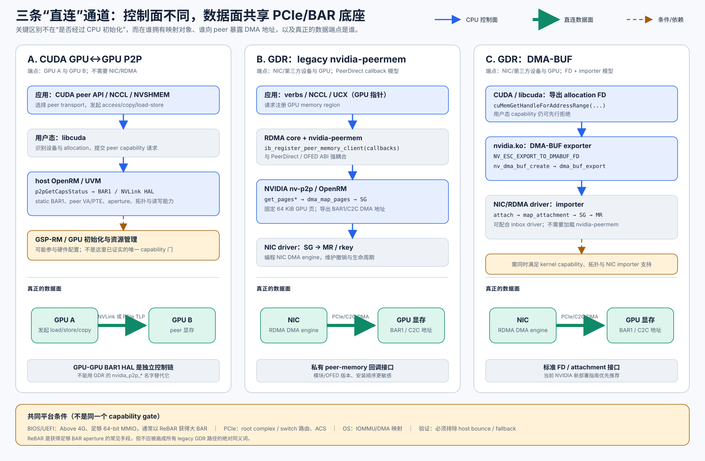
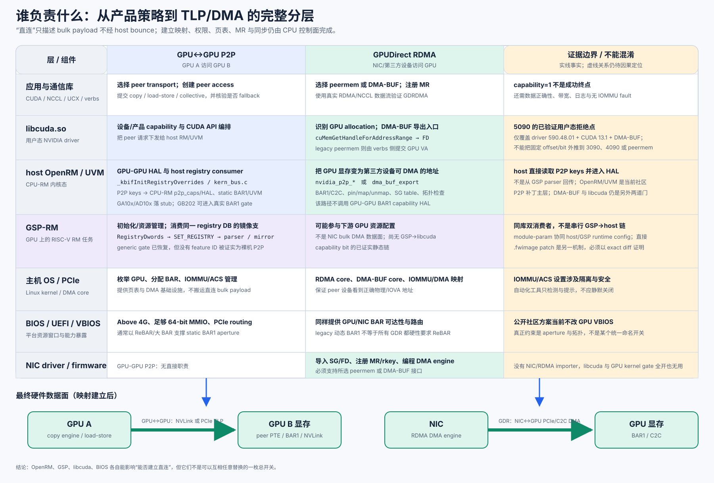
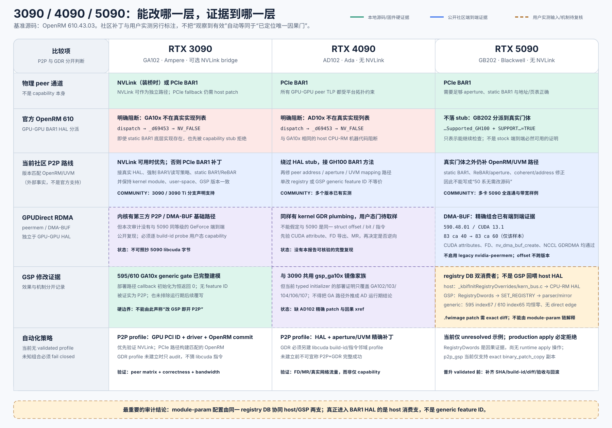
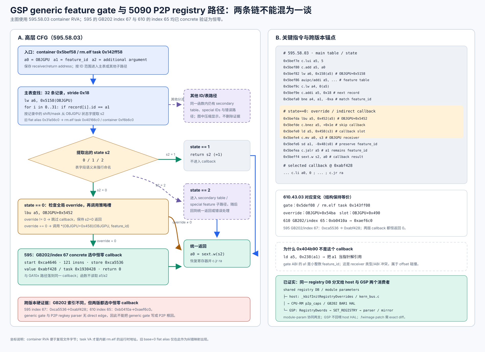
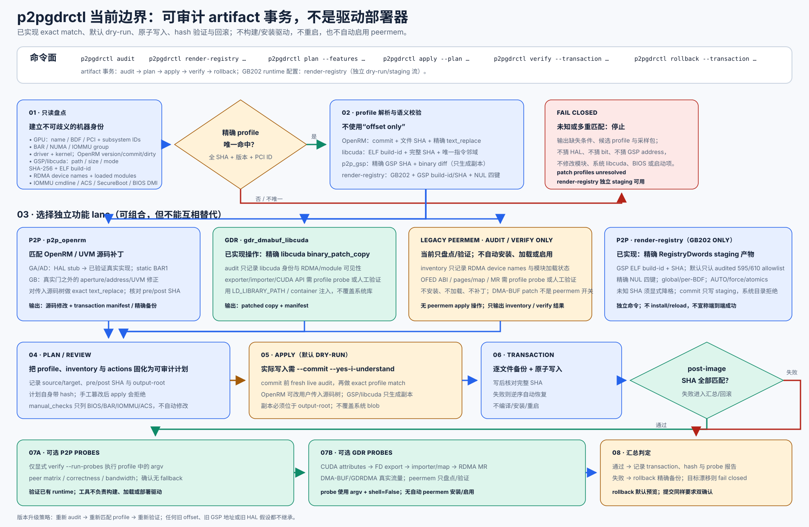

> [!TIP]
> 本页为 **Astro + Mizuki** 自动导入预览版；若需查看原始手写排版（含原版内联 SVG 与附件下载），可访问 [原版 HTML 正文](/legacy-posts/pcie-p2p-gdr-gsp-enablement-guide.html)。

面向 RTX 3090 / 4090 / 5090 的数据通路、反汇编证据、修改策略与自动化工具   
 
- 0. 先给最终答案 
- 1. 三条“直连”通道到底有何异同 
- 2. 主机、驱动、GSP、BIOS 各自负责什么 
- 3. RTX 3090、4090、5090：现状与正确修改层 
- 4. 为什么 5090 的 runtime registry / “GSP 方法”会奏效 
- 5. generic feature gate：反汇编恢复了什么，又没有证明什么 
- 6. GDR 两条内核通道的源码级解释 
- 7. 非 DC 卡做 GDR：为什么 5090 仍需改 `libcuda` 
- 8. 两种目标的完整功能与数据通路清单 
- 9. 已生成的可审计 profile 执行框架：`p2pgdrctl` 
- 10. 可执行的部署策略 
- 11. 验证标准、失败定位与回滚 
- 12. `.fwimage`、DATA/BSS、全量反汇编与 CFG：可重复恢复摘要 
- 13. 工程决策：到底改哪一层 
- 14. 最终硬结论、软结论与未解决项 
- 15. 产物导航 
  

>  

版本：2026-07-10 本地静态对象：NVIDIA Open GPU Kernel Modules tag `610.43.03` / commit `452cec62d827034798072827d3866d1881662b77`；`gsp_ga10x-595.58.03.bin` 与 `gsp_ga10x-610.43.03.bin` 外部动态样本：RTX 5090 + driver `590.48.01` + CUDA 13.1 的 DMA-BUF GDR 实验；社区 OpenRM `610.43.02-p2p` 目标：把 GPU↔GPU PCIe P2P、legacy `nvidia-peermem`、DMA-BUF GDR、host OpenRM、GSP-RM、`libcuda` 和 BIOS/拓扑放到同一张可验证的工程图中。  

---

 

## 0. 先给最终答案

 

### 0.1 五个最重要的结论

 
 
- **GPU↔GPU PCIe P2P 与 GPUDirect RDMA 不是同一个功能。**前者的两个数据端点都是 GPU；后者通常是 NIC/第三方 PCIe 设备与 GPU。它们共享 PCIe、BAR、IOMMU、ACS 和地址映射底座，但拥有不同的 capability、对象、API 和生命周期。 
- **`nvidia-peermem` 与 DMA-BUF 是 GDR 的两种内核接入方式。**`nvidia-peermem` 用 NVIDIA 私有 `nvidia_p2p_*`/PeerDirect callback；DMA-BUF 用标准 FD、attach、map_attachment 和 scatter-gather。新部署一般优先 DMA-BUF，但能否使用仍取决于 CUDA 用户态、内核导出器、NIC importer 和拓扑四层同时通过。 
- **3090/4090 与 5090 的 P2P 阻断位置不同。**在审计的 OpenRM 中，GA10x/AD10x 的 BAR1-P2P HAL 默认分派到恒 `NV_FALSE` stub；GB202 已分派到真实 GH100-family 实现，并设置 `SUPPORT_BAR1_P2P_BY_DEFAULT=true`。因此 30/40 系通常必须改 host OpenRM；50 系可能通过 GSP-RM 运行时注册表配置打通 selector/static BAR1，但仍需实际映射、UVM 和平台条件。 
- **用户报告“修改 GSP 后 5090 P2P 确实生效”在 registry 注入场景下有完整机制解释，但不是一条 GSP-only 单线。**`NVreg_RegistryDwords` 进入共享 RM registry DB 后分叉：host CPU-RM 直接读取四个 P2P/BAR1 键并驱动 `p2p_caps`/GB202 真实 HAL；同一表又经 `NV_RM_RPC_SET_REGISTRY` 送给 GSP-RM，使 GPU 侧字段与资源初始化一致。若所谓“改 GSP”是这种注入，它实际是 host+GSP 协同运行时配置；若是直接改 `.fwimage`，必须拿 exact diff 另证，不能由 module-parameter 链代替。 
- **5090 DMA-BUF GDR 的已验证用户态门仍在 `libcuda.so`。**博客样本中，内核 DMA-BUF capability 已为真，CUDA API 仍拒绝；只有 `libcuda.so.590.48.01` 的一字节补丁使 FD 导出和 NCCL GDRDMA 真正通过。GSP P2P 配置不能替代这个用户态门，也不能自动使能 legacy `nvidia-peermem`。 
 

### 0.2 回答用户的三个直接问题

                    

| 问题 | 精确回答 |
| --- | --- |
| 3090/4090/5090 应改 Open 驱动还是 GSP？ | 3090/4090：首先必须解决 host/OpenRM BAR1 HAL stub，并处理 mapping/UVM/ReBAR；只写同一组 GSP 键不够。5090：真实 HAL 已存在；四键 registry 配置由 host 与 GSP 两侧共同消费，可解释 runtime 注入法的成功。直接`.fwimage` patch 则必须按 exact diff 单独分析。社区方案仍额外修过 host mapping/UVM。 |
| 非 DC 卡做 GDR，是改`libcuda` 还是改 GSP？ | 对已验证的 5090 + 590.48.01 DMA-BUF 样本，必须改`libcuda` 副本；GSP 不是等价替代。其他卡/版本必须先 probe，不能外推同一偏移或同一 bit。`nvidia-peermem` 又是另一条链，博客补丁明确不覆盖。 |
| 能否做跨驱动、跨卡的一键脚本？ | 可以做**profile 驱动、哈希锁定、失败关闭、可回滚**的工具；不能可信地承诺“任意版本、任意卡盲改必成”。本仓库已生成安全骨架；未知组合只能盘点，且会拒绝生成可执行计划，不会猜 offset 后直接写。 |

 

### 0.3 证据等级

                        

| 等级 | 含义 |
| --- | --- |
| **H：硬证据** | 本地源码或精确固件字节、地址、CFG、concrete execution 可重复验证 |
| **D：动态事实** | 用户或公开实验在精确硬件/版本上已实际复现 |
| **I：机制推断** | 多条硬证据能解释现象，但尚缺同机逐键消融或 trace |
| **U：未解决** | 缺精确 artifact、运行日志或反虚化，不用猜测补齐 |

 

---

 

## 1. 三条“直连”通道到底有何异同

 



GPU P2P、nvidia-peermem 与 DMA-BUF 的控制面和数据面 

### 1.1 GPU↔GPU P2P

 

目标是让 GPU A 直接访问 GPU B 的显存。控制面大致为： 

```text
CUDA/NCCL/NVSHMEM
  -> libcuda 提交 peer capability / peer mapping 请求
  -> host OpenRM / UVM 选择 C2C、NVLink、PCIe proprietary 或 PCIe BAR1
  -> 建 peer VA/PTE、BAR1 mapping、aperture 与生命周期
  -> GPU A 发起 load/store/copy，PCIe TLP 或 NVLink 到 GPU B

```

 

这里没有 NIC，也不需要 RDMA MR/rkey。OpenRM 的 `p2pGetCapsStatus()` 按 C2C → NVLink → indirect NVLink → PCIe 的顺序探测；PCIe BAR1 分支明确调用 `kbusIsPcieBar1P2PMappingSupported_HAL()`。本地锚点为： 
 
- [`p2p_caps.c`](https://github.com/NVIDIA/open-gpu-kernel-modules/blob/610.43.03/src/nvidia/src/kernel/platform/p2p/p2p_caps.c)：`742-745`、`785-930`； 
- [`kern_bus_gh100.c`](https://github.com/NVIDIA/open-gpu-kernel-modules/blob/610.43.03/src/nvidia/src/kernel/gpu/bus/arch/hopper/kern_bus_gh100.c)：`1449-1493`。 
 

### 1.2 GDR：legacy`nvidia-peermem`

 

目标通常是让 NIC 的 DMA engine 直接读写 GPU 显存。控制面是 PeerDirect callback 模型： 

```text
verbs / NCCL / UCX 持有 GPU virtual address
  -> RDMA core 询问已注册的 peer-memory client
  -> nvidia-peermem.acquire/get_pages
  -> nvidia_p2p_get_pages() 固定 GPU 页
  -> nvidia_p2p_dma_map_pages(NIC pci_dev, ...)
  -> 生成 SG DMA address
  -> NIC driver 注册 MR/rkey
  -> NIC DMA engine <-> GPU memory

```

 

它的特点是： 
 
- NVIDIA 私有 `nvidia_p2p_*` API； 
- 当前代码假设 64 KiB GPU page； 
- 与 RDMA core/PeerDirect/OFED ABI 和模块安装顺序更耦合； 
- 不使用 GPU↔GPU pair 的同一个 BAR1 capability HAL。 
 

### 1.3 GDR：DMA-BUF

 

DMA-BUF 把 GPU allocation 导出为标准文件描述符： 

```text
CUDA / libcuda
  -> cuMemGetHandleForAddressRange(... DMA_BUF_FD ...)
  -> NV_ESC_EXPORT_TO_DMABUF_FD
  -> nvidia.ko: nv_dma_buf_create / dma_buf_export
  -> NIC/RDMA importer: attach -> map_attachment
  -> SG table -> ibv_reg_dmabuf_mr / NIC MR
  -> NIC DMA engine <-> GPU memory

```

 

它减少了 NIC driver 对 NVIDIA 私有 callback ABI 的依赖，但不是“只要 Linux 支持 dma-buf 就必然能用”。至少还要同时满足： 
 
- `libcuda` 暴露 DMA-BUF/GDR capability 并允许 FD 导出； 
- `nvidia.ko` 的 `nv->dma_buf_supported` 为真； 
- NIC/RDMA driver 能 import DMA-BUF； 
- `nv_dma_buf_attach()` 的拓扑检查通过； 
- IOMMU/ACS/地址可见性正确。 
 

NVIDIA 当前部署文档把 DMA-BUF 与 `nvidia-peermem` 列为两种 GDR 路径，并在满足条件时优先推荐 DMA-BUF：[GPU Operator GPUDirect RDMA](https://docs.nvidia.com/datacenter/cloud-native/gpu-operator/latest/gpu-operator-rdma.html)。 

### 1.4 一张表看清差异

                                                          

| 维度 | GPU↔GPU P2P | `nvidia-peermem` GDR | DMA-BUF GDR |
| --- | --- | --- | --- |
| 数据端点 | GPU ↔ GPU | NIC/第三方设备 ↔ GPU | NIC/第三方设备 ↔ GPU |
| 用户 API | CUDA peer API、NCCL/NVSHMEM | verbs/NCCL/UCX + GPU pointer | CUDA FD export + verbs/NCCL/UCX |
| 内核接口 | OpenRM P2PApi/UVM | `nvidia_p2p_*` + PeerDirect callbacks | Linux`dma_buf` FD/attach/map |
| 地址对象 | peer VA/PTE、BAR1 peer mapping | NVIDIA page table + DMA mapping | DMA-BUF attachment + SG table |
| 典型后端 | NVLink、C2C、PCIe BAR1 | BAR1、C2C/平台物理地址 | static/dynamic BAR1、C2C/pages |
| 主要版本耦合 | OpenRM/UVM 与 CUDA | OFED/RDMA ABI、模块构建顺序 | kernel DMA-BUF/RDMA importer 与 CUDA |
| `libcuda` capability gate | 有 | 取决于调用栈，不等于博客 bit | 明确有；5090 样本已证实 |
| 与 generic GSP feature gate 等价？ | 否 | 否 | 否 |

 

---

 

## 2. 主机、驱动、GSP、BIOS 各自负责什么

 



各层职责与可见数据 

### 2.1 BIOS/UEFI 与主板平台

 

BIOS 不决定 CUDA 是否给 GeForce 暴露 capability，但它决定驱动是否有可用的物理资源和直达路由：                                  

| 项目 | 作用 | 精确边界 |
| --- | --- | --- |
| Above 4G Decoding | 给多 GPU 和大 BAR 分配足够 64-bit MMIO | 多卡/大 BAR 通常必需；仅打开不代表 P2P 已启用 |
| Resizable BAR | 让 BAR1 aperture 足够大，常用于 static BAR1 覆盖 client-visible FB | GPU-GPU static BAR1 很关键；legacy/dynamic BAR1 不应笼统写成绝对必须 |
| IOMMU off / passthrough | 保持 peer 看到的 DMA 地址为 1:1 | 官方 GDR 文档要求关闭或 1:1；社区 P2P 分支要求`iommu=pt` |
| ACS redirect | 可能把 peer TLP 上送 root port/root complex，失去 switch 内直达 | 合适的裸机 PCIe switch 上会降速或 hang；禁用会削弱隔离，脚本不应静默修改。VM 依赖 ACS，不能照搬裸机做法，应保留 ACS 并让 NIC 使用 ATS |
| PCIe 拓扑 | 同 switch/root port/root complex 的可达性和带宽 | 同一 upstream root complex 是 NVIDIA GDR 文档的基线；跨 CPU/跨 root 不应假定可用，可能严重限速、回退或不可靠 |

 

官方 GDR 地址一致性要求见 [GPUDirect RDMA 文档](https://docs.nvidia.com/cuda/gpudirect-rdma/index.html)；ACS 排障见 [NCCL GPU Direct troubleshooting](https://docs.nvidia.com/deeplearning/nccl/user-guide/docs/troubleshooting/gpu_troubleshooting.html)。 

### 2.2 主机内核与 RDMA 栈

 

主机侧需要： 
 
- 匹配当前 kernel 的 NVIDIA open kernel modules； 
- `nvidia_uvm` 的 peer aperture/PTE 路径与 OpenRM 匹配； 
- DMA-BUF 路径需要 `CONFIG_DMA_SHARED_BUFFER`、RDMA DMA-BUF MR API 和支持 importer 的 NIC driver； 
- peermem 路径需要 `nvidia-peermem` 与 RDMA core/OFED ABI 相容； 
- Secure Boot 开启时，重编译的模块必须正确签名； 
- 所有层必须来自同一驱动 release，不能把 610 kernel module 与 595 GSP/userspace 混装。 
 

### 2.3 host OpenRM / UVM

 

这是消费卡 GPU↔GPU P2P 的主要控制层： 
 
- GPU pair capability 和连接类型选择； 
- BAR1 HAL 分派； 
- static BAR1 创建； 
- peer physical address、PTE aperture 和 BAR1 bus address； 
- UVM peer registration/coherent route； 
- mapping 的创建、引用计数和销毁。 
 

### 2.4 GSP-RM

 

GSP-RM 承担大量 GPU 初始化与 RM 策略。对本题已硬钉的职责是： 
 
- 接收 host 打包的 registry table； 
- 解析 `ForceP2P`、`RMForceP2PType`、`RMPcieP2PType`、`PeerMappingOverride`、`RMForceStaticBar1`； 
- 把值写入 KernelBif/KernelBus runtime fields； 
- 参与真实 BAR1/static BAR1 初始化和资源管理。 
 

但应严格避免两种过度推断： 
 
- “GSP 里存在 P2P 字符串”不等于某个 generic feature ID 就是 P2P； 
- “GSP P2P 配置成功”不等于 `libcuda` 的 GDR capability 或 NIC importer 自动成功。 
 

### 2.5`libcuda.so`

 

`libcuda` 不搬运 PCIe 数据，但它决定用户态能否发出某些请求： 
 
- CUDA device attributes； 
- peer API； 
- `cuMemGetHandleForAddressRange` 的 DMA-BUF FD 导出； 
- `cuMemCreate(... GPU_DIRECT_RDMA ...)`； 
- 版本私有的 SKU/product policy。 
 

5090 实验最重要的发现是：内核已经返回 DMA-BUF capability YES，`libcuda` 仍能独立拒绝。因此它不是可由 GSP 自动覆盖的同一个门。 

---

 

## 3. RTX 3090、4090、5090：现状与正确修改层

 



三代 RTX 的默认阻断与修改策略 

### 3.1 stock OpenRM 的决定性差异

 

OpenRM `610.43.03` 的生成 HAL 表写得非常直接： 

```text
// g_kern_bus_nvoc.c:329-338
if (ChipHal is GB202 | GB203 | GB205 | GB206 | GB207 | GB20B | GB20C |
               GR100 | GR102) {
    SUPPORT_BAR1_P2P_BY_DEFAULT = NV_TRUE;
} else {
    SUPPORT_BAR1_P2P_BY_DEFAULT = NV_FALSE;
}

// g_kern_bus_nvoc.c:1144-1154
if (ChipHal is GH100 | GB100 | ... | GB202 | ... | GR102) {
    kbusIsPcieBar1P2PMappingSupported = GH100_real_implementation;
} else {
    kbusIsPcieBar1P2PMappingSupported = d69453_false_stub;
}

```

 

真实 GH100-family 门体： 

```text
if (pcieP2PType != BAR1 && !SUPPORT_BAR1_P2P_BY_DEFAULT)
    return NV_FALSE;
if (pGpu0 == pGpu1)
    return NV_FALSE;
if (!staticBar1Enabled(gpu0) || !staticBar1Enabled(gpu1))
    return NV_FALSE;
if (either direction already has mailbox peerNumberMask)
    return NV_FALSE;
return NV_TRUE;

```

 

所以： 
 
- **RTX 3090 / GA102：**有 NVLink 的组合可先验证 NVLink；PCIe BAR1 路径默认会撞 host HAL stub。 
- **RTX 4090 / AD102：**没有 GeForce NVLink 退路，PCIe BAR1 路径同样撞 stub。 
- **RTX 5090 / GB202：**不会撞该 stub，且 default-support property 为真；但还必须满足 selector、static BAR1、mailbox 互斥、PTE/aperture 和拓扑。 
 

### 3.2 当前社区 OpenRM P2P 补丁实际改了什么

 

社区 `610.43.02-p2p` 的核心提交不是一个布尔值，而是 8 个文件（1 个 `install.sh` + 7 个源码文件）、多个层次的配套修改：[3590ded commit](https://github.com/aikitoria/open-gpu-kernel-modules/commit/3590ded022c6e855b1ffa0a09edeb508396935e3)。 

```text
// 1. 对 default HAL 也接 GH100 BAR1 实现：解决 GA/AD false stub
- __kbusIsPcieBar1P2PMappingSupported__ = ..._d69453;
+ __kbusIsPcieBar1P2PMappingSupported__ = ..._GH100;

- __kbusCreateP2PMappingForBar1P2P__ = ..._395e98;
+ __kbusCreateP2PMappingForBar1P2P__ = ..._GH100;

// 2. 默认开启 read/write override，并默认选择 BAR1
- pKernelBif->p2pOverride = BIF_P2P_NOT_OVERRIDEN;
+ pKernelBif->p2pOverride = 0x11;
- pKernelBif->pcieP2PType = MAILBOX;
+ pKernelBif->pcieP2PType = BAR1;

// 3. 打开 ReBAR 默认值
- EnableResizableBar = 0;
+ EnableResizableBar = 1;

// 4. GP100 common create/remove 路由增加 PCIE_BAR1
+ if (connection_type == PCIE_BAR1)
+     return kbusCreate/RemoveP2PMappingForBar1P2P_HAL(...);

// 5. Blackwell/UVM 与外部 PTE/phys-address 修正
+ GB100+ 走 coherent registration route；
+ BAR1 P2P 时改 PTE aperture，并使用 bar1BusAddr；
+ 修正 IOVAS mapping 生命周期容错。

```

 

截至 2026-07-10，该分支公开声明支持 3090（NVLink 优先，否则 PCIe BAR1）、4090 和 5090，并给出 1×RTX PRO 6000 + 8×5090 的 matrix/带宽样例；这是会随分支更新的社区动态证据，不是 NVIDIA 支持承诺。固定代码改动应以 `3590ded` commit 为准。[分支说明与测试结果](https://github.com/aikitoria/open-gpu-kernel-modules/tree/610.43.02-p2p) 

### 3.3 三代卡的推荐策略

                            

| 卡 | GPU↔GPU P2P | 共享 RM registry 四键 | GDR DMA-BUF |
| --- | --- | --- | --- |
| RTX 3090 / GA102 | NVLink pair 可先验证 NVLink；PCIe 需版本匹配 OpenRM HAL/mapping patch | 不能越过 GA host false stub，只能作为补充 | 未有与 5090 同等级的公开一字节结论；逐版本 probe |
| RTX 4090 / AD102 | 需 OpenRM HAL + BAR1 mapping/UVM/ReBAR patch | 同上，单独不够 | 同上，不能盲套 5090 offset |
| RTX 5090 / GB202 | 可用社区完整 OpenRM patch；用户只确认某个 GSP-side 方法奏效，exact method 未提供 | 若方法是 registry 注入，host/GSP 双消费者机制可解释；若是`.fwimage` patch 仍需 exact diff | 590.48.01 样本仍需`libcuda` 用户态 patch；P2P registry 不替代它 |

 

---

 

## 4. 为什么 5090 的 runtime registry / “GSP 方法”会奏效

 

本节是报告的核心。结论先说：**真正闭合的是 P2P/BAR1 专用 registry 双消费者链，不是 generic `RMDisableFeatureDisablement` feature-ID 链。**下述因果只直接解释通过 `NVreg_RegistryDwords`/registry bundle 注入的办法；若用户方法直接改写 `.fwimage` 字节，必须提供原始/修改后镜像与加载日志，另做精确差分。 

### 4.1 分析对象与坐标

                      

| 固件 | 文件 SHA-256 | `rm.elf` RX container RVA | container→task VA 差值 |
| --- | --- | --- | --- |
| 595.58.03 | `bedd3a55614bfa355ea8c7ff6c70adbd75381fe05fde347c00c26ef43f1a0675` | `0x18f000` | `+0xe71000` |
| 610.43.03 | `572373620a37418f24dc16b5031c39338778c3257e48e8408de9a57291b24f3a` | `0x19f000` | `+0xe61000` |

 

下文的 GSP 地址默认是 `.fwimage` 内 `rm.elf` **container RVA**。它不是整个外层文件 offset，也不是 Ghidra 人为加 `0x100000` 的 synthetic 地址；运行时 task VA 必须按对应 PT_LOAD 翻译。 

### 4.2 host 如何建立共享 registry，并让 CPU-RM 与 GSP-RM 都看到它

 

Linux 参数格式在 `nv-reg.h:210-218` 已明确： 

```text
NVreg_RegistryDwords="&lt;key=value&gt;;&lt;key=value&gt;;..."

```

 

未知于静态模块选项表的 key 会直接传给 RM。这里不是只有一条 RPC 路径，而是两条消费者路径。 

CPU-RM 直接读取同一 registry DB： 

```text
// kernel_bif.c:1130-1150
osReadRegistryDword(pGpu, "ForceP2P", &data32);
pKernelBif->p2pOverride = data32;

osReadRegistryDword(pGpu, "RMForceP2PType", &data32);
pKernelBif->forceP2PType = data32;

osReadRegistryDword(pGpu, "RMPcieP2PType", &data32);
pKernelBif->pcieP2PType = data32;

// kern_bus.c:189-198
osReadRegistryDword(pGpu, "RMForceStaticBar1", &data32);
pKernelBus->staticBar1ForceType = data32;

```

 

这些正是 host `p2p_caps.c:725-755` 与 `kbusIsPcieBar1P2PMappingSupported_HAL()` 使用的对象字段。与此同时，host 还把 registry table 发给 GSP-RM： 

```text
// kernel_gsp.c:4655-4665
osPackageRegistry(pGpu, NULL, &regTableSize);
pRegTable = alloc(regTableSize);
osPackageRegistry(pGpu, pRegTable, &regTableSize);

// kernel_gsp.c:4694-4705
NV_RM_RPC_GSP_SET_SYSTEM_INFO(...);
NV_RM_RPC_SET_REGISTRY(...);       // 真正把 registry table 发给 GSP-RM

```

 

完整结构应画成分叉，而不是误写成“GSP parser 回传并设置 host HAL 字段”： 

```text
NVreg_RegistryDwords
  -> rm_parse_option_string / rm_write_registry_dword -> shared RM registry DB
       ├─ CPU-RM osReadRegistryDword
       │    -> KernelBif/KernelBus fields -> p2p_caps -> BAR1 HAL
       └─ RmPackageRegistry -> _kgspPrepareRegistry / osPackageRegistry
            -> NV_RM_RPC_SET_REGISTRY -> GSP-RM parser / matching runtime fields

```

 

因此，如果现有方法是写 module parameter/registry bundle，它虽然常被称为“改 GSP”，但并没有修改签名 `.fwimage` 字节，而且不是 GSP 单侧生效：host 与 GSP 都消费同一配置。固件反汇编证明 GSP 侧 parser/field 确实存在；host 源码证明 CPU-RM 不需要等待 GSP 回传就能读取这些键。 

### 4.3 GSP-RM 镜像侧：两版 P2P parser 的精确落点

                                  

| 语义 | 595 parser RVA / field | 610 parser RVA / field |
| --- | --- | --- |
| `ForceP2P` | `0x22209c` → KernelBif `+0x278` | `0x233648` → `+0x27c` |
| `RMForceP2PType` | `0x2220e6` → `+0x27c` | `0x233692` → `+0x280` |
| `RMPcieP2PType` | `0x22210e` → `+0x280` | `0x2336ba` → `+0x284` |
| `PeerMappingOverride` | `0x222134` → `+0x284` | `0x2336e0` → `+0x288` |
| `RMForceStaticBar1` | `0x23c6ca` → KernelBus static field | `0x24eb96` → KernelBus static field |

 

610 的关键反汇编可读成： 

```text
# s1 = KernelBif receiver；s2 = registry reader context；-0x3c(s0) = DWORD out

0x233630  li    a5,-1
0x23363a  sw    a5,0x27c(s1)       # p2pOverride sentinel = NOT_OVERRIDDEN
0x233648  auipc/addi a1,...         # a1 = "ForceP2P"
0x233658  call  read_registry_dword
0x233664  lw    a3,-0x3c(s0)
0x233668  srliw a5,a3,4
0x23366c  andi  a4,a3,3            # READ field
0x233670  andi  a5,a5,3            # WRITE field
0x233672  seqz  a4,a4               # 派生 reads-disabled property
0x233676  seqz  a5,a5               # 派生 writes-disabled property
0x23367a  sw    a3,0x27c(s1)       # p2pOverride = ForceP2P DWORD
0x23367e  sb    a4,0x269(s1)
0x233682  sb    a5,0x26a(s1)

0x233686  sw    zero,0x280(s1)     # forceP2PType default = 0
0x233692  auipc/addi a1,...         # "RMForceP2PType"
...                                # read + range check <= 3
0x2337fa  sw    a5,0x280(s1)

0x2336ae  sw    zero,0x284(s1)     # pcieP2PType default = MAILBOX(0)
0x2336ba  auipc/addi a1,...         # "RMPcieP2PType"
0x2336c0  call  read_registry_dword
0x2336cc  lw    a5,-0x3c(s0)
0x2336d0  sw    a5,0x284(s1)

```

 

字段随版本整体漂移，语义和顺序保持一致。这证明 registry table 到达 GSP-RM 后会被独立解析并写入匹配的 GPU 侧对象；它不证明这些 GSP 字段是 host `p2p_caps` 字段的唯一来源。自动化也因此不能用“固定 offset 跨版本盲写”，必须匹配版本、SHA/build-id 或语义签名。 

### 4.4 四个值分别做了什么

 

#### `ForceP2P=0x11`

 

`ForceP2P` 是 READ `1:0`、WRITE `5:4`、ATOMICS `9:8` 三个二位字段： 

```text
0x11  -> READ=1 ENABLE, WRITE=1 ENABLE, ATOMICS=0 DISABLE
0x111 -> READ/WRITE/ATOMICS 都显式 ENABLE
0x211 -> READ/WRITE ENABLE，ATOMICS 使用字段值 2（DEFAULT）

```

 

`p2p_caps.c:319-378` 会把 READ/WRITE status 强制改为 `OK`，然后在 `:749-755` 提前返回，从而跳过后面的 host-system status 检查。但它位于 BAR1 selector 和真实 HAL 检查之后，不能凭空创建 mapping。 

#### `RMForceP2PType=1`

 

```text
0 DEFAULT, 1 PCIEP2P, 2 NVLINK, 3 C2C

```

 

它选择 P2P 大类。值 1 明确选择 PCIe；它不决定 PCIe 内部是 mailbox 还是 BAR1。 

#### `RMPcieP2PType=1`或`2`

 

```text
0 MAILBOX（stock default）
1 BAR1
2 AUTO

```

 

决定性的早退： 

```text
// p2p_caps.c:725-731
if ((forceP2PType != DEFAULT && forceP2PType != PCIEP2P) ||
    (pcieP2PType != BAR1 && pcieP2PType != AUTO))
    return NV_ERR_NOT_SUPPORTED;

```

 

stock 的 `MAILBOX=0` 会在真实 BAR1 HAL 之前被拒绝；改 1/2 才能继续。 

#### `RMForceStaticBar1=1`或`2`

 

```text
0 DISABLE, 1 ENABLE, 2 AUTO

```

 

`ENABLE` 仍不是无条件成功。`kern_bus_tu102.c:419-443` 要求 BAR1 VA 至少覆盖 client-visible FB；`AUTO` 还为 UserD、doorbell、console、mailbox 和对齐保留空间。窗口不足会明确返回错误，注册表键不能把物理 aperture 变大。 

### 4.5 5090 的闭合因果图

 

```text
RegistryDwords -> shared RM registry DB
  ├─ CPU-RM direct reads
  │    -> forceP2PType = PCIE
  │    -> pcieP2PType = BAR1/AUTO
  │    -> staticBar1ForceType = ENABLE/AUTO
  │    -> p2p_caps + GB202 real GH100-family HAL
  │    -> ForceP2P READ/WRITE override
  └─ SET_REGISTRY RPC
       -> GSP-RM parser -> matching KernelBif/KernelBus runtime fields/resources

两侧配置一致 + GB202 SUPPORT_BAR1_P2P_BY_DEFAULT=true
  -> 两卡 static BAR1 + 无 mailbox 冲突
  -> peer mapping / PTE / UVM
  -> 实际 GPU↔GPU 数据面

```

 

这是为什么 registry 注入法在 5090 上可以奏效，而不能直接外推 3090/4090：GA/AD 在应用 capability override 以前已由 host false stub 返回。严格边界是：GSP parser 证明配置的 GPU 侧镜像存在，不应被误写成“GSP parser 单独向 host HAL 喂值”。 

---

 

## 5. generic feature gate：反汇编恢复了什么，又没有证明什么

 



GSP generic feature gate 的 CFG、指令与 5090 专用 P2P 链 

### 5.1 610.43.03 gate 的完整高层语义

 

入口：container `0x5def08` / `rm.elf` task VA `0x143ff08`。ABI 为： 

```text
a0 = OBJGPU receiver
a1 = integer feature_id
a2 = additional argument
return a0 = extracted/policy state

```

 

关键指令： 

```text
0x5def08  addi  sp,sp,-0x40
...       save  s0/s2/s3/ra

# feature-ID 特殊范围/表路径
0x5def1e  bgeu  a5,a1,...
0x5def22  addiw a5,a1,-0x11
0x5def28  bltu  a5,...              # 0x11..0x1f 特殊路径

# 读取 OBJGPU 配置字并查 32×0x18 表
0x5def2c  c.lui a5,5
0x5def2e  c.add a5,a0               # a5 = OBJGPU+0x5000
0x5def30  lw    a6,0x1c0(a5)        # OBJGPU+0x51c0 packed state word
...
0x5def6a  lw    a4,0x530(a5)        # record.shift
0x5def6e  lw    s2,0x534(a5)        # record.mask
0x5def72  srlw  a6,a6,a4
0x5def76  and   s2,s2,a6            # s2 = extracted state

# state=0 时才进入 override/callback
0x5def7c  beq   s2,2,secondary_path
0x5def80  bnez  s2,return
0x5def84  c.lui a5,5
0x5def86  c.add a5,s3
0x5def88  lbu   a5,0x4ba(a5)        # OBJGPU+0x54ba override byte
0x5def8c  c.bnez a5,return           # nonzero => skip callback
0x5def8e  ld    a5,0x490(s3)        # OBJGPU policy callback slot
0x5def92  c.mv  a0,s3               # receiver
0x5def94  sd    a1,-0x38(s0)        # preserve feature_id
0x5def98  c.jalr a5
0x5defa2  sext.w s2,a0               # callback result becomes state
...
0x5defaa  return s2

```

 

等价伪代码： 

```text
int generic_feature_gate(OBJGPU *gpu, uint32_t feature_id, void *arg)
{
    const FeatureRecord *record = lookup_record_by_id(feature_id); // 32×0x18 线性查 ID
    int state = extract_state(gpu->packed_feature_state,
                              record->shift,
                              record->mask);

    if (state == 2)
        return secondary_table_path(gpu, feature_id, arg);

    if (state == 0 && gpu->disable_feature_disablement == 0)
        state = gpu->feature_policy_cb(gpu, feature_id, arg);

    return state;
}

```

 

该伪代码只概括 main-table path；`0x11..0x1f` 的特殊范围、`state==2` secondary table 和错误路径仍以 CFG/逐指令报告为准。物理 table index 与 `feature_id` 明确不相等，不能写成 `feature_table[feature_id]` 直接索引。 

595.58.03 是同构实现，但字段为：                      

| 版本 | gate | override | callback slot |
| --- | --- | --- | --- |
| 595.58.03 | `0x5bef58` / task `0x142ff58` | `OBJGPU+0x5452` | `OBJGPU+0x458` |
| 610.43.03 | `0x5def08` / task `0x143ff08` | `OBJGPU+0x54ba` | `OBJGPU+0x490` |

 

### 5.2 GB202 的 callback 不是 P2P 禁用函数

 

这里不能跨版本假定 GB202 使用相同的内部 `HalVar` 编号。两版固件各自的 chip-index helper 给出：595 为 `67/0x43`（group 2、low 3），610 为 `65/0x41`（group 2、low 1）。把各自编号输入真实 initializer，并 concrete execute 到回调槽写入，结果为：                            

| 版本 | GB202 index | chip-index target | slot store（container / task） | callback（container / task） | 指令数 / trace SHA-256 |
| --- | --- | --- | --- | --- | --- |
| 595.58.03 | `67 / 0x43` | `0xbfb03e` | `0xca5536 / 0x1b16536` | `0xabf428 / 0x1930428` | 121 /`d2eb523d…eff86b960` |
| 610.43.03 | `65 / 0x41` | `0xc85712` | `0xb0410a / 0x196510a` | `0xaef6c0 / 0x19506c0` | 208 /`363207ab…950f6b` |

 

595 的 index 67 与误用 index 65 时的 branch trace 不同，但两个 mask 路径恰好汇合到同一 `0xca5536 → 0xabf428`。因此“回调恒零”的结论成立，“两版都是 index 65”的说法不成立。两版目标的精确 14 字节均为 `411122e400082264014541018280`。 

叶函数反汇编本质为： 

```text
addi sp,sp,-0x10
sd   s0,8(sp)
addi s0,sp,0x10
ld   s0,8(sp)
li   a0,0
addi sp,sp,0x10
jr   ra

```

 

因此在已建模的初始态： 

```text
raw state = 0, override = 0 -> 调 callback -> 0
raw state = 0, override = 1 -> 跳 callback -> 保留 0

```

 

结果相同。全 RX 位移扫描中旧称的三个“后续覆写”也被排除：`0x236fb6` 和 `0x2e9e84` 的 base 已分别加 `0x4000`/`0x2000`，不是 OBJGPU 槽；`0xcd0d8c` 是 `sp+0x458` 栈保存。typed creator 范围内未找到 GB202 的后续直接覆盖。 

可重复验证（会锁定两版固件 SHA-256、index、真实分支、写槽地址、目标字节、返回值、指令数和 trace hash）： 

```text
.\.venv\Scripts\python.exe re-scripts\verify_gb202_gate_callback.py

```

 

### 5.3 两个旧地址结论必须纠正

 

`0x404b90` 不是 OBJGPU gate callback。它只是 raw same-offset 扫描跨 NVOC receiver 类型得到的碰撞；其 ABI 直接矛盾： 

```text
0x404bce  c.mv  s2,a1
0x404bd6  ld    a5,0x238(s2)  # 把 a1 当对象指针
0x404bda  c.mv  a1,s2
0x404bdc  c.mv  a0,s1
0x404bde  c.jalr a5

```

 

generic gate 传入的 `a1` 是 0..31 的小整数 `feature_id`；若把它送进上面函数，会在 `a1+0x238` 解引用，故它属于另一 receiver/ABI，不能作为该槽函数。 

旧 flat 别名 `0x332f570` 也不是静态 callback descriptor 或代码。正确 task→backing 翻译为 `rm.elf@0x41a0570` / container RVA `0x10f5570`，落在 file-backed RW `PT_LOAD`，静态字节全零，属于运行时全局候选（非 BSS）；当前只在 error/assert 子路径被读取。旧平坦地址模型把多任务和 data backing 混在一起，才会把它误反汇编为“高熵垃圾代码”。 

### 5.4 为什么不能把`RMDisableFeatureDisablement`说成 P2P 根因

 

已证实： 
 
- 该 regkey 确实写入上述 override byte； 
- gate 确实有 32 项主表、特殊 ID 路径和策略 callback； 
- 两版均恢复了 caller、函数边界和 CFG。 
 

未证实且当前证据反对： 
 
- 没有 feature ID 被静态证明为裸机 P2P； 
- P2P/BAR1 registry parser 到 generic gate 的 direct edge 为 0； 
- 已恢复的 P2P command handler 不直接读取该 override byte； 
- GB202 初始 callback 为恒 0，flag 0/1 无差异。 
 

所以正确表述是： 

>  

5090 P2P 的实测成功是真实动态事实；共享 registry DB 的 host+GSP 四键链能完整解释 runtime 注入法。`RMDisableFeatureDisablement` 若只是 bundle 中的附加项，很可能是冗余项。只有在“单独设置该键也能稳定成功”的严格 A/B 结果出现后，才需要追踪尚未恢复的间接/晚期状态。  

### 5.5 建议的逐键消融

                                            

| 轮次 | 参数 | 目的 |
| --- | --- | --- |
| A0 | 无 override | stock 基线 |
| A1 | `RMDisableFeatureDisablement=1` | 检查 generic flag 单独是否真有作用 |
| A2 | `ForceP2P=0x11` | 只改 capability status |
| A3 | A2 +`RMPcieP2PType=1` | 验证 BAR1 selector |
| A4 | A3 +`RMForceP2PType=1` | 验证显式 PCIe 大类 |
| A5 | A4 +`RMForceStaticBar1=1` | 验证 static BAR1 条件 |
| A6 | A5 +`RMDisableFeatureDisablement=1` | 检查 generic flag 是否仅组合态有差异 |

 

每轮都要冷启动或完整重载驱动，并保存 registry 参数、static BAR1 日志、`nvidia-smi topo`、peer matrix、数据校验、带宽与时延。只看到 capability=1 不算成功。 

完整专项证据见 `gsp-5090-p2p-regkey-proof.md`。 

---

 

## 6. GDR 两条内核通道的源码级解释

 

### 6.1`nvidia-peermem`：私有 page-table → DMA mapping → SG

 

`nvidia-peermem.c` 的关键路径： 

```text
static int nv_mem_get_pages(...)
{
    ctx->page_size = GPU_PAGE_SIZE;
    return nvidia_p2p_get_pages(
        0, 0,
        ctx->page_virt_start,
        ctx->mapped_size,
        &ctx->page_table,
        nv_get_p2p_free_callback,
        ctx);
}

static int nv_dma_map(..., struct device *dma_device, ...)
{
    struct pci_dev *pdev = to_pci_dev(dma_device);

    if (page_table->page_size != NVIDIA_P2P_PAGE_SIZE_64KB)
        return -EINVAL;

    ret = nvidia_p2p_dma_map_pages(pdev, page_table, &dma_mapping);
    sg_alloc_table(sg_head, dma_mapping->entries, GFP_KERNEL);

    for_each_sg(...) {
        sg_dma_address(sg) = dma_mapping->dma_addresses[i];
        sg_dma_len(sg)     = ctx->page_size;
    }
}

```

 

逐行含义： 
 
- `get_pages` 识别 CUDA/GPU virtual address，并让 NVIDIA RM 固定相应 GPU pages； 
- `dma_map_pages` 的输入包含目标 NIC 的 `pci_dev`，因此得到的是该 peer 设备可用的 DMA address； 
- 结果被转换成 Linux `sg_table`； 
- RDMA/NIC driver 再把 SG 注册为 MR，生成 lkey/rkey； 
- invalidate callback 和 `put_pages` 负责生命周期，不能把固定页永久泄漏。 
 

这条路不需要先创建“GPU A ↔ GPU B pair”，但仍需要第三方 peer mapping、BAR/C2C 地址和平台拓扑正确。 

### 6.2 DMA-BUF：FD exporter → attachment → SG

 

内核 capability 首先由 OpenRM 计算： 

```text
// subdevice_ctrl_gpu_kernel.c:527-535
data = DMABUF_CAPABILITY_NO;
if (osDmabufIsSupported() &&
    !gpuIsApmFeatureEnabled(pGpu) &&
    !NVCPU_IS_PPC64LE)
    data = DMABUF_CAPABILITY_YES;

// osinit.c:671-673
nv->dma_buf_supported = (returned_capability == YES);

```

 

导出入口仍会复查： 

```text
// nv-dmabuf.c:1564-1579
static NV_STATUS nv_dma_buf_create(...)
{
    if (!nv->dma_buf_supported)
        return NV_ERR_NOT_SUPPORTED;
    ...
}

```

 

NIC attach 阶段不是无条件接受： 

```text
// nv-dmabuf.c:1017-1058
if (mapping_type == FORCE_PCIE) {
    if (!nv_pci_is_valid_topology_for_direct_pci(nv, peer_pci_dev))
        return -ENOTSUPP;
    skip_iommu = NV_TRUE;
} else {
    if (!nv_grdma_pci_topology_supported(nv, &peer_dma_dev))
        return -ENOTSUPP;
}

```

 

map 阶段根据平台选择： 

```text
if (coherent && mapping_type == DEFAULT)
    sgt = nv_dma_buf_map_pages(...);  // coherent pages/C2C
else
    sgt = nv_dma_buf_map_pfns(...);   // BAR1 PFNs

```

 

底层 `rm_dma_buf_map_mem_handle()` 也明确区分 coherent C2C 与非一致性平台的 static/dynamic BAR1。由此可见，“DMA-BUF GDR”和“GPU-GPU BAR1 P2P”可以共享 BAR1，却不是同一个 gate。 

### 6.3`RmGpuDirectRdmaForceSPA`不是通用 GDR 使能键

 

源码确实存在 `RmGpuDirectRdmaForceSPA`，但注释与使用点把边界写得很窄：`kern_bus.c:201-212` 的读取本身会按 regkey 设置 `bGrdmaForceSpa`，其紧邻注释将用途限定为 coherent system + BAR1；真正的 `kbusGetGpuFbPhysAddressForRdma_IMPL:1315-1333` 使用点只在 forced-PCIe/coherent 条件通过后选择缓存的 BAR1 SPA，而不是 GPA，并明确称为等待 hypervisor 保证 GPA==SPA 前的 stop-gap。`kern_bus_gm107.c:711-715` 也只是缓存 BAR1 SPA。 

因此它是“已存在 GDR mapping 该返回哪类物理地址”的地址选择 WAR，不是打开 GeForce DMA-BUF/peermem 的总开关，不能替代 NIC importer、MR、`libcuda` capability 或真实数据验证。GSP/固件里出现 GDR 字符串也不能单独改变这一结论。 

### 6.4 何时选哪条

                                  

| 条件 | 优先 DMA-BUF | 可能仍需`nvidia-peermem` |
| --- | --- | --- |
| 新 kernel、open GPU module、新 MLNX_OFED/inbox RDMA | 是 | 通常否 |
| NIC importer 支持`ibv_reg_dmabuf_mr` | 是 | 否 |
| 旧 OFED/应用只实现 PeerDirect | 否 | 是 |
| CUDA 用户态不暴露 DMA-BUF FD | 无法使用 | 可单独调查 peermem |
| 需要减少 NVIDIA↔OFED 私有 ABI 耦合 | 是 | 否 |

 

不要同时把两条路径的日志混为一谈：`nvidia_peermem` 已加载不代表 NCCL 使用它；`DMA-BUF is available` 也不代表 `nvidia-peermem` 可用。 

---

 

## 7. 非 DC 卡做 GDR：为什么 5090 仍需改`libcuda`

 

### 7.1 公开实验钉死的精确组合

 

Harry Chen 的实验范围是： 

```text
GPU: RTX 5090
driver/libcuda: 590.48.01
CUDA: 13.1
GDR path: DMA-BUF

```

 

实验先把内核 `DMABUF_CAPABILITY`、`nv->dma_buf_supported` 等路径强制或打印为 YES，但 CUDA 仍返回： 

```text
CU_DEVICE_ATTRIBUTE_DMA_BUF_SUPPORTED = 0
CU_DEVICE_ATTRIBUTE_GPU_DIRECT_RDMA_SUPPORTED = 0
cuMemGetHandleForAddressRange(...) = CUDA_ERROR_NOT_SUPPORTED

```

 

这一步已经排除了“只改 kernel/GSP capability 就够了”。最终定位到 `libcuda.so.590.48.01` 的 device 初始化： 

```text
0x42d690  movzbl 0x5f14(%rdi),%eax
0x42d697  mov    %eax,%edx
0x42d699  or     $0x40,%edx
0x42d69c  cmpl   $0x8,0xc60(%rdi)
0x42d6a3  mov    %dl,0x5f14(%rdi)

```

 

原逻辑只设置 `0x40`；DMA-BUF/GDR attribute 分支还要求 `0x20`。最小修改： 

```text
file offset 0x42d69b
83 ca 40  ->  83 ca 60
                  ^^ 0x40 | 0x20

```

 

补丁后以下接口全部通过： 
 
- `CU_DEVICE_ATTRIBUTE_DMA_BUF_SUPPORTED`； 
- `CU_DEVICE_ATTRIBUTE_GPU_DIRECT_RDMA_SUPPORTED`； 
- `CU_DEVICE_ATTRIBUTE_GPU_DIRECT_RDMA_WITH_CUDA_VMM_SUPPORTED`； 
- `cuMemGetHandleForAddressRange(... DMA_BUF_FD ...)`； 
- `cuMemCreate(... GPU_DIRECT_RDMA ...)`。 
 

端到端 24 卡/3 节点/400 Gbps NDR IB 样本的 NCCL `busbw` 从约 8.87 提升到 19.93 GB/s，并出现 `DMA-BUF is available` 与 `NET/IB/.../GDRDMA` 日志。详见[原始实验与反汇编](https://harrychen.xyz/2026/05/20/enable-gpudirect-rdma-on-rtx-5090/)。 

这是一项特定 RTX 5090 组合的社区实验；该 `libcuda` 补丁本身不是 NVIDIA 官方支持方法，也不能据此把结果推广到所有 GeForce、所有 CUDA 或所有 NIC。 

### 7.2 现有 P2P registry / GSP 方法能不能替代这一个字节？

 

对这个精确样本，硬证据是：**已测试的 kernel capability 改动和本报告所分析的 P2P registry/GSP 配置不能替代；目前唯一动态证实奏效的是 `libcuda` patch。**这不等于数学上排除未来或未知的另一种 GSP/RM patch。 

原因不是抽象猜测，而是逐层 A/B： 
 
- kernel DMA-BUF capability 已经是 YES； 
- 用户态 `libcuda` 仍返回 0/`NOT_SUPPORTED`； 
- 修改 `libcuda` 私有 device flag 后，FD export 和真实 GDRDMA 同时成功。 
 

共享 RM P2P 四键能使 host/GSP 选择并初始化 GPU-GPU BAR1 路径，但不会直接重写正在运行的 x86-64 `libcuda` 私有结构。不能排除某个尚未识别的 GSP/RM patch 改变 `libcuda` 初始化所依据的 device/product 返回值；只是当前没有这种调用链或动态 A/B 证据。因此工程结论是“不要拿现有 P2P 配置替代已验证的 `libcuda` patch”，而不是宣称所有可能的 GSP 修改永远不可能影响用户态决策。 

### 7.3 这个补丁也不等于`nvidia-peermem`

 

博客作者明确指出，一字节补丁只覆盖 DMA-BUF 相关 API，不会让 legacy `nvidia-peermem` 自动工作。两者入口完全不同： 

```text
libcuda DMA-BUF bit -> export FD -> dma_buf importer

nvidia-peermem -> peer-memory callbacks -> nvidia_p2p_get_pages/dma_map_pages

```

 

所以不能把“DMA-BUF GDR 已成功”写成“所有 GDR 通道均已解锁”。 

### 7.4 3090/4090 或新驱动能否照抄 offset？

 

不能。正确迁移方法是： 
 
- 先对目标 `GPU + driver + libcuda build-id` 运行 CUDA attribute/FD probe； 
- 同时确认 kernel `nv->dma_buf_supported` 和 `nv_dma_buf_create` 是否已经可达； 
- 只有在“kernel YES、libcuda NO”时，才沿 `cuDeviceGetAttribute` 和 `cuMemGetHandleForAddressRange` 反向恢复用户态 gate； 
- 定位该版本的 flag 初始化，而不是搜索固定 `0x42d69b`； 
- profile 必须记录原文件 SHA-256、ELF build-id、expected bytes、replacement bytes 和完整 post-image SHA-256； 
- 修改副本，通过 `LD_LIBRARY_PATH` 或受控容器 mount 使用，不直接覆盖系统 `libcuda`； 
- 用真实 NIC MR、网络传输与 NCCL 日志验证，不能只看 attribute。 
 

目前公开端到端硬证据只覆盖上述 5090 组合；对 3090/4090 应保持“待逐版本验证”，而不是宣称同一个 bit 恒定存在。 

---

 

## 8. 两种目标的完整功能与数据通路清单

 

### 8.1 GPU↔GPU PCIe P2P

                                       

| 层 | 必要功能/数据 | 失败表现 |
| --- | --- | --- |
| BIOS/平台 | Above 4G、足够 BAR1/ReBAR、可接受的 ACS、IOMMU 1:1、可达 PCIe topology | BAR 不足、TLP 被重定向到 root complex、IOMMU fault、带宽像 host bounce |
| host driver | pair capability、BAR1 HAL、static BAR1、peer bus address、PTE/aperture、mapping lifecycle | `cudaDeviceCanAccessPeer=0`、create mapping 失败、访问错误 |
| UVM | peer registration 与 external allocation PTE 正确 | CUDA peer enable 成功但访问/页表错误 |
| GSP-RM | 收到 selector/override/static BAR1 配置，初始化资源 | 仍选 mailbox、static BAR1 未建、策略拒绝 |
| `libcuda` | 暴露/发起 CUDA peer API | 用户 API 先行拒绝 |
| 数据面 | GPU DMA/load/store 发出 PCIe TLP 到 peer BAR | 正确性失败或带宽没有从 staged copy 改善 |

 

### 8.2 NIC↔GPU DMA-BUF GDR

                                       

| 层 | 必要功能/数据 | 失败表现 |
| --- | --- | --- |
| BIOS/平台 | NIC 与 GPU 的 peer DMA 地址可见；IOMMU 1:1；ACS/topology 可接受 | attach/topology 失败、IOMMU fault、bounce |
| `libcuda` | GDR/DMA-BUF attributes、FD export、VMM usage | error 801 /`CUDA_ERROR_NOT_SUPPORTED` |
| nvidia kernel | `nv->dma_buf_supported`、export ioctl、static/dynamic BAR1 或 coherent pages | `nv_dma_buf_create=NOT_SUPPORTED` |
| Linux DMA-BUF | FD、attachment、map/unmap、SG lifetime | attach/map_attachment 失败 |
| NIC/RDMA | DMA-BUF importer、MR/rkey、DMA engine | `ibv_reg_dmabuf_mr` 失败 |
| NCCL/UCX/app | 选择 GDR transport，不回退 socket/host | 有通信但日志无 GDRDMA、带宽低 |

 

### 8.3 NIC↔GPU`nvidia-peermem`GDR

                                            

| 层 | 必要功能/数据 | 失败表现 |
| --- | --- | --- |
| BIOS/PCIe/OS | GPU 与 NIC 地址可达、合适 topology、IOMMU 1:1、ACS policy 与 DMA mask | peer DMA address 不可达、IOMMU fault、上送 root complex 或回退 |
| NVIDIA module | 导出兼容的`nvidia_p2p_*` API | peermem 模块 unresolved symbol/拒绝 |
| `nvidia-peermem` | 成功注册 peer-memory client | RDMA core 不识别 GPU pointer |
| RDMA/OFED | callback ABI 匹配 | 模块加载但注册失败或静默回退 |
| page/DMA map | 64 KiB page table、目标 NIC DMA addresses、SG | `get_pages`/`dma_map_pages` 失败 |
| 生命周期 | invalidate、put_pages、dma_unmap | 泄漏、use-after-free、GPU reset 问题 |
| app/transport | NCCL/UCX/verbs 实际选择 PeerDirect 并拒绝 host fallback | 通信可用但没有 peermem callback/GDRDMA，性能仍像 host staging |

 

---

 

## 9. 已生成的可审计 profile 执行框架：`p2pgdrctl`

 



profile 驱动的一键审计、修改、验证和回滚 

工具目录：`enablement-tool/`。当前它是安全的 artifact/profile transaction framework，不是已经覆盖任意真实机器的端到端“一键安装器”：仓库尚无 `validated` 生产 profile，也不会替用户 build/sign/install 模块、部署 GSP、改 initramfs、重载驱动或重启。 

### 9.1 它解决什么问题

 

`p2pgdrctl` 不是“扫描到相似字节就改”的脚本，而是一个事务执行器： 

```text
audit -> exact profile match -> plan -> dry-run
      -> explicit commit -> post-image verify -> runtime probes
      -> rollback

```

 

它采集并约束： 
 
- GPU PCI vendor/device ID、BDF、BAR resource、NUMA/IOMMU group； 
- NVIDIA driver version； 
- OpenRM git commit、dirty state 和相关文件 SHA-256； 
- GSP 与 `libcuda` 的文件 SHA-256、GNU ELF build-id； 
- IOMMU command line、ACS、Secure Boot； 
- RDMA devices、`ib_core`、`nvidia_peermem`/`nv_peer_mem`； 
- 每个 patch 的 expected bytes/count、完整 post-image SHA-256； 
- profile 指定的真实验证 probe。 
 

当前 matcher 自动约束 GPU `vendor:device`，并采集 subsystem ID 供审计，但尚未把 subsystem ID/VBIOS 作为 schema 的强制匹配键；跨 AIB/VBIOS 差异必须写进 `manual_checks`，不能把“已采集”误写成“已自动 fail-closed”。 

### 9.2 安全边界

 
 
- `audit` 和 `plan` 只读； 
- `apply`、`rollback` 默认也是 dry-run； 
- 真正写入必须同时给 `--commit --yes-i-understand`； 
- 对 exact-profile plan/apply，任一版本、PCI ID、SHA、build-id、pre-image、匹配次数或 host policy 不符即 fail-closed；registry renderer 默认也只接受已审计 SHA，显式 `--allow-unverified-gsp` 只能生成带降格标记的 staging 文本，不能把它当 validated deployment； 
- GSP/`libcuda` 只生成副本，不覆盖输入； 
- OpenRM 源码修改先备份、原子替换，并记录 transaction manifest； 
- rollback 遇到 apply 后的未知漂移会拒绝覆盖； 
- 不自动关闭 IOMMU/ACS，不改 BIOS，不替用户绕过 Secure Boot； 
- 不声称 capability probe 等于数据面成功。 
 

### 9.3 使用流程

 

GB202 registry 路径可先独立生成 staging 配置。命令会绑定 GSP SHA/build-id、确认四个精确 NUL-terminated parser key、校验 BDF，并默认只接受本地已审计的 595/610 GSP SHA allowlist；默认不写文件。`--gpu-arch gb202` 仍是操作者声明，当前 renderer 不会仅凭 PCI ID 自动推导架构。未知 SHA 必须显式加 `--allow-unverified-gsp`，输出会降格为 `unverified-string-presence`，不能作为语义兼容证明： 

```text
cd enablement-tool

python3 p2pgdrctl.py render-registry \
  --gsp /lib/firmware/nvidia/610.43.03/gsp_ga10x.bin \
  --gpu-arch gb202 --mode auto \
  --bdf 0000:01:00.0 --bdf 0000:11:00.0 \
  --output-root /var/tmp/p2pgdr-registry

# 审核渲染内容与哈希后，才写 staging 文件；不会安装到 /etc
python3 p2pgdrctl.py render-registry \
  --gsp /lib/firmware/nvidia/610.43.03/gsp_ga10x.bin \
  --gpu-arch gb202 --mode auto \
  --bdf 0000:01:00.0 --bdf 0000:11:00.0 \
  --output-root /var/tmp/p2pgdr-registry \
  --commit --yes-i-understand

```

 

完整 exact-patch transaction 流程为： 

```text
cd enablement-tool

# 1. 只读盘点
python3 p2pgdrctl.py audit \
  --openrm-root /work/open-gpu-kernel-modules \
  --gsp /lib/firmware/nvidia/590.48.01/gsp_ga10x.bin \
  --libcuda /usr/lib/x86_64-linux-gnu/libcuda.so.590.48.01 \
  --output inventory.json

# 2. 精确 profile 生成计划；P2P 后端二选一
python3 p2pgdrctl.py plan \
  --inventory inventory.json \
  --profile my-validated-profile.json \
  --features p2p_openrm,gdr_dmabuf_libcuda \
  --output-root /var/tmp/p2pgdr-artifacts \
  --output enablement-plan.json

# 3. 默认只预览，不写盘
python3 p2pgdrctl.py apply --plan enablement-plan.json

# 4. 审核 plan 后显式提交
python3 p2pgdrctl.py apply \
  --plan enablement-plan.json \
  --commit --yes-i-understand

# 5. 校验产物；profile 可另外定义无 shell 的 argv probes
python3 p2pgdrctl.py verify \
  --transaction ~/.local/state/p2pgdrctl/transactions/&lt;id&gt; \
  --profile my-validated-profile.json \
  --run-probes

# 6. 回滚也先 dry-run
python3 p2pgdrctl.py rollback --transaction &lt;transaction-dir&gt;
python3 p2pgdrctl.py rollback \
  --transaction &lt;transaction-dir&gt; \
  --commit --yes-i-understand

```

 

### 9.4 为什么当前附带的 5090 profile 故意不能执行

 

当前两个 unresolved 模板刻意不把两条证据偷合并：`rtx5090-590.48.01.unresolved.json` 只记录公开 DMA-BUF 样本；`rtx5090-user-p2p.unresolved.json` 只记录用户确认 P2P 奏效但 exact driver/GSP/method 未知。它们缺少目标组合的： 
 
- 精确 PCI ID； 
- OpenRM commit/目标文件 hash； 
- GSP SHA/build-id 与实际配置方法； 
- `libcuda` SHA/build-id； 
- 完整 pre/post image hash； 
- 同拓扑端到端验收记录。 
 

因此二者的 `status=unresolved`，工具会拒绝 apply，也不会把它们拼成 `enable-both`。这既是必要的安全边界，也代表一个真实缺口：执行/回滚框架已经存在，但精确 profile、部署适配器和端到端通过记录尚未交付。得到同一目标机的 inventory、精确 artifact 和验证结果后，才能建立新的 `validated` 组合，再由工具重复已审计的变换。 

### 9.5 当前自动化覆盖与下一步

                                       

| 功能 | 已实现 | 必须由 profile 提供 |
| --- | --- | --- |
| OpenRM source patch | 精确文本替换、count/hash、备份/回滚 | 每版真实 diff 与 post hashes |
| GB202 runtime registry | global/per-BDF、AUTO/force、atomics、GSP SHA/build-id 与四键字符串检查；只写 staging | 安装/激活/回滚适配、A0-A6 与真实 peer 验收；GA/AD 不允许使用此后端替代 HAL patch |
| GSP binary patch | 只对副本做 exact offset/bytes/hash | 仅在确有二进制 patch 时使用；5090 registry 法不应伪装成 binary patch |
| `libcuda` patch | 对副本 exact bytes/hash；保留 mode | 每版 build-id、offset、pre/post hash |
| host inventory | GPU/PCIe/IOMMU/ACS/RDMA/artifact | BIOS 人工核对 |
| verify/rollback | post hash、argv probes、drift protection | 真正 P2P/GDR probe 命令与通过条件 |

 

代码、schema 和测试说明见 `enablement-tool/README.md`。当前 25 项工具测试全部通过；registry renderer 也已对本地 595/610 两个真实 GSP artifact 做 dry-run，均识别四个精确 C-string、命中 audited SHA/build-id，并输出 staging 内容哈希。 

---

 

## 10. 可执行的部署策略

 

### 10.1 RTX 5090：先做共享 RM registry 的 runtime P2P 消融

 

这组值具有完整静态机制解释，但在投入生产前仍应按 A0-A6 消融。较保守的 AUTO 起点： 

```text
ForceP2P=0x11;
RMForceP2PType=1;
RMPcieP2PType=2;
RMForceStaticBar1=2

```

 

Linux 全局 module parameter 示例： 

```text
options nvidia NVreg_RegistryDwords="ForceP2P=0x11;RMForceP2PType=1;RMPcieP2PType=2;RMForceStaticBar1=2"

```

 

安装前必须先读取并合并机器已有的 `NVreg_RegistryDwords` / `NVreg_RegistryDwordsPerDevice`，保留所有无关 RM keys；renderer 只生成独立 staging 行，不会替你解析并合并现有 `options nvidia` 配置。重复定义同一 module parameter 可能导致覆盖/竞争，不能直接追加后假定两行会安全合并。 

多型号混插时更适合按 BDF： 

```text
options nvidia NVreg_RegistryDwordsPerDevice="pci=0000:01:00.0;ForceP2P=0x11;RMForceP2PType=1;RMPcieP2PType=2;RMForceStaticBar1=2;pci=0000:11:00.0;ForceP2P=0x11;RMForceP2PType=1;RMPcieP2PType=2;RMForceStaticBar1=2"

```

 

只有 AUTO 未建 static BAR1、且 BAR1 aperture 已确认足够时，才试 `RMPcieP2PType=1;RMForceStaticBar1=1`。`RMDisableFeatureDisablement` 不放入默认 profile；它应作为单独 A/B 变量。 

注意：配置发生在早期 RM/GPU/GSP 初始化；修改后通常需要完整重载 NVIDIA 模块或冷启动。不要在仍有 CUDA/display client 时强卸载模块。 

### 10.2 RTX 3090/4090：使用匹配版本的 OpenRM patch

 

推荐流程： 
 
- 锁定 NVIDIA user-space、GSP、OpenRM 同一 release； 
- 选择该 release 的已审计社区分支，或移植固定 commit 中 7 个源码文件加安装脚本所表达的多层 diff； 
- 不只改 generated HAL，还要核对 GP100 common route、KernelBif defaults、ReBAR、UVM coherent path、PTE aperture、BAR1 bus address 和 IOVAS lifecycle； 
- 编译并签名 open kernel modules； 
- IOMMU 设为 1:1 passthrough，审计 ACS 与拓扑； 
- 3090 先区分 NVLink 与 PCIe BAR1；4090 没有 NVLink 退路； 
- 完整跑 peer matrix、correctness、bandwidth/latency。 
 

只写 `RMPcieP2PType=1` 对 GA/AD stock stub 无效；这是最容易被误导的一点。 

### 10.3 RTX 5090 DMA-BUF GDR

 

对 `590.48.01` 精确样本： 
 
- 先部署版本匹配的 NVIDIA kernel/OpenRM、BAR1/C2C 地址映射与平台基础；无需先启用 GPU↔GPU P2P capability/HAL； 
- 确认 kernel DMA-BUF capability、NIC importer 和拓扑； 
- 复制 `libcuda.so.590.48.01`； 
- 只在 SHA/build-id 匹配时执行 `0x42d69b: 0x40→0x60`； 
- 用副本的 `libcuda.so.1`/`libcuda.so` symlink 与 `LD_LIBRARY_PATH` 隔离加载； 
- 验证 attribute、FD export、MR 注册、真实网络数据与 NCCL GDRDMA。 
 

对其他版本/卡，回到第 7.4 节重新逆向，不能由脚本模糊匹配一个 `83 ca 40` 就下手。 

### 10.4 legacy`nvidia-peermem`

 
 
- 确认应用/NIC stack 确实需要 PeerDirect，而不是 DMA-BUF； 
- 在目标 kernel/OFED 组合下构建 NVIDIA modules 和 `nvidia-peermem`； 
- 检查 `ib_core`、`nvidia_peermem` 载入和 peer client 注册日志； 
- 验证 `get_pages`、`dma_map_pages`、MR 注册和 invalidate； 
- 升级 OFED/kernel 后重新构建，不把旧 module 留在新 ABI 上。 
 

博客的一字节 `libcuda` 补丁不处理这条路径。 

---

 

## 11. 验证标准、失败定位与回滚

 

### 11.1 P2P 必须同时过三关

                        

| 关卡 | 观察 | 不能接受的假阳性 |
| --- | --- | --- |
| capability | `nvidia-smi topo -p2p r/w`、`cudaDeviceCanAccessPeer` | 只显示 1 |
| correctness | 每个有向 pair 写入不同 pattern、同步、peer 校验 | 单方向或小 buffer 偶然通过 |
| data plane | `p2pBandwidthLatencyTest`/`nvbandwidth`，比较 enabled/disabled 带宽与时延 | API 成功但仍走 host staging |

 

应覆盖全部有向 GPU pair，而不是只测 GPU0→GPU1。跨 switch、跨 root complex、跨 NUMA 分组应分开标记。 

### 11.2 DMA-BUF GDR 必须同时过五关

 
 
- CUDA attributes 为 1； 
- `cuMemGetHandleForAddressRange` 返回有效 FD； 
- `ibv_reg_dmabuf_mr` 或 perftest 注册成功； 
- NIC 实际传输的数据正确； 
- NCCL/UCX 日志显示 DMA-BUF/GDRDMA，且网络性能发生符合拓扑的提升。 
 

### 11.3`nvidia-peermem`必须看真实 callback

 

模块存在或 `lsmod` 命中不够。至少要确认 peer-memory client 注册、GPU pointer acquisition、`nvidia_p2p_get_pages`、DMA mapping 和 NIC MR 都执行成功，并检查没有 fallback 到 host memory。 

### 11.4 失败时按层定位

                                    

| 症状 | 优先检查 |
| --- | --- |
| 5090 仍不进入 BAR1 | registry 是否通过 RPC 到达；`RMPcieP2PType`；static BAR1 日志 |
| GA/AD 写键无效 | host HAL 是否仍为 false stub |
| static BAR1 失败 | BAR1 aperture、ReBAR、64-bit MMIO、client-visible FB 大小 |
| capability=1 但 copy 错 | PTE aperture、bar1BusAddr、UVM、IOMMU/ACS |
| DMA-BUF attribute=0 但 kernel YES | `libcuda` 用户态 SKU gate |
| FD 成功但 MR 失败 | NIC importer、topology、IOMMU、DMA mask |
| NCCL 有通信但无 GDRDMA | transport selection、`NCCL_NET_GDR_LEVEL`、topology/fallback |

 

### 11.5 风险与回滚

 
 
- P2P/IOMMU/ACS 修改会削弱隔离；不要在有不可信设备或 workload 的多租户主机上盲用； 
- 错误 peer PTE 可导致静默数据损坏，不一定立即 crash； 
- 驱动/GSP/userspace 版本混装可能导致 GSP timeout、Xid 或无法加载； 
- 修改系统 `libcuda` 会影响所有进程，必须使用副本； 
- 升级驱动前先 rollback profile 产物与 module config； 
- transaction manifest、pre/post SHA、测试日志要随部署保存。 
 

---

 

## 12.`.fwimage`、DATA/BSS、全量反汇编与 CFG：可重复恢复摘要

 

本节把底层逆向工程结果并入本报告，避免只给出几个“神奇地址”而丢掉地址为什么可信、函数边界如何得到、哪些区域其实不是代码等关键背景。完整逐段报告仍保存在 `REVERSE-ENGINEERING-REPORT.md` 与 `module-disassembly/`。 

### 12.1 正确 loader 模型

 

外层 `gsp_ga10x.bin` 是 ELF64 RISC-V relocatable 容器；`.fwimage` 内又有资源 manifest 和多个彼此独立的 ELF task。权威地址键是： 

```text
(module name, task virtual address)
        <-> 该 module 的 PT_LOAD
        <-> .fwimage container RVA
        <-> 外层文件 offset

```

 

不能把 `rm.elf`、`vgpu.elf`、`init.elf` 等任务按同一个 base-0 地址空间拼在一起；两个任务即使出现相同 task VA，也不是同一个对象。                            

| 版本 | Manifest RVA | 资源 | 有效内嵌 ELF | 其他资源 | 偶然 ELF magic 拒绝数 |
| --- | --- | --- | --- | --- | --- |
| 595.58.03 | `0x6d000` | 12 | 11 | `rm.bindata.bin` | 1 |
| 610.43.03 | `0x6d000` | 13 | 12 | `rm.bindata.bin` | 1 |

 

每个 program header 按 loader 语义建模： 
 
- `PT_LOAD R-X`：全字节反汇编输入； 
- `PT_LOAD RW-`：有文件 backing 的 DATA； 
- `p_memsz > p_filesz`：精确 zero-fill/BSS； 
- `PT_TLS`：TLS 的 file image 与 zero-fill； 
- heap、MMIO、动态分配和启动后的覆写：明确不伪装成静态可知。 
                      

| 版本 | 全部`PF_X` 字节 | file-backed`PF_W` | PHDR zero/BSS/TLS |
| --- | --- | --- | --- |
| 595.58.03 | `0xeee000`（15,654,912） | `0x25d000` | `0x8000` |
| 610.43.03 | `0xfab000`（16,429,056） | `0x2af000` | `0x5000` |

 

`rm.bindata.bin` 是 manifest 命名的高熵资源：595 为 `[0x11c1000,0x456e000)`，610 为 `[0x12cd000,0x5053000)`。高熵和 AES 字符串不能单独证明它“由 fuse key 原地 AES-GCM 解密”。feature 表、generic gate 全局与已恢复的 P2P command handler 均位于内嵌 ELF 的 `PT_LOAD`，不是 bindata 中的“运行时垃圾”。 

### 12.2 为什么先全量反汇编，再恢复函数

 

实际流水线正是用户要求的顺序： 

```text
解析外层 ELF / manifest
  -> 验证每个内嵌 ELF 与 PHDR
  -> 建 DATA/BSS/TLS/VA 映射
  -> 线性覆盖每一个 PF_X 字节
  -> 再用 call/prologue/tail/pointer-table 证据恢复函数入口
  -> 建基本块、CFG、call/xref
  -> 最后做 feature、callback、P2P command 专项分析

```

 

每个可执行段都生成： 
 
- `*.asm.gz`：完整 primary listing； 
- `*.linemap.bin`：随机访问行表； 
- `*.candidate-map.bin`：每个半字起点的候选长度图； 
- 无法解码的 16-bit 单元保留成 `.hword`； 
- Capstone 未覆盖的长编码保留成 `.insn`，不静默跳过。 
                             

| 字节覆盖指标 | 595.58.03 | 610.43.03 |
| --- | --- | --- |
| Primary 指令 | 5,349,572 | 5,638,241 |
| `.hword` 保留 | 143,593 | 149,901 |
| `.insn` 保留 | 19,535 | 18,791 |
| 拒绝的半字相位冲突 | 155 | 170 |

 

这里的“全量”是每个有效内嵌 ELF 的每个 `PF_X` 字节都有 decode 或明确保留项；它不等于“每个字节都是代码”。 

### 12.3 函数边界与 CFG 恢复质量

                                                      

| 指标 | 595.58.03 | 610.43.03 |
| --- | --- | --- |
| Evidence-backed 函数入口 | 45,853 | 48,046 |
| 仅静态指针表候选 | 9,414 | 9,803 |
| 函数候选合计 | 55,267 | 57,849 |
| Canonical 基本块 | 796,494 | 837,416 |
| CFG 覆盖区间并集 | 12,204,102（77.9570%） | 12,721,174（77.4309%） |
| 唯一直接调用点 | 166,397 | 174,879 |
| 唯一间接调用/trap 点 | 82,962 | 87,143 |
| Canonical block overlap | 0 | 0 |
| Decode-limit continuation | 0 | 0 |

 

入口证据包括 ELF entry、直接 call、验证过的负栈帧序言、严格 epilogue-tail、静态指针表和已知 gate。无符号、无 unwind 且存在间接跳转，所以“55,267/57,849 个候选”是分级结构恢复，不应冒充 NVIDIA 符号表的绝对真值；77% 是 CFG 区间并集覆盖率，也不是“准确率”。 

### 12.4 32 项 generic feature 表与语义边界

 

硬结果： 
 
- 结构为 32 项 `&lt;feature_id, word_selector, shift, mask, blob_ptr&gt;`； 
- 595：旧 flat 别名 `0x31a56c0` → `rm.elf@0x40166c0` → container RVA `0xf6b6c0`； 
- 610：旧 flat 别名 `0x31b3d38` → `rm.elf@0x4014d38` → container RVA `0x104ad38`； 
- 两版 32 项的物理 index、selector、shift、mask 完全一致； 
- gate 直接调用为 595 的 84 个、610 的 101 个，其中各 3 个动态 ID；动态候选集合均为 `{0x02,0x05,0x06,0x07,0x13}`； 
- caller-context 能给部分 ID 标注功耗/clock-gating 域，但没有任何 ID 被证明是 P2P。 
  **展开完整 32 项位域、调用数与 caller-context 语义**                                                                                                                                                                                                                                                                                                             

| ID | 物理 Index | selector / shift / mask | 595 常量调用 | 610 常量调用 | caller-context 语义 | 置信度 |
| --- | --- | --- | --- | --- | --- | --- |
| `0x00` | 6 | `2 / 22 / 0x3` | 2 | 0 | 未解析 | — |
| `0x01` | 7 | `2 / 24 / 0x3` | 0 | 0 | 未解析 | — |
| `0x02` | 5 | `2 / 26 / 0x3` | 0 + 动态候选 | 0 + 动态候选 | 未解析 | — |
| `0x03` | 3 | `0 / 0 / 0x3` | 1 | 1 | 未解析 | — |
| `0x04` | 4 | `0 / 2 / 0x3` | 0 | 0 | 未解析 | — |
| `0x05` | 0 | `0 / 4 / 0x3` | 3 + 动态候选 | 2 + 动态候选 | ELCG / engine auto clock-gating | 高 |
| `0x06` | 2 | `0 / 6 / 0x3` | 4 + 动态候选 | 4 + 动态候选 | ELPG / power-gating init | 高 |
| `0x07` | 1 | `0 / 18 / 0xf` | 18 + 动态候选 | 25 + 动态候选 | BLCG | 高 |
| `0x08` | 8 | `0 / 14 / 0x3` | 0 | 0 | 未解析 | — |
| `0x09` | 9 | `0 / 16 / 0x3` | 0 | 0 | 未解析 | — |
| `0x0a` | 10 | `0 / 8 / 0x3` | 1 | 1 | PCIe link policy 子 ID | 中 |
| `0x0b` | 11 | `0 / 10 / 0x3` | 1 | 1 | PCIe link policy 子 ID | 中 |
| `0x0c` | 12 | `0 / 12 / 0x3` | 0 | 0 | 未解析 | — |
| `0x0d` | 13 | `0 / 22 / 0x3` | 1 | 1 | adaptive-power debug policy | 高 |
| `0x0e` | 14 | `0 / 26 / 0x3` | 0 | 0 | 未解析 | — |
| `0x0f` | 15 | `0 / 28 / 0x3` | 0 | 0 | 未解析 | — |
| `0x10` | 16 | `0 / 30 / 0x3` | 0 | 0 | 未解析 | — |
| `0x11` | 17 | `1 / 2 / 0x3` | 1 | 1 | display IMP / bandwidth policy | 中 |
| `0x12` | 18 | `1 / 4 / 0x3` | 0 | 0 | 未解析 | — |
| `0x13` | 19 | `1 / 6 / 0x3` | 37 + 动态候选 | 50 + 动态候选 | SLCG | 高 |
| `0x14` | 20 | `1 / 8 / 0x3` | 0 | 0 | 未解析 | — |
| `0x15` | 21 | `1 / 10 / 0x3` | 1 | 1 | low-power FSM per-step statistics | 高 |
| `0x16` | 27 | `1 / 24 / 0x3` | 1 | 1 | low-power EI client | 高 |
| `0x17` | 22 | `1 / 12 / 0x3` | 1 | 1 | GC6 / NVSR paired control | 中 |
| `0x18` | 23 | `1 / 14 / 0x3` | 1 | 1 | GC6 / NVSR paired control | 中 |
| `0x19` | 24 | `1 / 16 / 0x3` | 0 | 0 | 未解析 | — |
| `0x1a` | 25 | `1 / 18 / 0x3` | 0 | 0 | 未解析 | — |
| `0x1b` | 26 | `1 / 20 / 0x3` | 1 | 1 | PCIe link policy 子 ID | 中 |
| `0x1c` | 28 | `1 / 26 / 0x3` | 1 | 1 | 未解析 | — |
| `0x1d` | 29 | `1 / 0 / 0x3` | 4 | 4 | SeqFGPG / CG unload policy | 中 |
| `0x1e` | 30 | `1 / 28 / 0x3` | 1 | 1 | SeqFGPG OFA policy | 高 |
| `0x1f` | 31 | `1 / 30 / 0x3` | 1 | 1 | 未解析 | — |

  

这些标签由 caller 字符串与 CFG 上下文自动汇总，不是隐藏的 NVIDIA 官方枚举名。“PCIe link policy”也不能偷换成“GPU P2P”。 

### 12.5 P2P command 的函数边界与 negative result

 

命令 `0xa082012c` 的表项格式为 `[class=0x10008][cmd][paramsize=0x0c][descriptor VA][handler VA]`：                            

| 版本 | Table RVA | Descriptor task/RVA | Handler task/RVA | 正常返回 | Blocks / direct / indirect |
| --- | --- | --- | --- | --- | --- |
| 595 | `0xd2d550` | `0x1bab010 / 0xd3a010` | `0x104a9e8 / 0x1d99e8` | `0x104aacc` | `11 / 3 / 2` |
| 610 | `0xdcfd90` | `0x1c3d930 / 0xddc930` | `0x104d130 / 0x1ec130` | `0x104d21c` | `11 / 3 / 2` |

 

对应 `Unable to get p2p capability.` 字符串位于 `vgpu.elf` 调用上下文，而 generic gate 只在 `rm.elf` 出现；两版 P2P parser/handler 到 generic gate 的 direct edge 均为 0，handler 也不直接读 override byte。每版仍有两个 vtable 间接调用未反虚化，所以严谨结论是“当前静态搜索域未发现 direct relation”，不是“数学上证明永远无关”。 

### 12.6 一键重建反汇编报告

 

```text
# loader、全 PF_X listing、函数、CFG、feature、callback、command 与回归测试
powershell -NoProfile -ExecutionPolicy Bypass -File re-scripts\run_full_analysis.ps1

# 单独复现 GB202 两版 index/initializer/callback 硬证据
.\.venv\Scripts\python.exe re-scripts\verify_gb202_gate_callback.py

# typed OBJGPU initializer 的完整 JSON/Markdown 证据
.\.venv\Scripts\python.exe re-scripts\gsp_true_gate_callback.py --out callback-analysis

```

 

`run_full_analysis.ps1` 是**逆向报告生成器**；`enablement-tool/p2pgdrctl.py` 是**artifact/profile 事务执行器（含 registry staging）**，并不自动部署系统，二者不能混为一谈。 

---

 

## 13. 工程决策：到底改哪一层

                                              

| 目标与硬件 | 首选动作 | 不能替代它的动作 | 通过标准 |
| --- | --- | --- | --- |
| 3090 NVLink P2P | 先测 stock NVLink pair；失败再审计匹配版本 OpenRM/UVM | 盲写 GB202 GSP 四键 | 全 pair correctness + 带宽/时延 |
| 3090 PCIe P2P | 匹配版本 OpenRM HAL/mapping/UVM patch | 单独 registry override | 同上，且确认 connection type 是 PCIe BAR1 |
| 4090 PCIe P2P | 匹配版本 OpenRM HAL/mapping/UVM/ReBAR patch | GSP selector 不能越过 host false stub | 同上 |
| 5090 PCIe P2P | 先做四键 AUTO 消融；也可采用完整社区 OpenRM patch | `RMDisableFeatureDisablement` 不应默认当根因 | static BAR1 + capability + real copy |
| 5090/590.48.01 DMA-BUF GDR | 精确`libcuda` 副本 patch + kernel/NIC DMA-BUF | 只开 GPU-GPU P2P 或只改 GSP | FD + MR + real NIC data + GDRDMA |
| 任意卡 legacy peermem | 匹配 kernel/OFED 的`nvidia-peermem` 与 PeerDirect 验证 | 博客 DMA-BUF bit | get_pages + dma_map + MR + real NIC data |

 

如果最终目标是“P2P + GDR 都开”，应把它理解为两个 feature transaction 共享一组 host/platform 前置条件： 

```text
共同前置：BIOS/MMIO/ReBAR + topology + IOMMU/ACS policy + 同版驱动栈
      ├─ GPU↔GPU：OpenRM/GSP selector + BAR1 mapping + UVM + peer test
      └─ NIC↔GPU：libcuda export policy + DMA-BUF 或 peermem + NIC MR + network test

```

 

任何一边通过，都不能替另一边签字。 

---

 

## 14. 最终硬结论、软结论与未解决项

 

### 14.1 可以硬说的

 
 
- 两版固件的 loader 段、DATA/BSS/TLS、全 `PF_X` 字节覆盖、函数候选、CFG、32 项 feature 数值表和 P2P command handler 都能重复生成。 
- GB202 在 595 中是 HalVar 67、610 中是 65；两条真实 initializer trace 都把 OBJGPU generic callback 槽写成同一行为的 14 字节恒零函数。 
- 在审计的 OpenRM 610.43.03 与 GSP 595/610 静态对象中，存在一条独立、专用、闭合的“registry 配置 → BAR1 准入条件”双消费者链：共享 registry DB 一支被 CPU-RM 直接读入 P2P/BAR1 字段并进入 `p2p_caps`/GB202 HAL，另一支经 GSP RPC 写入 GSP-RM 匹配字段与资源状态。这证明机制与准入路径存在，不单独证明用户目标机已经成功建立 static BAR1/peer mapping。 
- 在审计的 610 OpenRM 中，GA10x/AD10x 对应 BAR1-support false stub，GB202 对应真实 GH100-family 实现；因此 3090/4090 与 5090 不能使用同一个“只写 GSP 键”的结论。 
- `nvidia-peermem` 与 DMA-BUF 是不同 GDR 接口；它们与 GPU↔GPU P2P 共享底层 PCIe/BAR 条件，但 API、对象和生命周期不同。 
 

### 14.2 有强机制解释，但仍需目标机消融的

 
 
- 用户报告的 5090 “GSP 方法”确实奏效；若方法是 registry 注入，host+GSP 四键链足以解释其机制，但没有用户原始 bundle 和 A0-A6 日志时，不能断言四个键每一个都是最小必要项。若方法是直接 `.fwimage` patch，则仍缺 exact diff，不能把两种方法混成一个证明。 
- `RMPcieP2PType=2` / `RMForceStaticBar1=2` 的 AUTO 是更保守的起点；实际平台若 AUTO 不建 mapping，是否改成 1 必须由 BAR1 大小和日志决定。 
- 社区 OpenRM 分支给出跨 3090/4090/5090 的动态样例，但这是特定分支、驱动与拓扑的社区结果，不是 NVIDIA 官方支持保证。 
 

### 14.3 不能硬说的

 
 
- 没有任何 generic feature ID 被证明等于裸机 P2P；`0x13` 的高频也不是 P2P 证据。 
- `RMDisableFeatureDisablement` 不能由现有证据命名为 P2P 开关；它与专用 P2P parser 没有 direct edge，已建模 GB202 callback 又恒返回 0。 
- 5090 的 P2P 成功不能外推为 DMA-BUF GDR、`nvidia-peermem` 或 atomics 已成功；`ForceP2P=0x11` 明确关闭 ATOMICS 字段。 
- 5090/590.48.01 的 `libcuda` offset/bit 不能外推到 3090、4090、其他 driver 或其他 CUDA build。 
- 不存在可信的“任意卡、任意驱动、任意主板都盲改成功”的单一字节脚本。可行的是严格 profile 化、逐组合验证、失败关闭和可回滚。 
 

---

 

## 15. 产物导航

                                                

| 目的 | 文件/目录 |
| --- | --- |
| 本题的人类可读主报告 | 本文件`PCIE-P2P-GDR-GSP-ENABLEMENT-GUIDE.md` |
| 全固件 loader/反汇编/CFG 总报告 | `REVERSE-ENGINEERING-REPORT.md` |
| 5090 四键与真实 BAR1 HAL 专项证据 | `analysis-report/gsp-5090-p2p-regkey-proof.md` |
| GB202 callback 可复现验证器 | `re-scripts/verify_gb202_gate_callback.py` |
| typed OBJGPU callback 机器证据 | `callback-analysis/true-gate-callback.md` / `true-gate-callback.json` |
| 内嵌 ELF、DATA/BSS/TLS、全 listing、函数/CFG | `module-disassembly/` |
| 32 项 feature 表与调用点 | `feature-analysis/` |
| P2P command handler/CFG | `cmd-analysis/` |
| 可审计部署工具 | `enablement-tool/README.md` / `enablement-tool/p2pgdrctl.py` |
| 五张报告图 | `report-assets/enablement/` |

 

报告中的地址、字节和哈希应以对应 artifact/profile 为单位保存。升级 driver 后，先重新跑 inventory 和逆向验证，再决定是否迁移 patch；不要把“地址看起来相近”当作版本兼容证明。
