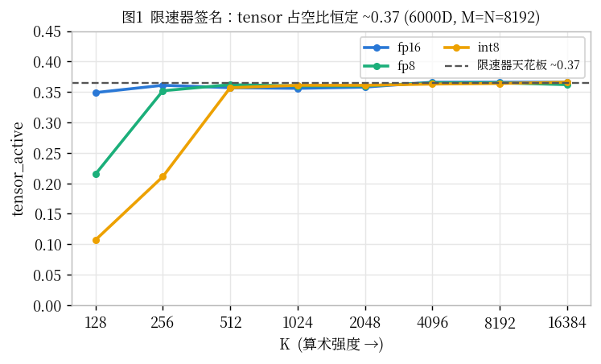
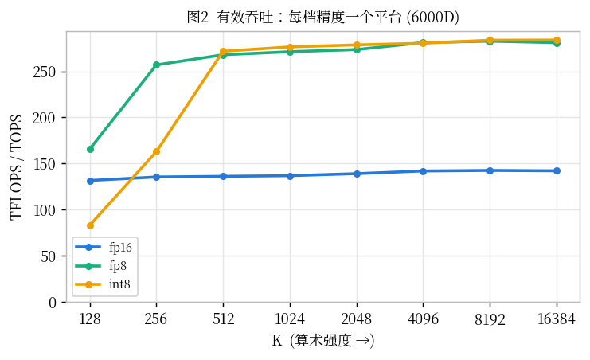
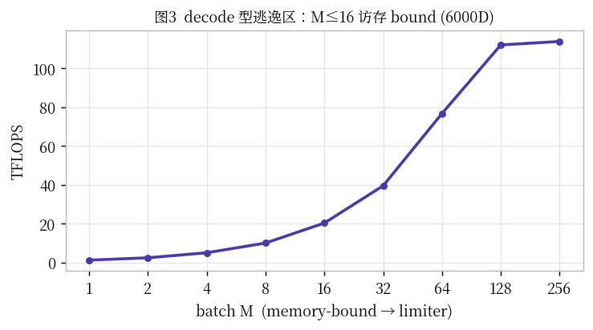
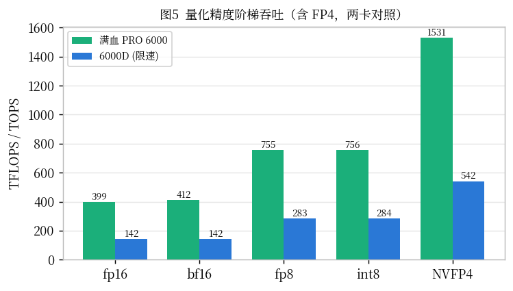
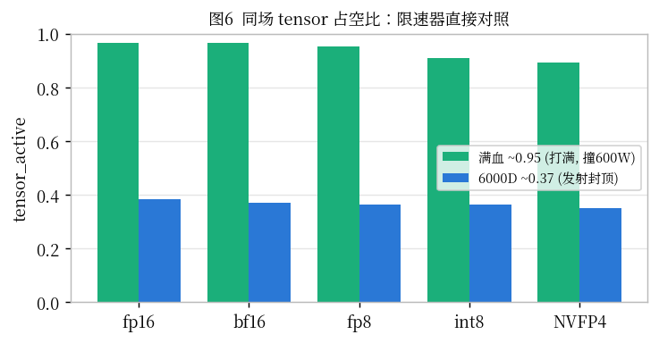
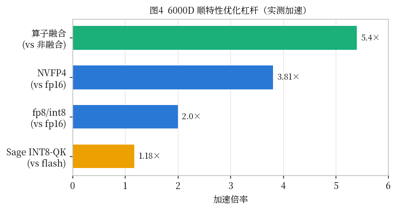

> [!TIP]
> 本页为 **Astro + Mizuki** 自动导入预览版；若需查看原始手写排版（含原版内联 SVG 与附件下载），可访问 [原版 HTML 正文](/legacy-posts/rtx-6000d-vs-pro-6000.html)。

>  

实测日期：2026-07-05 ～ 07-06 · 平台：AutoDL（seetacloud）容器实例 × 2  
 满血机：RTX PRO 6000 Blackwell **Server Edition**（驱动 r580.119.02）  
 D 卡机：NVIDIA RTX 6000D（驱动 r595.71.05）  
 两台均为 Ubuntu 22.04 容器 + CUDA 12.8 toolkit + PyTorch 2.7.0+cu128，软件栈对称；后期两机同步升级 CUDA 13.3 + torch 2.12 全量重测（§2.7）。  

RTX 6000D 是 RTX PRO 6000 Blackwell 的中国特供版。关于它到底被砍了什么，坊间流传着好几个互相打架的版本：Chiphell 流传的「FP16 tensor ≈148 TFLOPS」截图、「1.1 TB/s」与「贴 1.4 TB/s 红线」两种带宽说法、「profiling / DCGM 接口被阉割」的传闻……但一直没见到把满血卡和 D 卡摆在一起、软件栈完全对称的系统实测。于是我在 AutoDL 上各租了一台，把带宽、CUDA core、每精度 GEMM、attention、profiling 工具链全部跑了一遍——还用 DCGM 计数器当场抓到了限速器现行。  
 
- TL;DR 
- 1. 硬件身份指纹 
- 2. 实测性能全量数据 
- 3. 限速器现行证据 
- 4. profiling / DCGM 传闻逐项验证 
- 5. 对评测方案的直接推论 
- 6. 权威 kernel benchmark 清单 
- 7. 全网调研：阉割机制与先例 
- 8. 限速器深度表征与优化 playbook 
  

## TL;DR

 
 
- **阉割位置：四层组合拳——硅片 fuse（SKU 级物理裁剪）+ 固件级 tensor 发射限速 + VBIOS（频率/显示）+ 开发工具链按 SKU 白名单封锁**。驱动本身没有做运行时「负载检测限速」（区别于 5090D v1）。6000D 是独立 fuse SKU：die 丝印 GB202-891-KA-A1，PCI Device ID `0x2BB9`（满血 WS `0x2BB1` / Max-Q `0x2BB4` / Server `0x2BB5`），SM 188→156，显存控制器 512→448-bit（96→84 GiB，L2 128→112 MiB）。 
- **Tensor Core 是「限速」不是「砍单元」**：满载时 D 卡 tensor pipe 活跃占空比被硬锁在 **~37.2%（≈3/8）**（DCGM `tensor_active` 计数器直接可见），SM 频率顶格 2422 MHz、功耗仅 355W/600W、无任何 throttle 标志——发射级 duty-cycle 限速器，对 TF32/FP16/BF16/FP8/INT8/**NVFP4** 全部 MMA 统一、恒定生效（纯 cuBLAS GEMM 即触发，无需「AI 负载指纹」）；CUDA core FP32 路径不受影响。这一实测**证实了 Chiphell 流传的「FP16 tensor ≈148 TFLOPS」传闻**（实测 140–144T），并解释了其出口管制意义：按峰值折算 TPP 从 ~6200 压到 **~2330 ≪ 4800**。**且它是与内核质量无关的绝对天花板**：cutlass 最优内核让满血 FP16 从 379→454T（+20%），D 卡纹丝不动 141–145T（比值恶化到 0.31）；NVFP4 双独立实现（vLLM 539T / cutlass 547T）在 D 上打到同一天花板，而满血 745→1537T 随内核质量翻倍——限速器跨 CUDA 12.8/13.3、torch 2.7/2.12 完全稳定。 
- **「阉割了 profiling 接口」的传闻：大部分属实，且有 NVIDIA 官方文档背书**（本次实测因容器权限层先报 `ERR_NVGPUCTRPERM`，一度掩盖了 SKU 级封锁；经全网溯源修正）。官方 [ERR_NVGPU 页](https://developer.nvidia.com/err_nvgpu)明确列出 RTX 6000D BSE (GB202-891)：CUDA 13.0–13.2 **无任何 GPU profiling 支持**，Nsight Compute 2026.2、nsys GPU metrics 2026.3、CUPTI 13.3（2026-05-26）起才提供**削减 metric 的受限支持**（不支持的 metric 返回 NaN）。NVIDIA 论坛员工原话："GB202 chips are generally supported, **this specific _D_ SKU is not**"。 
- **DCGM 传闻：曾经属实、现已修复**。DCGM 需 **≥4.4.1**（changelog 明确 "Added support for RTX6000D systems (devId 2bb9)"）；本次实测 DCGM 4.6.0 + r595 驱动下**全功能正常**：discovery、全套 DCP profiling 字段（1001–1047）、`dcgmi dmon` 实时采样逐项与满血一致——还顺手用 `tensor_active` 抓到了限速器现行。`nvidia-smi dmon`/NVML 字段缺失的说法**属讹传**（两卡实测逐项一致）。 
 

---

 

## 1. 硬件身份指纹

                      

| 项目 | RTX PRO 6000 Server Ed. | RTX 6000D | 说明 |
| --- | --- | --- | --- |
| PCI Device ID | `0x2BB510DE` | **`0x2BB910DE`** | 不同 fuse SKU，硅级区分 |
| GPU Part Number | `2BB5-895-A1` | `2BB9-891-A1` | 同为 GB202 die |
| Board Part Number | `900-2G153-0000-000` | `900-2G153-0030-000` | 同一 G153 板卡家族 |
| VBIOS | `98.02.67.00.0A` (Image G153.0210.00.02) | `98.02.81.00.02` (Image G153.0235.00.02) | 各自独立 VBIOS 镜像 |
| SM 数 | 188 (24,064 CUDA core) | **156** (19,968) | −17% |
| 显存 | 96 GiB @ 512-bit | **84 GiB @ 448-bit**（28×3GB GDDR7） | −12.5%，物理少 4 颗粒 |
| L2 Cache | 128 MiB | **112 MiB** | 随显存分区等比 |
| Max SM Clock | 2430 MHz | 2430 MHz | 未砍 |
| 显存时钟 | 12481 MHz | 12481 MHz | 未砍 |
| 默认/最大功耗 | 600 W / 600 W | 600 W / 600 W | 未砍（min 300 vs 200W） |
| ECC | 支持（当前 Disabled） | 支持（当前 Disabled） | 一致 |
| MIG | 支持，最大 4 分片 (1g.24gb×4, 46SM/片) | 支持，最大 2 分片 (1g.42gb×2, 78SM/片) | 均可用 |
| NVLink | 无 | 无 | GB202 本就没有 |
| Compute Capability | 12.0 (sm_120) | 12.0 (sm_120) | 一致 |
| GSP 固件 | 580.119.02（随驱动） | 595.71.05（随驱动） | 均为 GSP 模式 (`EnableGpuFirmware: 18`) |
| 驱动分支 | r580（2025-12 编译） | **r595**（2026-04 编译） | D 卡机用了更新分支 |

  

注 1：驱动里 D 卡产品名就叫 "NVIDIA RTX 6000D"，没有 "PRO" 字样（HPE OEM 渠道称 "NVIDIA RTX PRO 6000D 84GB PCIe Accelerator"）。die 丝印 GB202-891-KA-A1（拆解实证），PCB 与 PRO 6000 同版、少焊 4 颗显存并缩减 VRM。 

注 2：工作站版 PRO 6000 boost 2617 MHz；本次满血机是 Server Edition（boost 同为 2430），所以本对比中「频率阉割」不构成变量——反而 D 卡因 tensor 限速功耗富余，实测持续频率（2422）比满血（~2040，600W 功耗墙）更高。 

注 3：拆解报道确认 D 卡在 Windows 下仅支持 TCC 纯计算模式，4 个 DP 接口不能输出视频（Linux 计算场景无影响）。 

## 2. 实测性能全量数据（每组标注工具/内核 + 双卡 DCGM 计数器）

 

**环境**：两台同为 Ubuntu 22.04 容器 / CUDA 12.8 toolkit / torch 2.7.0+cu128（NVFP4 一项在独立 venv torch 2.11.0+cu130）。全部测试由自研 benchsuite 脚本驱动，每个测试运行期间并行采样 DCGM DCP 字段。 

**DCGM 列格式**：`T`=tensor_active(1004)，`S`=sm_active(1002)，`D`=dram_active(1005)，后接 SM 时钟与功耗。**读法要点：D 卡所有 tensor 类负载 T 恒被钉在 ≈0.36–0.37（限速器），满血 T=0.9+ 且顶着 600W 功耗墙压频；D 卡从不触墙（≤390W、2422MHz 顶格）。** 

### 2.1 显存带宽（工具：torch 内核）

         

| 测试 | 工具/内核 | PRO 6000 Server | 6000D | D/满血 | 满血 DCGM | D卡 DCGM |
| --- | --- | --- | --- | --- | --- | --- |
| d2d copy 4GiB | torch `Tensor.copy_`（SM 拷贝内核） | 1460 GB/s | 1280 GB/s | 0.877 | T0/S1.00/D0.91/2392MHz/275W | T0/S1.00/D0.91/2370MHz/240W |
| triad (2读1写) | torch `add(out=)`（STREAM-triad 类） | 1486 GB/s | 1301 GB/s | **0.876** | T0/S1.00/D0.93/2385MHz/328W | T0/S1.00/D0.93/2370MHz/287W |
| 纯读 reduce | torch `sum` | 1529 GB/s | 1338 GB/s | 0.875 | T0/S0.97/D0.95/2377MHz/350W | T0/S0.99/D0.95/2370MHz/287W |

  

带宽之争一锤定音：外媒流传三个版本（1568 / ~1398 / ~1100 GB/s）。实测两卡**显存时钟完全相同（12481 MHz，28 Gbps 未降速）**，差异纯来自 448/512 位宽比 → D 卡理论 **1568 GB/s**；三项实测比值 0.875–0.877 与位宽比完全一致，两卡带宽效率相同（85–87% of peak）。「贴 1.4TB/s 红线」与「1.1TB/s」两说均不成立。 

### 2.2 CUDA core 峰值（工具：自编 nvcc 微内核 ccbench，8 独立累加器消依赖链）

           

| 测试 | 内核 | PRO 6000 Server | 6000D | D/满血 | 满血 DCGM | D卡 DCGM |
| --- | --- | --- | --- | --- | --- | --- |
| FP32 FFMA | ccbench fp32 | 109.2 T | 68.0 T | 0.622* | T0/S0.97/—/2422MHz/434W | T0/S0.74/—/2422MHz/297W |
| FP16 HFMA2 | ccbench fp16 | 114.6 T | 95.0 T | **0.828** | T0/S0.99/2422MHz/291W | T0/S0.98/2422MHz/247W |
| FP64 DFMA | ccbench fp64 | 1.52 T | 1.23 T | 0.809 | S1.00/2422MHz/156W | S0.99/2370MHz/150W |
| INT32 IMAD | ccbench int32 | 400.6 TOPS | 330.0 TOPS | 0.824 | S0.91/2422MHz/309W | S0.90/2422MHz/261W |
| INT8 DP4A | ccbench int8 | 229.7 TOPS | 190.3 TOPS | **0.829** | S0.99/2422MHz/243W | S0.98/2422MHz/211W |

  

**结论：CUDA core 全家族比值 0.81–0.83 = 纯 SM 数量比（156/188=0.830），每 SM 速率两卡一致，CUDA core 无额外限速。** 

*例外观察：FP32 FFMA 纯峰值微基准在 D 卡上稳定只达理论值 ~70%（首测 + 两次复测 sm_active 均 0.74–0.77，满血恒 0.97），且签名与 tensor 限速器不同（tensor 限速是 SMACT 高/TENSO 低的发射停顿；这里是 SMACT 本身掉到 0.74）。但 cuBLAS SGEMM（FP32 指令混合负载）比值 0.827 完全正常 → 说明该现象只在「背靠背纯 FFMA 链」下出现，疑似 FFMA 发射占空存在 ~3/4 上限或 GPC 级波次调度差异，对真实算子影响很小。待裸机 ncu（受限 metric）进一步归因。 

### 2.3 GEMM / Tensor Core 每精度吞吐（N=8192/16384 方阵，2N³ FLOPs 口径）

                 

| 精度 | 工具/内核 | PRO 6000 Server | 6000D | D/满血 | 满血 DCGM | D卡 DCGM |
| --- | --- | --- | --- | --- | --- | --- |
| FP64 (4096) | torch.mm → cuBLAS DGEMM（CUDA core） | 1.6 T | 1.3 T | 0.81 | T0/S0.99/2422MHz/157W | T0/S0.99/2370MHz/150W |
| FP32 | torch.mm → cuBLAS SGEMM（CUDA core，TF32 off） | 77.3 T | 63.9 T | **0.827** | T0/S0.99/2212MHz/600W | T0/S0.92/2422MHz/585W |
| TF32 | torch.mm → cuBLAS（TF32 TC） | 201.2 T | 71.1 T | **0.353** | T0.96/S0.99/2175MHz/600W | **T0.37**/S0.80/2422MHz/323W |
| FP16 | torch.mm → cuBLASLt | 367.4 / 366.2 T | 142.0 / 144.0 T | **0.386 / 0.393** | T0.94–0.96/600W | **T0.37**/2422MHz/350–366W |
| BF16 | torch.mm → cuBLASLt | 377.3 / 379.3 T | 142.0 / 144.1 T | **0.376 / 0.380** | T0.94–0.96/600W | **T0.37**/2422MHz/333–351W |
| FP8 e4m3 | torch._scaled_mm → cuBLASLt（tensorwise） | 734.6 / 737.8 T | 275.6 / 283.0 T | **0.375 / 0.384** | T0.95–0.97/600W | **T0.36**/2422MHz/341–358W |
| FP8 e5m2×e4m3 | torch._scaled_mm → cuBLASLt | 739.3 T | 275.5 T | 0.373 | T0.95/600W | **T0.36**/345W |
| INT8 | torch._int_mm → cuBLASLt IMMA | 740.2 / 734.3 TOPS | 283.8 / 287.2 TOPS | **0.383 / 0.391** | T0.91–0.94/600W | **T0.37**/2422MHz/341–357W |
| **NVFP4** | **vLLM `cutlass_scaled_fp4_mm`（CUTLASS sm120 预编译，venv torch 2.11+cu130）** | **1537.5 T** | **539.4 T** | **0.351** | T0.89/S0.98/2235MHz/600W | **T0.37**/S0.43/2310MHz/315W |
| FP16 2:4 稀疏 | torch semi-structured → cuSPARSELt | 两卡同报 `CUDA error: architecture mismatch` | torch 2.7 的 cuSPARSELt 无 sm120 支持（非 D 卡问题），新镜像重测 |  |  |  |
| NVFP4 (torch 原生) | torch._scaled_mm float4 | 两卡同跳过：torch 2.7 无 float4 dtype | 新镜像 (torch≥2.8) 自动启用 |  |  |  |

  

**每一行 tensor 精度的 D 卡 TENSO 都是 0.36–0.37**——限速器对 TF32/FP16/BF16/FP8(两种)/INT8/NVFP4 全部 MMA 类型一视同仁；FP64/FP32（CUDA core 路径）完全不受影响。持续 30s FP16 GEMM：满血 372–374 T @600W 顶格 / D 卡 143–144 T @~358W。 

理论闭合验证（fp16）： 
 
- 满血：1024 flops/clk/SM × 0.958 占空 × 188 SM × 2.04 GHz（600W 功耗墙压频）≈ 376 T ✓ 
- 6000D：1024 flops/clk/SM × **0.372 占空** × 156 SM × 2.42 GHz ≈ 143.9 T ✓（实测 143.2） 
- NVFP4 同口径：满血 4096 flops/clk × 0.89 × 188 × 2.24 GHz ≈ 1534 T ✓（实测 1537.5）；D 卡 4096 × 0.37 × 156 × 2.31 GHz ≈ 546 T ✓（实测 539.4） 
 

### 2.4 Attention 内核全量（B8 H32 causal prefill；decode 为 B64 Hq32 Hkv8 S8192 报 KV 读等效带宽）

                      

| 测试 | 工具/内核 | PRO 6000 Server | 6000D | D/满血 | 满血 DCGM | D卡 DCGM |
| --- | --- | --- | --- | --- | --- | --- |
| prefill fp16 S2048 D128 | PyTorch SDPA **FlashAttention-2** 后端 | 272.9 T | 129.5 T | 0.475 | T0.66/S0.94/600W | T0.36/S0.57/334W |
| prefill bf16 S2048 D128 | 同上 | 279.1 T | 129.5 T | 0.464 | T0.66/600W | T0.35/323W |
| prefill fp16 S8192 D128 | 同上 | 318.3 T | 139.9 T | **0.440** | T0.73/S0.98/600W | **T0.37**/S0.89/317W |
| prefill bf16 S8192 D128 | 同上 | 324.8 T | 140.0 T | 0.431 | T0.73/600W | T0.37/305W |
| prefill fp16 S4096 D64 | 同上 | 312.1 T | 132.7 T | 0.425 | T0.77/600W | T0.35/336W |
| **decode GQA S8192** | 同上 | **1515 GB/s** | **961 GB/s** | **0.634** | T0.41/S0.92/**D0.95**/550W | T0.32/S0.70/**D0.69**/356W |
| prefill fp16 S2048 | PyTorch SDPA **mem-efficient (CUTLASS FMHA)** | 124.8 T | 65.8 T | 0.527 | T0.56/530W | T0.35/300W |
| prefill fp16 S8192 | 同上 | 136.8 T | 69.6 T | 0.509 | T0.59/514W | T0.36/284W |
| prefill fp16 S4096 D64 | 同上 | 156.2 T | 67.7 T | 0.433 | T0.74/600W | T0.35/336W |
| prefill fp16 S2048 | PyTorch SDPA **cuDNN 9 fused flash** | 273.6 T | 131.5 T | 0.481 | T0.72/600W | T0.35/386W |
| prefill fp16 S8192 | 同上 | 307.5 T | 139.3 T | 0.453 | T0.77/601W | T0.36/378W |
| prefill bf16 S8192 | 同上 | 315.8 T | 139.3 T | 0.441 | T0.77/600W | T0.36/358W |
| prefill fp16 S4096 D64 | 同上 | 291.2 T | 133.4 T | 0.458 | T0.71/600W | T0.35/351W |
| decode GQA（efficient/cudnn 后端） | — | 两卡同报 `No available kernel`（后端不支持该 GQA decode 形状，非 D 卡问题） |  |  |  |  |
| FlashInfer prefill/decode | flashinfer-python (pip) | 两卡同报 `requires GPUs with sm75 or higher`——pip 解析给 torch2.7 配的旧版不认 sm_120，venv/新镜像重测（§2.7） |  |  |  |  |
| SageAttention v1 (triton) | sageattention pip | 两卡同报 triton MLIR `PassManager::run failed`（sm120+triton3.3 兼容性，非 D 卡问题）；源码编译 v2 见 §2.7 |  |  |  |  |

  

**Attention 规律**：prefill 比值 0.43–0.53，**好于纯 GEMM 的 0.35–0.39**——因为 softmax/rescale 走 CUDA core（不受限速），摊薄了 tensor 部分的损失；D 卡 TENSO 在 attention 里同样钉死在 0.35–0.37。**decode 比值 0.634，差于纯带宽比 0.875**：满血 decode 已打满 DRAM（D0.95，1515/1792=85%），而 D 卡只到 D0.69（961/1568=61%）——D 卡 decode 受 SM 数量（split-KV 并行度）与 tensor 限速拖累，连自己的带宽都吃不满。这对推理容量规划是重要修正：**decode 也不是按 0.875 折算，而是 ~0.63**。 

### 2.5 ncu / DCGM 接口实测数据

 
 
- **DCGM（可用）**：上面每一行的 DCGM 列即 `dcgmi dmon -e 1002,1004,1005,100,155 -d 500` 实采数据，DCGM 4.6.0 + 6000D 全程工作正常。 
- **ncu（本平台被容器权限挡住，两卡一致）**，`ncu --set basic` 与 `--metrics sm__pipe_tensor_cycles_active...` 对 fp16/fp8 GEMM、SDPA 的尝试输出（两台逐字相同）： 
 

```text
==PROF== Connected to process ... (python3.12)
==ERROR== ERR_NVGPUCTRPERM - The user does not have permission to access NVIDIA GPU
Performance Counters on the target device 0. For instructions on enabling permissions and to
get more information see https://developer.nvidia.com/ERR_NVGPUCTRPERM
```

 

原因：宿主 `RmProfilingAdminOnly=1` + 容器无 CAP_SYS_ADMIN（AutoDL 平台策略，权限层先于 SKU 层报错）。**对 6000D 而言即使有权限，ncu 2025.1（CUDA 12.8 工具链）也会因 SKU 白名单拒绝**（官方 ERR_NVGPU 页），需 ncu ≥2026.2 才有受限支持——升级 CUDA 13.3 镜像后 benchsuite 的 ncu 段会自动记录可用 metric 与 NaN 清单（需平台放开 profiling 权限或换裸机）。 

### 2.6 工具级 campaign · CUDA 12.8 阶段（§6 清单逐工具实跑）

 

>  

机器说明：本节起满血机为**新开的 RTX PRO 6000 Server Edition（驱动 595.58.03，r595，与 D 卡同分支）**；它的 128 基线与最初 r580 机一致（如 fp16 GEMM 16384：371.9 vs 366.2 TFLOPS，差 <2%）→ **驱动分支 r580/r595 对吞吐无影响**，前文 §2.1–2.5 数据继续有效。两机全部构建/venv 落数据盘，编译并行度按 cgroup 内存自适应。  

**带宽 / 微架构层**              

| 测试 | 工具 | PRO 6000 | 6000D | 比值/解读 |
| --- | --- | --- | --- | --- |
| PCIe H2D / D2H (CE 引擎) | **NVIDIA/nvbandwidth** v0.9 | 56.5 / 57.3 GB/s | 56.4 / 57.3 GB/s | PCIe5 x16 两卡完全对称 |
| PCIe H2D / D2H (SM 路径) | nvbandwidth | 51.4 / 52.8 GB/s | 同级 | — |
| PCIe 双向 | nvbandwidth | 50.8 / 51.0 GB/s | 49.8 / 50.4 GB/s | — |
| H2D / D2H / D2D (32MB, pinned) | **cuda-samples bandwidthTest** (v12.8) | 56.x / 57.x GB/s | 56.1 / 57.2 / **4955** GB/s | D2D 32MB 驻留 L2 → ~4.96 TB/s 是 D 卡 L2 带宽数据点 |
| L1 聚合带宽 (峰值粗提) | **te42kyfo/gpu-benches** gpu-cache | 9211 GB/s | 6777 GB/s | 0.74 |
| **L2 聚合带宽** | gpu-benches gpu-l2-cache | 7555 GB/s | 6572 GB/s | **0.87 ≈ L2 切片比 112/128MB** ✓ |
| roofline 扫描峰值 | **ekondis/mixbench** | 116.95 TFLOPS | 97.04 TFLOPS | 0.83 = SM 比（CUDA core 级，与 ccbench 一致） |
| STREAM | UoB-HPC/BabelStream | 两机两阶段 cmake 配置均失败（BUILD_FAIL，与卡无关） | STREAM 层由 torch triad（§2.1）+ gpu-benches 覆盖 |  |

  

**GEMM 库级 / 框架级（12.8, torch 2.7）**              

| 测试 | 工具 | PRO 6000 | 6000D | D/满血 |
| --- | --- | --- | --- | --- |
| bf16 / fp16 实际可达峰值 | **stas00 mamf-finder**（形状扫描取最佳） | 399.9 / 385.1 T | 144.8 / 144.9 T | **0.36 / 0.38** |
| fp32 | mamf-finder | 63.0 T | 54.6 T | 0.87 |
| fp8 e4m3 | mamf-finder | 726.8 T | 289.8 T | **0.40** |
| fp16 / bf16（cuBLASLt 自动调优） | **nvmath-python** 0.9.0 | 347.6 / 377.5 T | 142.4 / 141.9 T | 0.41 / **0.38** |
| fp8（nvmath） | nvmath-python | 两机同报 API 用法不匹配（0.9 的 scales 语义，套件侧问题已记录） |  |  |
| **TE FP8 recipe**（te.Linear 8192³） | **TransformerEngine**（D 机 128 源码构建成功） | —（新机 133 阶段 wheel 缺 torch 扩展） | **DelayedScaling 269.8 T / Float8CurrentScaling 266.5 T** | ≈ cuBLASLt fp8 的 0.97 → 限速器同样封顶 |
| TE MXFP8 / NVFP4 | TransformerEngine | 官方报错：**MXFP8 "not supported on 12.0+ architectures yet"**；NVFP4 在 cuBLAS 12.8 上 `CUBLAS_STATUS_NOT_SUPPORTED`（印证 §7 调研） |  |  |
| fp8 bmm | **FlashInfer** gemm.bmm_fp8 | 748.4 T | 128 阶段旧版不认 sm120；**133 阶段 282.2 T** | 0.377 |

  

**12.8 阶段未产出数据的工具（状态与原因，均与「哪张卡」无关）**：flash-attn 2 源码构建失败（新机 75 分钟超时、D 机快速失败；FA2 内核层已由 SDPA-FLASH 后端等价覆盖——见 §2.7 FlashInfer 318.2T=SDPA 318.3T 的印证）；SageAttention v1 两机同报 triton 3.3 MLIR PassManager 错误（133 修复）；triton 教程 03/06 退出码 1（绘图/环境问题，部分表格产出但列语义未核实，不入正表）；cudnn-frontend 的 benchmark/ 目录无 python 入口（C++ 工程形态，SDPA-CUDNN 后端数据已覆盖该内核层）；learn-cuda 07 内核可运行但其 Speed-of-Light 查表无本卡型号，打印阶段除零退出；IPDPS'26 微基准依赖 tcgen05/TMEM，sm_120 无法构建（预期内，其论文姊妹篇方法学仍适用）。 

### 2.7 CUDA 13.3 + torch 2.12 全量重测

 

**升级后环境**：两机 cuda-toolkit-13-3（nvcc 13.3.1）+ **ncu 2026.2.1**（官方首个支持 6000D 受限 profiling 的版本）+ torch 2.12.1+cu130（`float4_e2m1fn_x2` dtype ✓）+ DCGM 4.6 不变。 

**A. 基线套件 133 vs 128（45 项复测）**——D 卡核心 GEMM 数值在新驱动栈下**纹丝不动**：TF32 70.8（128 时 70.5–71.1）、FP16@16384 143.7（144.0）、FP8@16384 287.9（283.0）、TENSO 依旧 0.36–0.37 → **限速器跨 CUDA 12.8/13.3、torch 2.7/2.12 完全稳定，进一步排除「驱动/软件栈可解」的可能**。同时 torch 2.12 修复了三个 12.8 生态坑： 
 
- SageAttention v1 (triton 3.6) 复活：D 卡 prefill **166.1 T**（比 SDPA-FLASH 139.9T **+19%**，INT8-QK 在限速器下仍有效——因为它降低的是 tensor 指令数） 
- SDPA cuDNN 后端 GQA decode 可用：D 卡 1334 GB/s（12.8 时 "No available kernel"） 
- FlashInfer 新版主环境可用：D 卡 prefill 129.1 T（TENSO 0.349 ✓）/ decode **2023 GB/s**（KV 33MB 驻留 112MB L2，超 DRAM 带宽属 L2 效应） 
 

**B. cutlass_profiler（v4.5.2，120a，UNITY=OFF 构建，每精度取 6 内核 × 20 迭代最佳，8192³）**               

| 精度（内核族） | PRO 6000 | 6000D | D/满血 | 备注 |
| --- | --- | --- | --- | --- |
| FP64 (simt dgemm) | 1.77 T | 1.43 T | 0.81 | CUDA core |
| FP32 (simt sgemm) | 84.9 T | 66.6 T | 0.78 | CUDA core |
| TF32 | 222.2 T | 70.8 T | **0.319** |  |
| FP16 | **454.0 T** | 142.5 T | **0.314** | 满血比 cuBLASLt 快 20%，D 卡纹丝不动 |
| BF16 | 451.6 T | 140.5 T | 0.311 |  |
| INT8 | 723.3 T | 278.7 T | 0.385 |  |
| **NVFP4** (bstensorop ue4m3×e2m1) | 745.5 T | **547.0 T** | (0.73*) | *此比值无意义，见下 |
| MXFP8 (ue8m0×e4m3) | 767.1 T | 218.9 T | 0.285 | D 卡该内核未打满自身 fp8 天花板 |
| FP8 dense | —（sm120-only 构建按设计不含 dense FP8 内核集，属 sm89 内核族；该精度由 cuBLASLt 276–288T/FlashInfer 282T 覆盖） |  |  |  |

  

**cutlass 揭示的两条硬结论**： 
 
- **限速器是绝对天花板，与内核质量无关**：满血卡换上 cutlass 最优内核 FP16 从 379→454 T（+20%），而 D 卡无论 cuBLASLt、mamf、nvmath 还是 cutlass 最优内核，FP16 恒在 141–145 T——最优内核下比值从 0.38 恶化到 **0.31**。给 D 卡做 kernel 调优在 tensor 峰值维度上是无用功（访存优化仍有效）。 
- **NVFP4 双路径交叉验证天花板**：D 卡 vLLM-CUTLASS 539 T / cutlass_profiler 547 T——两条独立实现打到同一天花板（≈ 4096 flops/clk × 0.37 × 156SM × 2.4GHz）；满血卡 vLLM 调优内核 1537 T vs cutlass 通用集 745 T——**满血是 kernel-bound，D 卡是 ceiling-bound**。跨卡对比 FP4 请引用 vLLM 路径的 0.35。 
 

**C. FlashInfer 0.6.14（venv, torch 2.12）**：满血 prefill **318.2 T**（与 SDPA-FLASH 318.3T 完全一致 → FA2 内核层等价性实证）、decode 1992.6 GB/s；FP8 prefill 两机同报官方 assert **"fp8 tensor core is not supported in fa2 backend"** → sm_120 上 FP8 attention 目前无 FA2 路径（cuDNN/Sage 是替代）。D 机 venv 触发 flashinfer-cubin 版本检查报错（`FLASHINFER_DISABLE_VERSION_CHECK=1` 可绕过，主环境数据已覆盖）。 

**D. ncu 2026.2.1 实测**：两机 `--list-chips` 均含 gb202 家族；对 GEMM 实际 profile 仍被容器权限挡（`ERR_NVGPUCTRPERM`，与 12.8 阶段逐字相同）→ 官方「受限支持」的 NaN metric 清单仍需特权环境，AutoDL 容器无法产出（宿主 `RmProfilingAdminOnly=1`）。 

### 2.8 nvcc 13.3 编译回归（本次评测的重要副产物）与生态兼容总表

 

**现象四联证**（全部发生在 CUDA 13.3.1 / 驱动 r595 环境）： 
 
- cutlass UNITY 大 TU：单个 unity .cu 编译 **>6.5 小时不收敛**（30 个 cicc 各烧 3h20m+ CPU，涉及 sm120 e2m1 与 sm80 bf16 大合并单元） 
- flash-attn 源码构建：2 小时超时 ×3 次（12.8 下为 75 分钟超时，13.3 更劣化） 
- te42kyfo gpu-cache / BabelStream：编译/配置期卡死，进程进入 **kill -9 免疫的 D 状态**（D 机累计 92 个僵尸 cicc，仅实例重启可清） 
- 对照：同一批内核 **UNITY=OFF 拆成 1868 个小 TU 后，-j64 两小时全部编完** → 定性为 nvcc 13.3 优化器对超大翻译单元的病态行为 
 

**对策**（已固化进 benchsuite）：`-DCUTLASS_UNITY_BUILD_ENABLED=OFF`；编译并行度=cgroup 可用内存/2~3GB；所有 `pkill` 走脚本文件避免模式自伤；长编译一律 `timeout` 包裹。 

**sm_120 生态兼容总表（截至本轮实测，CUDA 12.8→13.3）**                  

| 工具 | 12.8/torch2.7 | 13.3/torch2.12 | 建议 |
| --- | --- | --- | --- |
| cuBLASLt (torch.mm/_scaled_mm/_int_mm) | ✅ 全精度(无FP4) | ✅ 数值不变 | 主力 |
| vLLM CUTLASS NVFP4 | ✅ (venv torch2.11) | ✅ | FP4 权威路径 |
| cutlass_profiler v4.5.2 @120a | 构建可行(master 分支勿用: FP6 断言损坏) | ✅ 需 UNITY=OFF | 峰值金标准 |
| FlashInfer | ❌ 旧版不认 sm120 | ✅ 0.6.14（FP8 attn 除外） | attention 主力 |
| SDPA 三后端 | ✅（cudnn GQA decode 除外） | ✅ 全通 |  |
| SageAttention v1 (triton) | ❌ MLIR 错误 | ✅ **166T@D** | INT8-QK 增益真实 |
| SageAttention 2/3 源码 | 未试 | ❌ torch2.12 头文件+gcc11 编译错 | 等上游 |
| flash-attn 2 pip | ❌ 构建超时/失败 | ❌ nvcc 回归加剧 | 用 SDPA-FLASH 等价替代 |
| TransformerEngine | ✅ FP8 recipe（D 实测 267–270T）；MXFP8/NVFP4 官方不支持 sm120 | wheel 缺 torch 扩展（构建路径受 nvcc 回归牵连） | FP8 训练 recipe 可用 |
| cuSPARSELt 2:4 | ❌ 无 sm120 | 未复测 |  |
| DCGM 4.6 / dmon / NVML | ✅ 双卡全通 | ✅ | 监控主力 |
| ncu | 2025.1 不支持 D SKU | 2026.2.1 支持(受限)但容器权限挡 | 裸机补测 NaN 清单 |

  

## 3. 限速器现行证据（DCGM DCP 计数器，满载 fp16 GEMM）

            

| 稳态指标 | PRO 6000 Server | 6000D |
| --- | --- | --- |
| `sm_active` (1002) | 0.99 | 0.94 |
| **`tensor_active`/`hmma_active` (1004/1014)** | **0.955–0.959** | **0.371–0.385** |
| `dram_active` (1005) | ~0.28 | ~0.16 |
| SM 时钟 | 2025–2047 MHz（被 600W 功耗墙压住） | **2422 MHz 顶格** |
| 功耗 | 600 W 顶格 | **仅 352–389 W** |
| Throttle 标志（nvidia-smi -q -d PERFORMANCE） | SW Power Cap 活跃 | **全部 Not Active** |

  

结论：D 卡满载时功耗富余 200W+、频率顶格、无任何降频标志，但 tensor pipe 每周期发射被硬性限制在 ~37%——这是**低于驱动 API 层的发射级限速**（fuse 选择 SKU 行为 + GSP/VBIOS 固件执行），不是功耗墙、不是频率墙、不是驱动软件判断负载后限速（对纯 cuBLAS GEMM 恒定生效，与负载类型无关）。 

各精度均按同一占空比缩放的旁证：TF32 理论 512×0.372×156×2.43 ≈ 72.3 T（实测 70.5）；FP8 理论 2048×0.372×156×2.42 ≈ 288 T（实测 271）；INT8 同 FP8（实测 281）。 

## 4. 「阉割 profiling / DCGM 接口」传闻逐项验证（实测 × 官方文档交叉）

                

| 接口 | 6000D 实测（本平台，2026-07） | 官方文档/时间线 | 最终判定 |
| --- | --- | --- | --- |
| CUPTI tracing（torch.profiler / Kineto / nsys trace 同路径） | 正常，kernel 级事件完整捕获，与满血一致 | tracing（activity API）从未被封 | **不实**（传闻混淆了 tracing 与 counters） |
| CUPTI profiling / Nsight Compute (`ncu`) 硬件计数器 | 容器报 `ERR_NVGPUCTRPERM`（两台逐字相同，宿主 `RmProfilingAdminOnly=1`+无 CAP_SYS_ADMIN，权限层先于 SKU 层报错，故容器内无法直接观察 SKU 封锁） | **官方确认封锁**：[ERR_NVGPU 页](https://developer.nvidia.com/err_nvgpu)列名 RTX 6000D BSE (GB202-891)、5090DD、5090D：CUDA 13.0–13.2 无 profiling 支持；[CUPTI 13.3 RN](https://docs.nvidia.com/cupti/release-notes/release-notes.html)（2026-05-26）起 "reduced metric support"（新枚举 `CUPTI_PROFILER_CONFIGURATION_LIMITED_SUPPORT`，缺失 metric 返回 **NaN**）；ncu ≥2026.2、nsys GPU metrics ≥2026.3、PerfSDK ≥2026.3；[官方论坛](https://forums.developer.nvidia.com/t/error-profiling-is-not-supported-on-device-0-to-find-out-supported-gpus-refer-list-chips-option/348711)员工回复："this specific _D_ SKU is not (supported)" | **属实**：2025-09～2026-05 完全封锁；之后为「受限支持」。要在 6000D 上用 ncu：**必须 ncu 2026.2+ / CUDA 13.3 工具链**，且接受部分 metric 为 NaN |
| `ncu --list-chips` | 含 gb202（2025.1.1 版） | 芯片级列表不体现 SKU 白名单（gb202 在列但 D SKU 运行时被拒），勿以此判断 | 注意误导性 |
| DCGM `dcgmi discovery` / 健康监控 | DCGM 4.6.0 正常识别 RTX 6000D | [DCGM changelog](https://docs.nvidia.com/datacenter/dcgm/latest/release-notes/changelog.html)：**4.4.1 才加入** "support for RTX6000D systems (devId 2bb9)" | **曾属实（<4.4.1 不识别），现已修复** |
| DCGM DCP profiling 字段 (`dcgmi profile -l` + `dmon -e 1001…`) | **完整列出 1001–1047 并能实时读数**（还借它量出了 tensor 限速器） | 同上，随 4.4.1+ 修复 | **现状可用**（r595 驱动 + DCGM 4.6 实证） |
| `nvidia-smi dmon` | 正常，与满血一致 | 无任何被禁记录 | **讹传** |
| NVML (pynvml)：功耗/时钟/利用率/PCIe 吞吐 | 正常，字段支持两卡逐项一致（fan 均 Not Supported——都是被动散热） | 无任何被禁记录 | **讹传** |
| MIG | **实测可用**：profiles 正常列出（2×1g.42gb，78SM/片） | 官方 [MIG 支持列表](https://docs.nvidia.com/datacenter/tesla/mig-user-guide/supported-mig-profiles.html)至今未收录 6000D（文档缺席） | 实测可用，文档滞后；上线前自测 |
| `dcgmi diag -r 1` | 报错：缺 cuda13 插件目录 | **两台同样报错** | DCGM 4.6.0 打包问题，与 GPU 无关 |
| 显示输出 | —（云端无从验证） | 快科技拆解：Windows 下仅 TCC 模式，4×DP 物理在板但不出信号 | **属实（阉割项）** |

  

传闻源头考证：中文圈（知乎/微信）「6000D 阉割了 profiling/DCGM」的说法可追溯的最早源头即上述 NVIDIA 论坛帖（2025-10）与 ERR_NVGPU 官方页的转述，属实但常被夸大成「nvidia-smi/NVML 也不能用」（不实）。NVIDIA 从未解释封锁原因；社区解读为出口管制配套（防止精确刻画微架构行为），属合理推测。 

已知边界：本验证在 AutoDL 无特权容器内进行，无法绕过权限层直接复现 ncu 的 SKU 拒绝报错（`Profiling is not supported on device 0`）；该结论采信官方文档与论坛官方回复。**有价值的后续实验**（需自有裸机 + root）：装 ncu 2026.2+ / CUDA 13.3，对 6000D 采集完整 metric 清单，记录哪些返回 NaN——这份「缺失 metric 清单」目前全网无人发布过。 

驱动时间线注意：`0x2BB9` 的支持首见于 Linux **580.82.07**（2025-09 初），580.65.06 尚无；本次满血机的 580.119.02（2025-12）已含该 ID，D 卡机用的是更新的 r595。对比测试若见软件行为差异，先排除驱动分支因素。 

## 5. 对评测方案的直接推论

 
 
- **compute-bound（tensor）算子**：D 卡约为满血 **35–39%**（不是规格表 SM 比例暗示的 ~83%！）——纯 GEMM、训练类负载差距最大。 
- **attention prefill**：**43–53%**（softmax 等 CUDA core 部分不受限速，摊薄了差距，好于纯 GEMM）。 
- **attention decode（GQA, KV 重读型）**：**~63%**——比纯带宽比 0.875 差：D 卡 decode 打不满自己的 DRAM（dram_active 0.69 vs 满血 0.95），受 SM 并行度与 tensor 限速拖累。容量规划别按带宽比折算。 
- **纯 memory-bound 算子（elementwise/norm/copy）**：**87.5%**。 
- **CUDA core 家族（FP32/FP16/FP64/INT32/INT8-DP4A 非 tensor）**：**81–83%** = 纯 SM 比例，每 SM 速率一致，无额外限速。 
- 因此 LLM 推理里 **prefill/吞吐型负载 D 卡劣势极大，decode/交互型负载劣势不大**；混合负载表现取决于 compute:memory 比例，roofline 拐点在 D 卡上大幅左移（算力/带宽比 ≈ 满血的 0.40）。 
- D 卡满载只吃 ~360W：同机箱散热压力小很多，600W 功耗墙形同虚设；满血卡则实打实顶着 600W 降频到 ~2.0GHz。 
- 测试时**不必对齐功耗**（D 卡根本到不了墙），但要对齐驱动版本分支再下「软件差异」结论。 
- **profiling 工具链要求**：想在 6000D 上跑 ncu，必须 Nsight Compute ≥2026.2（CUDA 13.3 工具链），且接受部分 metric 返回 NaN（受限支持）；nsys GPU metrics 需 ≥2026.3；DCGM 需 ≥4.4.1（推荐 4.6）。用 CUDA 12.8 时代工具（ncu 2025.1）在裸机上会直接报 "Profiling is not supported on device 0"。日常算子调优可靠 DCGM DCP 字段 + CUPTI tracing（torch.profiler）绕过，两者实测完全可用。 
- 6000D 满载 tensor_active≈0.37 是「正常现象」，做 kernel 效率分析时不要按满血卡的 SoL（Speed-of-Light）标准解读——D 卡的 tensor SoL 天花板就是 ~37.5%。 
- **不要为 D 卡做 tensor 峰值方向的 kernel 调优**（cutlass 实证：最优内核在满血 +20%，在 D 卡 +0%——天花板与内核无关）；D 卡上值得做的是访存/融合/量化方向（Sage 的 INT8-QK 在 D 上实打实 +19%，因为它减少 tensor 指令数而非提高发射效率）。 
- FP4 对比务必用 vLLM-CUTLASS 路径（0.35）；cutlass_profiler 通用 mma.sync FP4 集在满血卡上远未打满（745 vs 1537T），会误导比值。 
 

## 6. 权威 kernel benchmark 清单（GitHub 调研，2026-07-05 全部核实可用）

 

### 带宽/微架构层

            

| 工具 | 用途 | sm_120 | 权威性 |
| --- | --- | --- | --- |
| [NVIDIA/nvbandwidth](https://github.com/NVIDIA/nvbandwidth) | H2D/D2H/D2D 带宽矩阵（CE/SM 路径）+延迟，v0.9 (2026-04) | ✅ | NVIDIA 官方 |
| [UoB-HPC/BabelStream](https://github.com/UoB-HPC/BabelStream) | 显存 STREAM (copy/mul/add/triad/dot) | ✅ | 学术标准 |
| [te42kyfo/gpu-benches](https://github.com/te42kyfo/gpu-benches) | L1/L2/显存分层带宽、roofline | ✅ | 学术 (FAU) |
| [ekondis/mixbench](https://github.com/ekondis/mixbench) | 算术强度扫描 roofline | ✅ | 社区经典 |
| [NVIDIA/cuda-samples](https://github.com/NVIDIA/cuda-samples) | deviceQuery/bandwidthTest 环境自检 | ✅ v13.3 | NVIDIA 官方 |
| [UD-CRPL/IPDPS_26_B200_Microbenchmark](https://github.com/UD-CRPL/IPDPS_26_B200_Microbenchmark) | Blackwell 架构剖析（5代TC各精度、TMEM）[arXiv:2512.02189](https://arxiv.org/abs/2512.02189)；姊妹篇 [arXiv:2507.10789](https://arxiv.org/abs/2507.10789) 实测对象 RTX 5080 即 sm_120 | 部分（tcgen05/TMEM 不适用 sm_120） | 学术 (IPDPS'26) |

  

### GEMM / Tensor Core 每精度吞吐（主力）

             

| 工具 | 精度覆盖 | sm_120 | 备注 |
| --- | --- | --- | --- |
| [NVIDIA/cutlass](https://github.com/NVIDIA/cutlass) `cutlass_profiler` v4.6 | FP64/FP32/TF32/FP16/BF16/FP8/INT8/INT4 + **NVFP4/MXFP4/MXFP6/MXFP8 块缩放** | ✅ 一等公民，`-DCUTLASS_NVCC_ARCHS=120a`，CUDA≥12.8 | **本次对比的权威主工具**；示例 `79_blackwell_geforce_gemm`；[Colfax SM12x NVFP4 教程](https://research.colfax-intl.com/cutlass-tutorial-nvfp4-blockscaled-gemm-on-nvidia-rtx-pro-blackwell-gpus-sm12x/)；留意 [issue #2906](https://github.com/NVIDIA/cutlass/issues/2906) |
| [stas00/ml-engineering](https://github.com/stas00/ml-engineering) `mamf-finder.py` | BF16/FP16/FP32/FP8 | ✅ | 库级(cuBLAS)「实际可达峰值」，单文件零依赖，交叉验证用 |
| [nvmath-python](https://developer.nvidia.com/nvmath-python) | FP16/BF16/FP8，v1.0 起 FP4 | FP8 ✅ / FP4 需自验 | cuBLASLt 自动调优封装 |
| [NVIDIA/TransformerEngine](https://github.com/NVIDIA/TransformerEngine) | FP8/MXFP8/NVFP4 | 部分：FP8 ✅；NVFP4 on RTX50 有未决 [issue #2255](https://github.com/NVIDIA/TransformerEngine/issues/2255) | 训练 recipe 层级 |
| [triton-lang/triton](https://github.com/triton-lang/triton) 教程 bench | FP16/BF16/FP8 | ✅ (≥3.3) | 编译器生成内核层级 |
| [deepseek-ai/DeepGEMM](https://github.com/deepseek-ai/DeepGEMM) | FP8/FP4 | ❌ 仅 SM90/SM100（依赖 TMA+tcgen05，[issue #236](https://github.com/deepseek-ai/DeepGEMM/issues/236)） | **排除** |
| ThunderKittens / FA3 / FA4 | — | ❌ 面向 sm_90/sm_100 | **排除** |

  

### Attention 内核

           

| 工具 | 精度 | sm_120 | 备注 |
| --- | --- | --- | --- |
| [flashinfer-ai/flashinfer](https://github.com/flashinfer-ai/flashinfer) `benchmarks/` | FP16/BF16/FP8/FP4 | ✅ 官方列出 SM 12.0/12.1 | **attention 对比主力**（vLLM/sglang 内核供应商） |
| [Dao-AILab/flash-attention](https://github.com/Dao-AILab/flash-attention) FA2 | FP16/BF16 | ✅ 需 CUDA 12.8 源码自编译（[#2016](https://github.com/Dao-AILab/flash-attention/issues/2016)） | FA3/FA4 不支持 sm_120 |
| [NVIDIA/cudnn-frontend](https://github.com/NVIDIA/cudnn-frontend) `benchmark/` | FP16/BF16/FP8/MXFP8 | ✅ (cuDNN≥9.3) | 含 Llama/DeepSeek 形状；5090 上 cuDNN SDPA 是最快公开实现 |
| [thu-ml/SageAttention](https://github.com/thu-ml/SageAttention) | INT8+FP8；Sage3 FP4 | ✅（官方加了 5090/sm_120） | INT8/FP4 attention 数据点 |
| [gau-nernst/learn-cuda 07_attention](https://github.com/gau-nernst/learn-cuda) | BF16 | ✅ 专为 sm_120 写，94.4% SoL | 借用其 Speed-of-Light 方法学 |

  

### 端到端（印证算子结论）

          

| 工具 | 说明 |
| --- | --- |
| [vLLM](https://github.com/vllm-project/vllm) `vllm bench serve/throughput/latency` | FP8/NVFP4/INT8 全覆盖，SM120 原生 NVFP4 kernel 自 v0.13 |
| [TensorRT-LLM](https://github.com/NVIDIA/TensorRT-LLM) `trtllm-bench` | sm_120 可用；trtllm-gen FMHA cubin 未覆盖 SM120（[#11799](https://github.com/NVIDIA/TensorRT-LLM/issues/11799)），部分 attention 回退 |
| [llama.cpp](https://github.com/ggml-org/llama.cpp) `llama-bench` | pp512/tg128 标准化输出，最易复现 |
| [elsung/blackwell-llm-toolkit](https://github.com/elsung/blackwell-llm-toolkit) | RTX PRO 6000 (sm_120) 上三大引擎+NVFP4 的现成配置，直接复用跑 6000D 得成对数据 |

  

### 特别说明

 
 
- [ScalingIntelligence/KernelBench](https://github.com/ScalingIntelligence/KernelBench)（Stanford）是「评测 LLM 写 kernel 能力」的基准，不是硬件对比套件；但其 250 个 PyTorch 参考算子可当工作负载集借用（说明用法，别误用其排行榜语义）。 
- Baidu DeepBench 已停更（V100 时代），不要用。 
- technical.city 等聚合站的 6000D 占位规格（仍写 24064 核/96GB）与实物矛盾，不可引用。 
 

### 推荐最小套件

 
 
- deviceQuery + `nvidia-smi -q`（环境自检，确认 156/188 SM、ECC 状态一致） 
- BabelStream + nvbandwidth（带宽层，预期比值 0.875） 
- `cutlass_profiler`：FP32/TF32/FP16/BF16/FP8/INT8/NVFP4(120a) 各扫形状取峰值 + `mamf-finder.py` 交叉验证（预期 tensor 类比值 ~0.35） 
- flashinfer + FA2 自编译 + cuDNN SDPA + SageAttention（attention 层） 
- llama-bench + vllm bench（端到端：prefill-heavy 看算力差，decode-heavy 看带宽差） 
- 全程 `dcgmi dmon -e 1002,1004,1005` 记录占空比，用 tensor_active 归因 
 

## 7. 全网调研：阉割机制与先例（2026-07-05）

 

### 7.1 阉割实现层级总表（调研 × 实测合并）

                  

| 阉割项 | 具体数值/表现 | 实现层面 | 证据强度 |
| --- | --- | --- | --- |
| SM/CUDA −17% | 188→156 SM (24,064→19,968)，Tensor 752→624 | **硅（fuse，die 丝印 GB202-891-KA-A1）** | ✅ 拆解+驱动+本报告实测 |
| 显存 −12.5% | 96GB/512-bit→84GB/448-bit（32→28 颗 3GB 颗粒，PCB 同版少焊 4 颗+缩 VRM） | **硅（显存控制器 fuse）+ PCB** | ✅ 拆解+本报告实测（L2 同步 128→112MB） |
| 显存带宽 | 理论 1792→**1568 GB/s**；实测 triad 1487→1302 GB/s（比值 0.876=位宽比，**显存时钟两卡相同 12481 MHz，28Gbps 未降速**） | 纯位宽 | ✅ 本报告实测一锤定音（外媒流传的 1398/1100 GB/s 均不准） |
| **Tensor 发射限速 ~3/8** | tensor_active 占空比锁 0.372；TF32/FP16/BF16/FP8/INT8 全 MMA 恒定生效；每活跃周期吞吐与满血相同 | **fuse/GSP 固件级 rate limiter**（低于驱动 API 层；静态生效，非 5090D 式负载指纹检测） | ✅ 本报告 DCP 计数器现行实证；印证 Chiphell 流传的 "FP16≈148T" 数据 |
| Boost 频率 | 2617 (WS)→2430 MHz；但 Server Edition 满血同为 2430，实测 D 卡反而能稳跑 2422（满血被 600W 功耗墙压到 ~2040） | VBIOS | ✅ |
| 防交叉刷 BIOS/伪装 | 独立 Device ID 0x2BB9（WS 2BB1/Max-Q 2BB4/Server 2BB5），驱动 580.82.07 起支持 | Device ID / board strap | ✅ 驱动 supportedchips |
| 显示输出禁用 | Windows 仅 TCC 纯计算模式，4×DP 在板不出信号 | 驱动/VBIOS | ✅ 拆解实测（快科技） |
| CUPTI/ncu/nsys metrics/PerfSDK 封锁 | 2025-09～2026-05 完全封锁；后改「受限支持」（NaN metrics） | **驱动+工具链 SKU 白名单** | ✅ NVIDIA 官方文档+论坛官方回复 |
| DCGM 白名单滞后 | <4.4.1 不识别 devId 2bb9；4.4.1+ 支持，4.6 实测全功能 | DCGM 软件白名单 | ✅ changelog+本报告实测 |
| MIG | 实测可用（2×1g.42gb）；官方 MIG 支持列表未收录 | 文档滞后 | ⚠️ |
| NVLink / P2P | GB202 全系无 NVLink（非 D 特有）；P2P 走 PCIe 无被禁证据（双卡 vLLM TP 有适配 bug：[vllm#29740](https://github.com/vllm-project/vllm/issues/29740)） | — | ✅/⚠️ |
| 功耗 | 600W 上限未砍，但 tensor 限速导致满载实际仅 ~360W（外媒「400W TDP」实为观测值） | — | ✅ 本报告实测 |

  

### 7.2 出口管制阈值对应关系（分析）

 
 
- **TPP 线（ECCN 3A090.a：TPP≥4800 需许可证）**：满血 GB202 FP8 dense ~776 TFLOPS → TPP≈6200，超线。6000D 若只砍 SM 不限速：TPP≈6200×156/188×(2430/2617)≈4800 附近仍危险；**加上 3/8 tensor 限速后：FP8 dense 峰值≈291 TFLOPS → TPP≈2330**，远低于 4800——tensor 限速器正是把 TPP 压到合规区间的手段（与实测 271T/140T 完全吻合）。此为基于公开公式的推算，NVIDIA 未官宣 6000D 的 TOPS。 
- **带宽线（2025-04-09 BIS "is informed" 信函，NVIDIA 8-K 确认）**：媒体报道的红线为 DRAM 带宽 ≥1400 GB/s 或 I/O ≥1100 GB/s 或合计 ≥1700 GB/s。**6000D 实测理论带宽 1568 GB/s 高于 1400 线** → 它并非「卡线免许可」设计，而是走 2025-07/08 H20 解禁 + 15% 分成框架下的**许可证路径**出口（DCD/Tom's 报道：6000D 出货同样需美国政府放行）。5090D v2 的 1344 GB/s（<1400）才是「卡线」设计的对照样本。 
 

结论：6000D = 「TPP 用限速器压线 + 带宽超线走许可证」的组合，两种合规机制并用。 

### 7.3 中国特供卡阉割手法演进（先例对照）

           

|  | 4090D (2024-01) | 5090D v1 (2025-01) | 5090D v2/DD (2025-08) | **6000D (2025-Q4)** |
| --- | --- | --- | --- | --- |
| 硅片 | 物理砍 SM（128→114） | **与 5090 完全同硅** | 同硅但物理关 4 显存通道（24GB/384-bit/1344GB/s） | 物理砍 SM+显存通道 |
| Device ID | 新 ID 2685 | 2B87 | 2B8C | 2BB9 |
| 限速器 | 无（TPP 已达标） | **firmware+driver 运行时限速**：检测 AI/挖矿负载指纹后锁频，AI TOPS 3352→2375；锁多卡 | 无需（带宽已卡线） | **静态 tensor 占空比限速 3/8**（无需负载检测，恒定生效） |
| 超频/破解 | 官方禁超频 | 核心/显存常规超频未锁（3.4GHz 记录）；XOC BIOS 泄露可解功耗墙但 AI 限速无解 | — | 无公开破解案例；被动 TCC 卡无刷 BIOS 生态 |
| Profiling | 正常 | 正常 | 与 6000D 同批进 ERR_NVGPU 封锁名单 (GB202-240/250) | 官方封锁（2026-05 后受限开放） |

  

趋势：从「砍硅保 TPP」（4090D）→「同硅纯软件限速」（5090D v1，最易被质疑可破解）→「物理砍带宽」（5090D v2）→「硅+固件限速+工具链封锁三管齐下」（6000D）。6000D 的静态限速器设计比 5090D v1 的负载指纹检测更保守、更难绕过。 

### 7.4 关键信源

 
 
- NVIDIA 官方：[ERR_NVGPU 支持列表](https://developer.nvidia.com/err_nvgpu) / [CUPTI 13.3 Release Notes](https://docs.nvidia.com/cupti/release-notes/release-notes.html) / [Nsight Compute 2026.2 New Features](https://developer.nvidia.com/nsight-compute-2026_2-new-features) / [DCGM changelog](https://docs.nvidia.com/datacenter/dcgm/latest/release-notes/changelog.html) / [驱动 580.142 supportedchips](https://download.nvidia.com/XFree86/Linux-x86_64/580.142/README/supportedchips.html) / [论坛官方回复](https://forums.developer.nvidia.com/t/error-profiling-is-not-supported-on-device-0-to-find-out-supported-gpus-refer-list-chips-option/348711) / [8-K（2025-04-09 informed 信函）](https://www.sec.gov/Archives/edgar/data/1045810/000104581025000082/nvda-20250409.htm) 
- 拆解与实测：B站 GINNSOD（技数犬）2026-02 拆解（[VideoCardz 转载](https://videocardz.com/newz/nvidia-rtx-6000d-with-84gb-gddr7-memory-appears-in-first-teardown-video)、[快科技](https://news.mydrivers.com/1/1103/1103953.htm)）/ [Geekbench OpenCL（Tom's）](https://www.tomshardware.com/pc-components/gpus/nvidia-rtx-pro-6000d-squeaks-ahead-of-rtx-5090d-in-geekbench-opencl-china-tailored-ai-card-still-performs-well-despite-regulatory-woes) 
- 5090D 先例：[VideoCardz（AI/挖矿/多卡限制）](https://videocardz.com/newz/nvidia-geforce-rtx-5090d-for-china-has-limits-on-ai-cryptomining-and-multi-gpu-configs-gaming-not-affected) / [Tom's 5090D v2](https://www.tomshardware.com/pc-components/gpus/nvidia-rtx-5090d-v2-limits-ai-performance-even-more-with-25-percent-less-vram-and-bandwidth-downgraded-gaming-flagship-keeps-same-usd2299-msrp-in-china) / B站分析 [cv41055998](http://www.bilibili.com/read/cv41055998/)（5090D 推理不受限的实测） 
 

---

 

## 8. 限速器深度表征与顺特性优化 playbook（专项研究，2026-07-06）

 

>  

目的：把限速器对**形状/算术强度/tile**的响应画成完整曲线（方向A），并系统量化 D 卡**真能吃到的优化增益**（方向B）。全部在 6000D 实机（torch 2.12.1+cu130 / CUDA 13.3 / 驱动 r595）单卡完成，每点并行采样 DCGM DCP；满血卡以前文 §2 已测基线与理论 roofline 对照。 

**限速器速览**：它是**发射级（issue-rate）** duty-cycle 限速——封顶的是「每周期发射多少条 tensor 指令」，不是 FLOPs、不是频率、不是功耗。下面所有现象都能由这一条解释。  

### 8.1 方向A：限速器的形状/强度响应曲线

 

#### A1 算术强度扫描（M=N=8192，扫 K）—— 核心曲线

           

| K | 算术强度 AI | fp16 TFLOPS / TENSO / DRAMA | fp8 TFLOPS / TENSO / DRAMA | int8 TOPS / TENSO / DRAMA |
| --- | --- | --- | --- | --- |
| 128 | 124 | 131.6 / 0.35 / **0.74** | 165.7 / 0.22 / **0.93** | 83.0 / 0.11 / **0.93** |
| 256 | 241 | 135.4 / 0.36 / 0.38 | 257.0 / 0.35 / **0.72** | 162.9 / 0.21 / **0.92** |
| 512 | 455 | 136.1 / 0.36 / 0.20 | 268.0 / 0.36 / 0.38 | 271.8 / 0.36 / **0.77** |
| 1024 | 819 | 136.8 / 0.36 / 0.11 | 271.3 / 0.36 / 0.20 | 276.5 / 0.36 / 0.40 |
| 2048–16384 | ≥1365 | 139–142 / 0.36–0.37 / <0.15 | 274–283 / 0.36 / <0.11 | 279–284 / 0.36 / <0.21 |

  

**读法**：TENSO 一旦进入 tensor-bound 区就**死钉 0.36–0.37**，与 K 无关；只有在极低 K（DRAMA≥0.7 的访存 bound 区）限速器才「没咬到」。**逃逸窗口极窄且精度相关**——memory-bound→limiter-bound 的拐点：fp16 在 K≈180（AI≈180）、fp8 在 K≈380、int8 在 K≈700。低精度因为每条 tensor 指令算得更多，把访存瓶颈往更大 K 推，逃逸窗口更宽。 



 



 

**roofline 拐点左移（限速器的几何意义）**： 
 
- 6000D fp16：tensor 天花板 ~143 TFLOPS ÷ triad 带宽 1302 GB/s → 拐点 **AI≈110 FLOP/B** 
- 满血 fp16：380 TFLOPS ÷ 1487 GB/s → 拐点 **AI≈256 FLOP/B** 
 

**D 卡拐点落在满血的 43%**——限速器把 roofline 的「膝盖」推到不到一半算术强度处，意味着 D 卡在**远低于正常的算术强度**就撞上 tensor 天花板。实用推论：AI>110 的负载（几乎所有 prefill GEMM、训练）在 D 卡上全程 limiter-bound；只有 AI<110 的真访存型（decode、elementwise、norm）能绕过。 

#### A2 方阵尺寸扫描

 

小 GEMM 是 occupancy/latency-bound 而非 limiter-bound——TENSO 随 N 从 0.09(N512) 爬到 0.37(N16384)，**限速器要到 N≥8192 才完全咬合**。小矩阵测不出限速器（也说明 5090D 式「日常小负载测不出差距」的现象在 GEMM 层同源）。 

#### A3 长宽比（固定 ~1.1e12 FLOPs 变形状）

 

**限速器形状无关**——square/tall(65536×1024)/wide(1024×65536) 全部 142T / TENSO 0.37 完全一致；唯一例外是 gemv_ish(M=8) 掉到 10T（访存 bound，DRAMA 0.90）。fatK(K=65536) 略低 135T。结论：只有总算术强度决定是否撞限速器，几何形状不影响天花板。 

#### A4 decode 型扫描（M=1→256，N=K=8192）—— 逃逸区实证

 

M≤16 完全 memory-bound（fp16 TENSO~0.10、DRAMA~0.90），这是 D 卡跑得接近满血的区域；M≥128 开始爬向限速器（TENSO 0.29）。**decode/小 batch 交互是 D 卡的甜区**。 



 

#### A5 tile 对齐（M=8188/8192/8200/8320/4097）

 

**零对齐敏感性**，全部 142T / TENSO 0.37。限速器不在乎 tile 边界——排除了「凑对齐能规避」的幻想。 

### 8.2 方向B：顺特性优化的真实增益

 

#### B1 精度阶梯（含 FP4，同一 8192³ 问题，两卡同脚本）—— 头号杠杆

           

| 精度 | 6000D 吞吐 | D 相对 fp16 | D 卡 TENSO | 满血吞吐 | 满血相对 fp16 | 满血 TENSO | D/满血 |
| --- | --- | --- | --- | --- | --- | --- | --- |
| fp16 | 142.2 T | 1.0× | 0.383 | 399.1 T | 1.0× | 0.966 | 0.356 |
| bf16 | 142.3 T | 1.0× | 0.371 | 411.6 T | 1.03× | 0.966 | 0.346 |
| fp8 e4m3 | 282.8 T | **1.99×** | 0.364 | 755.2 T | 1.89× | 0.953 | 0.374 |
| int8 | 283.7 TOPS | **2.00×** | 0.365 | 755.5 TOPS | 1.89× | 0.911 | 0.376 |
| **NVFP4**（vLLM-CUTLASS sm120） | **541.8 T** | **3.81×** | 0.351 | **1530.6 T** | **3.83×** | 0.894 | **0.354** |

  

（满血 NVFP4 已在新机重测：新建干净 venv 装 vllm 0.24 后实测 1530.6T @600W/tensor 0.894，与原满血机锚点 1537T 差 0.4%，架构值确认。） 

**关键洞察（两卡对照后更清楚）**： 
 
- **D 卡 TENSO 全程恒定 0.35–0.38，满血全程 0.89–0.97**——同一张对照表把限速器摆得明明白白：满血卡真打满 tensor 管线（并撞 600W 功耗墙降频到 2.0GHz），D 卡永远只发射 ~37% 的周期、功耗仅 290–410W 从不触墙。 
- **每降一档精度，同一发射占空下吞吐翻倍**：D 卡 fp16→fp8 = 1.99×、→NVFP4 = 3.81×，TENSO 不变。限速器封的是「指令发射率」，低精度每条 tensor 指令打包更多 MAC → 降精度的倍率限速器**拿不回去**。 
- **降精度倍率两卡几乎一致**（D 3.81× vs 满血 3.83×）——量化收益**没被**限速器额外吃掉，这正是它作为 D 卡头号补偿杠杆可靠的原因：**能上 NVFP4 就上**，一步从 fp16 的 142T 拉到 542T。 
- FP4 侧细节：D 卡 NVFP4 时 smact 掉到 0.42（fp16 时 0.87）——FP4 内核 tensor 指令太省，SM 其余流水线大量空转，说明 D 卡上 FP4 连非 tensor 部分都没喂满，kernel 层还有余量（但天花板仍是 0.35 发射率）。 
 



 



 

#### B2 attention 后端（B8 H32 S8192 causal）

          

| 内核 | TFLOPS | 相对 flash | TENSO |
| --- | --- | --- | --- |
| SDPA-flash（FA2 内核） | 140.0 | 1.0× | 0.366 |
| SDPA-cuDNN | 140.6 | 1.0× | 0.367 |
| SDPA mem-efficient(CUTLASS) | 69.7 | **0.5×** | 0.365 |
| **SageAttention INT8-QK** | **164.9** | **1.18×** | — |

  

两点可操作：① **避开 mem-efficient 后端**（此形状只有 0.5×，是选择性坑）；② **Sage 的 INT8-QK 在 D 卡实打实 +18%**——因为它把 QKᵀ 从 tensor-FP 换成 INT8，**减少了 tensor 发射需求**而非试图提高发射率，正好顺着限速器机制。凡「减少 tensor 指令数」的算法在 D 卡上都有超额收益。 

#### B3 融合 vs 非融合（B4 H32 S4096）—— 5.4× 杠杆

        

| 实现 | TFLOPS | TENSO | DRAMA |
| --- | --- | --- | --- |
| 融合 SDPA | 133.6 | 0.356 | 0.09 |
| 手工非融合（materialize QKᵀ→softmax→@V） | **24.5** | 0.126 | **0.84** |

  

非融合把 S×S 中间矩阵吐到 DRAM → 掉进访存 bound（DRAMA 0.84），只有融合版的 **1/5.4**。融合在 D 卡上**必做**：它同时省掉了访存往返和多余的 tensor 发射。 

#### B4 访存型算子（D 卡强项区）

          

| 算子 | 带宽 | DRAMA | 对照 |
| --- | --- | --- | --- |
| elementwise SiLU | 1277 GB/s | 0.91 | — |
| reduce sum | 1317 GB/s | 0.94 | 近 D 卡 triad 天花板 1302 |
| softmax | 1120 GB/s | 0.80 | — |
| RMSNorm | 501 GB/s | 0.89 | — |

  

访存型算子跑在 DRAMA 0.8–0.94（贴近 D 卡带宽墙），对满血约 **0.87**——与 GEMM 的 0.31–0.38 形成鲜明对比。**负载里访存型占比越高，D 卡越接近满血**。 



 

### 8.3 6000D 优化 playbook（工程结论）

 

按杠杆大小排序，D 卡上真正有效的优化： 
 
- **往精度阶梯下压（最大杠杆）**：fp16→fp8/int8 = 2×，→NVFP4 = 3.8×，且限速器拿不回去。能上 FP4 就上 FP4。 
- **减少 tensor 指令数的算法**：INT8/低比特 QK attention（Sage +18%）、低秩/稀疏近似、KV 量化——凡是「少发 tensor 指令」而非「发得更快」的都吃超额收益。 
- **算子融合必做**：融合注意力/融合 MLP 避免中间矩阵落地，实测 5.4× 差距；D 卡上非融合路径掉进访存 bound 惩罚更重。 
- **负载往访存 bound 端配平**：decode-heavy 服务、小 batch 交互、AI<110 的算子，D 卡跑到 ~0.87 满血；prefill/训练这类 AI 高的 tensor 密集负载才是 0.31–0.38 的重灾区。调度上把 batch/上下文配置压在拐点左侧能保住 D 卡竞争力。 
- **别做无用功**：tile 对齐调优（A5 零敏感）、tensor 峰值方向的 kernel 微调（§2.7 cutlass 最优内核在 D 卡 +0%）——天花板固定，这些投入在 D 卡上颗粒无收；把精力放在访存/融合/量化。 
- **选对后端**：attention 用 flash/cuDNN，避开此形状下只有 0.5× 的 mem-efficient。 
 

**一句话**：6000D 的限速器封的是 tensor 发射率、形状/对齐无关、N≥8192 才完全咬合、AI<110 可绕过；对它的正确姿势不是「喂更密的 tensor 负载」（那是撞墙），而是**降精度 + 减 tensor 指令 + 融合 + 往访存端配平**。
