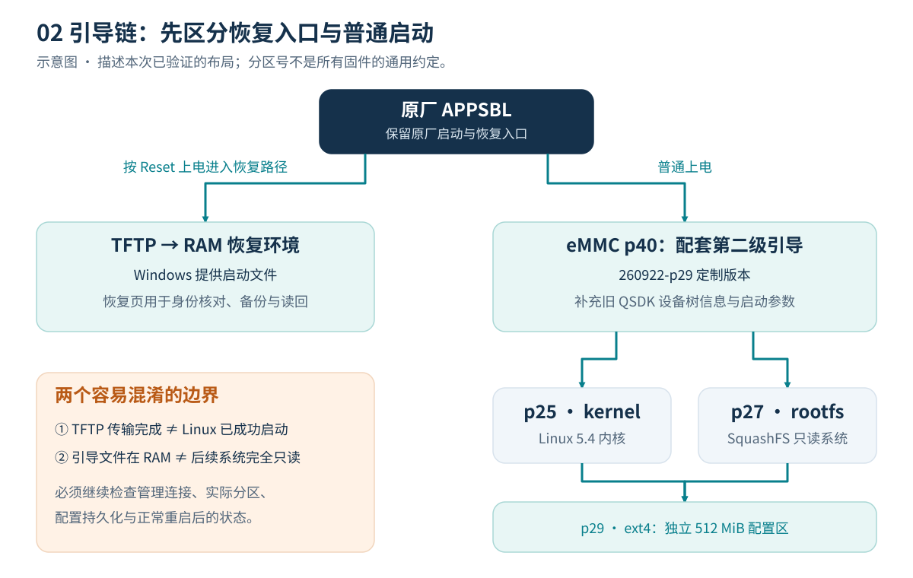
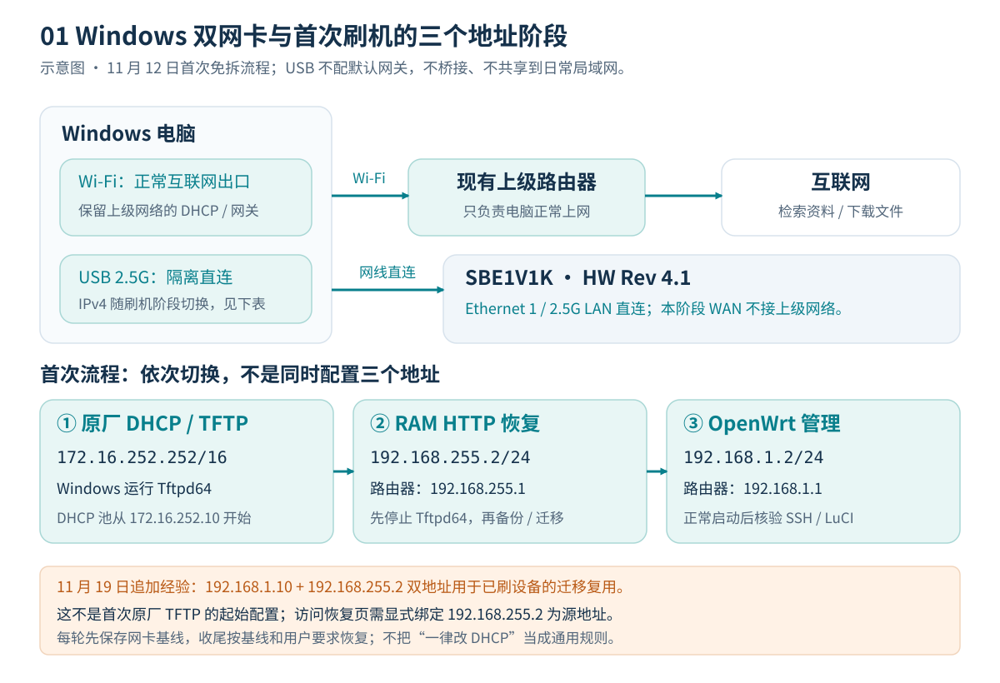
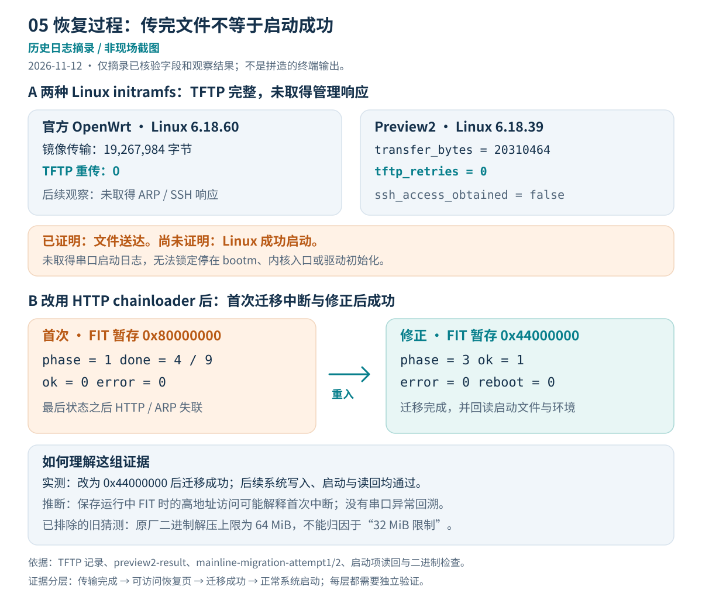
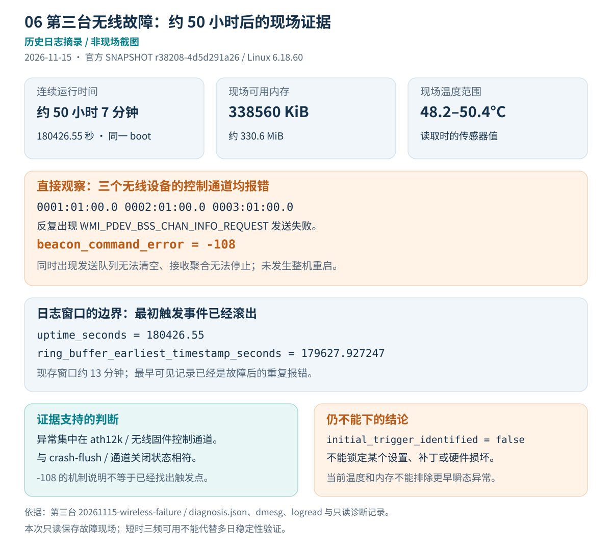
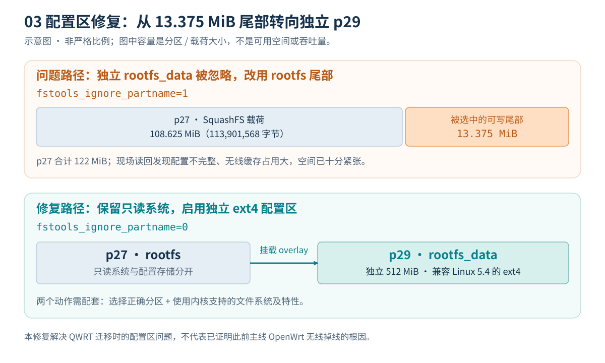
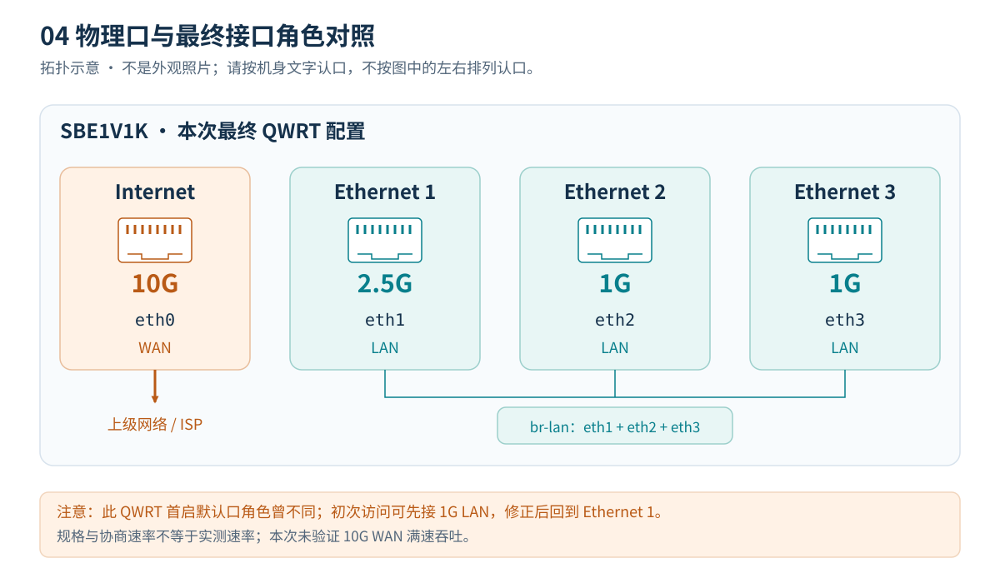

> [!TIP]
> 本页为 **Astro + Mizuki** 自动导入预览版；若需查看原始手写排版（含原版内联 SVG 与附件下载），可访问 [原版 HTML 正文](/legacy-posts/sbe1v1k-openwrt-qwrt-guide.html)。

SBE1V1K · HW REV 4.1 · WINDOWS ONLY  

三台原厂 Spectrum 路由器，从 Windows 免拆刷入官方 OpenWrt，到第三台遇到约 50 小时后的无线故障，再迁移到 QWRT、修复引导与配置分区，最后把成功方案应用到前两台。这里把每一步做了什么、怎样判断成功、哪些尝试没有解决问题写在一起。 **最终状态**

三台均运行 QWRT R26.5.1 / QSDK 12.2 R7，使用独立 p29 ext4；正常重启和三频连接管理页通过。第三台在 11 月 19 日的使用回访中确认：连续数天没有再掉线。前两台另完成两端 2.5 Gbps LAN 协商验证。 

适用对象是本次三台 HW Rev 4.1 与文中精确镜像/布局。Windows 是操作主机；文中的 Linux 命令通过 SSH 在路由器运行，不要求电脑启动 Linux 或 WSL。公开版省略实际口令、MAC、设备身份指纹与私有备份。 

图像均为依据实测记录绘制的技术示意或日志摘录，不冒充历史现场截图。文末单独列出本次重新执行的检查及其结果；没有为了拍图重复擦写正常使用的机器。 

代码附件与最终效果Windows 接线与地址 

## 01本次究竟做成了什么

 

三台 Askey / Spectrum SBE1V1K、标签 HW Rev 4.1，均使用 Windows 电脑与独立 USB 2.5GbE 网卡，经原厂 DHCP Option 43/TFTP 入口启动内存中的 HTTP 恢复程序。完成各自原厂分区备份后，安装 mainline 启动路径和官方 OpenWrt SNAPSHOT r38208-4d5d291a26、Linux 6.18.60，并逐台验证从 eMMC 启动和内核、根文件系统读回一致。没有使用 Linux 启动盘、WSL、拆机串口或第二台可运行 dnsmasq 的路由器。 

第一台的原厂系统经 HTTPS 读取确认为 `1.1.1-12-19324-g202510221629-SBE1V1K-prod`，处于 Cloud 模式。不要把这个版本未经核验地推广为所有设备均相同，也不要宣称任意原厂版本和硬件修订都已验证。 

这条成功路线包含三个不同程序，不能混称为“刷一个固件”：                          

| 文件/程序 | 本次作用 | 是否直接安装系统 |
| --- | --- | --- |
| `rtq7300t_boot_auto_upgrade_fw.img` | 原厂引导器接受的 FIT 脚本包装，继续下载第二个文件 | 否 |
| TFTP 目录的 `initramfs.itb` | 最终成功方案中实际是 YYH2913 的 `sbe1v1k-chainloader.itb`，只是沿用脚本要求的名字 | 否；先在 RAM 启动恢复环境 |
| `openwrt-qualcommbe-ipq95xx-askey_sbe1v1k-squashfs-sysupgrade.bin` | 经恢复程序识别的 OpenWrt sysupgrade tar 包 | 是，写入 eMMC 的系统分区 |

 

最初把真正的 Linux initramfs 作为第二文件的尝试没有成功启动，后来才改用小型 HTTP chainloader。文件名一样并不代表内容相同。 [



](/assets/sbe1v1k/02-boot-chain.svg)技术示意：完整引导链总览，右侧为最终 QWRT 的 260922-p29 路径；首次官方 OpenWrt 阶段使用 260720 与 F2FS。点击可查看原图。 

## 02Windows 侧连接与网络准备

 [



](/assets/sbe1v1k/01-windows-dual-network.svg)技术示意：Wi-Fi 保持电脑上网，USB 直连；首次刷机依次切换三个管理网段。点击可查看原图。 

实机使用电脑 Wi-Fi 保持互联网连接，独立 USB 网卡直接接路由器 **2.5G LAN / Ethernet 1**。WAN 不接上级网络。整个恢复网络只有这台电脑和待操作路由器，避免把临时 DHCP 服务发到日常局域网。 

首次流程按阶段切换 USB IPv4 地址，没有给 USB 配默认网关；Wi-Fi 网关和 DNS 保持原状。                              

| 阶段 | Windows USB 地址 | 路由器侧入口 | 电脑运行的临时服务 |
| --- | --- | --- | --- |
| 原厂 DHCP/TFTP 引导 | `172.16.252.252/16` | DHCP 分配池从 `172.16.252.10` 开始 | Tftpd64 的 DHCP + TFTP |
| RAM HTTP 恢复、分区备份、写入 | `192.168.255.2/24` | `http://192.168.255.1/` | 停止 Tftpd64 |
| OpenWrt 正常启动管理 | `192.168.1.2/24` | SSH / LuCI：`192.168.1.1` | 按需使用受限下载代理，结束后清理 |

 

应先识别专用网卡，并保存其真实基线。实际脚本使用网卡身份、描述和当前接口索引联合确认；公开示例不能硬编码作者电脑当时的 `ifIndex`、别名或硬件身份。第二台开始时该网卡已是静态配置，因此“结束后一律改回 DHCP”不是正确的通用恢复方法，应恢复本轮开始时保存的状态。 

可复用的检查和阶段配置示例（管理员 PowerShell；别名必须由操作者核对后填写）： 

```text
Get-NetAdapter | Select-Object Name, InterfaceDescription, ifIndex, Status, LinkSpeed
Get-NetIPConfiguration
Get-NetRoute -AddressFamily IPv4 -DestinationPrefix 0.0.0.0/0

$usbName = '已核对的专用 USB 网卡别名'
Get-NetAdapter -Name $usbName | Format-List Name, InterfaceDescription, ifIndex, Status
Get-NetIPAddress -InterfaceAlias $usbName -AddressFamily IPv4
Get-NetIPInterface -InterfaceAlias $usbName -AddressFamily IPv4

# 以下每次只选择当前阶段对应的一行；不要一次执行三行。
# 原厂 DHCP/TFTP 阶段：
netsh interface ipv4 set address "name=$usbName" source=static address=172.16.252.252 mask=255.255.0.0 gateway=none store=persistent
# HTTP 恢复阶段，先关闭本次 Tftpd64：
# netsh interface ipv4 set address "name=$usbName" source=static address=192.168.255.2 mask=255.255.255.0 gateway=none store=persistent
# 正常系统管理阶段：
# netsh interface ipv4 set address "name=$usbName" source=static address=192.168.1.2 mask=255.255.255.0 gateway=none store=persistent

```

 

这里没有配置网络桥接、ICS，也没有修改 Wi-Fi 默认路由。防火墙规则限制到本次 Tftpd64 可执行文件和专用 USB 网卡；不能用“关闭所有防火墙”替代。TFTP 的数据连接并不始终只使用 UDP 69，因此当时采用按程序和接口限定 UDP 的规则，而不是只开放 69 后假设一定足够。 

11 月 19 日复用流程又遇到两个问题；它们不属于 11 月 12 日的初始步骤： 
 
- USB 未接线时，持久配置已是静态，但 ActiveStore 一度仍显示旧 DHCP 租约；实际接线后 DHCP 显示 Disabled、两个静态地址变为 Preferred、旧租约消失，不需要因此先重启网卡。 
- 后来同时配置 `192.168.1.10/24` 与 `192.168.255.2/24` 时，Windows 对 `192.168.255.1` 的路由虽选中 USB，却曾选择 `192.168.1.10` 为源地址。恢复 HTTP 客户端应显式绑定 `192.168.255.2`，避免恢复环境没有跨子网回程。两地址都 `SkipAsSource=False` 不保证自动挑选符合预期。 
 

## 03Tftpd64 的配置细节

 

本次使用 PJO2 发布、签名验证通过的 Tftpd64 portable v4.74。发布元数据日期为 2025-10-21。**主窗口 Server Interfaces 下拉框不能替代服务绑定设置**；需在设置中限制 TFTP、DHCP 接口，实际 INI 分别为 `LocalIP` 和 `DHCP LocalIP`。`Services=5` 在这一版源码中是 TFTP 位 1 与 DHCP 位 4 的组合。 

以下配置保存为 `tftpd32.ini`，放在 `tftpd64.exe` 同目录。将示例路径换成实际存在的专用目录： 

```text
[TFTPD32]
BaseDirectory=C:\SBE1V1K\tftp-root
TftpPort=69
Services=5
LocalIP=172.16.252.252
DHCP LocalIP=172.16.252.252
SecurityLevel=3
Enable IPv4=1
Enable IPv6=0
WinSize=0
Negociate=1
PXECompatibility=0
Timeout=3
MaxRetransmit=6
TftpLogFile=C:\SBE1V1K\logs\tftpd64.log

[DHCP]
IP_Pool=172.16.252.10
PoolSize=11
Mask=255.255.0.0
BootFile=rtq7300t_boot_auto_upgrade_fw.img
Lease (minutes)=5
DNS=
DNS2=
WINS=
Gateway=
AddOptionNumber1=43
AddOptionValue1=askey
AddOptionNumber2=66
AddOptionValue2=172.16.252.252

```

 

Option 43 的内容是 ASCII 字符串 `askey`；不是把可见文本 `61 73 6b 65 79` 填进字符串栏。Option 66 在本次配置中明确指定 TFTP 地址。不要因为 Tftpd64 窗口已经出现就判断服务已正确绑定：第三台第一次尝试曾遇到网卡未绑定提示，没有有效启动请求；保持正确监听并重新按 Reset 上电后，两文件完整传输。 

实际物理操作为：断电，按住 Reset，接电，持续按住约 45 秒后松开。这个时间来自本次实机记录，目的是覆盖原厂恢复触发和第二阶段初始化；不是所有版本一律必须精确 45 秒的规格。操作结果看 DHCP、两个 TFTP 文件的完成记录，以及后续 HTTP 状态，不能只看指示灯颜色。 

## 04两种 Linux RAM 镜像未成功启动与最终成功路径

 

起初使用官方 Linux initramfs，TFTP 日志确认启动脚本和 19,267,984 字节的镜像均完整传输，重传为 0；等待后没有 `192.168.1.1` 的 ARP/SSH 响应。另一次尝试 yintaomu Preview2、Linux 6.18.39，结果相似。网卡有物理链路不等于内核已启动。 

当时官方 initramfs 的内核 load/entry 已为 `0x42200000`，不是某些旧教程提到的 `0x41000000`。实际解压内核为 49,078,280 字节。后来对本机原厂 APPSBL 的只读分析确认其解压输出上限是 **64 MiB**，并非曾经怀疑的 32 MiB；两份约 49 MB / 53 MB 的展开内核均不足以单凭该上限解释失败。因此这里的结论是“原因未最终确定”，不能写成“发现 32 MB 上限，缩小固件后解决”。没有串口启动日志，也不能确定具体停在 bootm、内核入口还是驱动初始化。 

原厂 U-Boot 版本字符串为： 

```text
U-Boot 1.0.10 [spf12.2_CSU2] (Sep 12 2024 - 02:30:19 +0000)

```

 

成功替代路径采用 [YYH2913 的 260720 发布](https://github.com/YYH2913/http-uboot/releases/tag/260720)： 

```text
原始资产：sbe1v1k-chainloader.itb
大小：758532 字节
SHA256：2aad05c1ee2574874a4570367a090ebf9af66cc02d23db91365ed0b83ef5d702
运行版本：U-Boot 2026.07-rc4-00162-g67b383934ff8

```

 

这里只公布公开软件包哈希，不公布任何单机校准或许可分区哈希。下载后使用 `Get-FileHash -Algorithm SHA256` 检查整文件，并检查 FIT 内部各段 hash、型号和 load/entry。运行该 RAM 环境和读取备份的已审计路径没有自动擦写；网页中“迁移”“准备”“上传”等动作则会写入。 

### 为什么最终把 FIT 暂存地址改成 0x44000000

 

第一台最初从 `0x80000000` 启动 HTTP 恢复成功，分区备份也正常。但首次发送永久 mainline 迁移请求后，最后收到的状态为 `phase=1, done=4, total=9, ok=0, error=0`，然后 HTTP/ARP 失联。`ok=0,error=0` 不是成功，也不能仅凭断连断定设备在正常重启。 

恢复源码会在写 GPT 前保存运行中的 chainloader FIT；该路径检查暂存 FIT 地址，包括 `0x80000000`。结合第二阶段内存映射调查，当时判断高地址读取可能导致同步异常。**没有捕获串口异常回溯，因此这是与源码和后续结果一致的解释，不是已经观察到的 CPU 异常事实。** 后来改为 `0x44000000` 重新临时进入恢复，迁移和系统安装成功；第二、三台直接使用修正地址也成功。 

重新进入恢复后，已检查分区号、起始位置、大小等元数据与原备份一致，并分别读回 p17、p40 与原备份一致。HTTP 清单不包含原始 GPT GUID/属性和完整头部，因此不能扩大成“已证明首次失败前后整张 GPT 每个字节都没变”。 

最终 FIT 启动脚本内的实际单行内容： 

```text
setenv serverip 172.16.252.252; tftpboot 0x44000000 initramfs.itb && bootm 0x44000000

```

 

这段文字是 **FIT 中的 script 数据**，不是把文本文件改成 `.img` 就能使用。实际用 Python 重建已核验启动包装中的 `/images/script/data` 和对应 SHA256，保持其余属性一致，重建后重新校验全部嵌入 hash。原启动包装 859 字节，修正版 863 字节。`&&` 确保下载失败时不继续执行 bootm。 

本机原厂恢复路径本身也将脚本包装加载到 `0x44000000`。后续对实际原厂二进制的检查确认，执行该 FIT 脚本的路径先分配并复制完整脚本文本，再解析执行，因此本次把后续 FIT 下载到同一地址没有破坏尚未执行的脚本。这条结论针对已检查的原厂二进制；不要泛化成所有 U-Boot 脚本都能任意自覆盖。 

这些地址分别承担以下作用：                              

| 地址 | 含义 |
| --- | --- |
| `0x44000000` | 最终采用的外层 chainloader FIT 暂存地址，且为持久启动读取位置 |
| `0x4a188000` | 260720 包中 shim 的 load/entry |
| `0x4a240000` | 260720 包中后续 U-Boot 载荷地址 |
| `0x42200000` | 本次官方 OpenWrt 内核 load/entry |
| `0x80000000` | 旧方案的外层 FIT 暂存地址；能打开恢复页不代表后续迁移路径安全 |

 [



](/assets/sbe1v1k/05-recovery-log.svg)历史日志字段摘录：传输完成、恢复可用与迁移完成是不同的检查点，不是现场截图。点击可查看原图。 

### 离线重建已验证的启动包装

 

代码附件中的 `build_low_launcher.py` 将原始 859 字节包装重建为 863 字节版本，锁定原文件与输出的 SHA256，并检查全部嵌入 hash。该工具只生成本地文件，不启动恢复服务、不刷路由器。原始包装应从原项目核对取得；附件不重新分发二进制。 

```text
python build_low_launcher.py rtq7300t_boot_auto_upgrade_fw.img rtq7300t_boot_auto_upgrade_fw-44000000.img

```

 

将输出复制到专用 TFTP 根目录，文件名按 INI 中的 `BootFile` 设置；第二个文件 `initramfs.itb` 放经过核验的 chainloader。不要把真正的 Linux initramfs 与这里沿用的文件名混淆。 

## 05先备份，再进入永久写入阶段

 

每台单独读取 HTTP `/partitions` 返回的清单，备份 43 个 GPT 分区以及 eMMC `boot0`、`boot1`，共 45 个文件、7,826,553,856 字节（约 7.29 GiB）。脚本先确认磁盘空闲空间大于计划备份量再加 1 GiB，并优先取启动、校准和许可有关分区。 

每个文件的验证链为：清单预计字节数 → HTTP `Content-Length` → 实际接收字节数 → 流式 SHA256 → 写盘后重新读取 SHA256。随后对 APPSBLENV、校准和许可等关键分区独立再读取一次，与已保存文件比对。全部备份结束时恢复环境仍处于 idle，未执行永久写入。 

准确表述是“原厂分区内容备份”，不能称为“整盘逐扇区镜像”：本次未保存原始 GPT 头、完整 GUID/属性表、未分配扇区或 RPMB，也没有进行完整还原演练。ART、LICENSE、启动环境等文件包含本机专属数据，必须按设备隔离保存，不放公开文章下载附件。 

下面的函数展示**只读备份与校验方法**。它使用 Python 二进制 I/O，避免旧 Windows PowerShell 对本机命令重定向的文本转换问题。它不会迁移分区或写路由器；每台应选择新的本地目录。真正用于整机流程时，仍应像本次脚本一样先检查清单、总空间和设备身份，并在最后核对 45 项完整性及关键分区第二次读回。 

```text
import hashlib
import http.client
import os
from pathlib import Path

ROUTER = "192.168.255.1"
SOURCE = "192.168.255.2"

def backup_one(remote_path: str, target: Path, expected_bytes: int):
    # remote_path 和 expected_bytes 来自已核对的 /partitions 清单。
    partial = target.with_suffix(target.suffix + ".partial")
    if target.exists() or partial.exists():
        raise FileExistsError("保留已有备份，先检查文件后再处理")
    conn = http.client.HTTPConnection(
        ROUTER, 80, timeout=45, source_address=(SOURCE, 0)
    )
    stream_hash = hashlib.sha256()
    received = 0
    try:
        conn.request("GET", remote_path, headers={"Connection": "close"})
        response = conn.getresponse()
        if response.status != 200:
            raise RuntimeError(f"HTTP {response.status}")
        if int(response.getheader("Content-Length", "-1")) != expected_bytes:
            raise RuntimeError("HTTP 长度与分区清单不符")
        with partial.open("xb") as out:
            while chunk := response.read(1024 * 1024):
                received += len(chunk)
                if received > expected_bytes:
                    raise RuntimeError("返回数据超过预计分区大小")
                out.write(chunk)
                stream_hash.update(chunk)
            out.flush()
            os.fsync(out.fileno())
        if received != expected_bytes:
            raise RuntimeError("备份被截断")
        disk_hash = hashlib.sha256()
        with partial.open("rb") as saved:
            while chunk := saved.read(1024 * 1024):
                disk_hash.update(chunk)
        if disk_hash.digest() != stream_hash.digest():
            raise RuntimeError("本地读回哈希不同")
        partial.rename(target)
        return {"bytes": received, "sha256": disk_hash.hexdigest()}
    finally:
        conn.close()

```

 

如果使用 PowerShell 接收 SSH 输出保存二进制，应核对所用版本的原生二进制重定向行为；本次 HTTP 备份核心选择 Python，不依赖 Windows PowerShell 5.1 的 `>`。不要将整份 `fw_printenv` 文本当成校准分区备份，也不要把备份哈希直接贴到公开诊断页。 

## 06mainline 迁移究竟写了什么

 

本机恢复页起初已经报告 `layout=mainline`，但这不等于可跳过迁移或迁移没有副作用。260720 的 mainline 动作仍会重写 GPT、重建后半段分区条目/UUID，将 chainloader 安装到 p40 `rsvd_2`，并修改 p17 `APPSBLENV` 的启动项。 

实际写入前检查了：45 项备份完整；当前设备与本台备份匹配；当前分区清单符合预期；恢复程序版本正确；`/status` idle；待用 FIT 和 sysupgrade 的哈希、机型、结构、容量已验证；本次加载地址明确是 `0x44000000`。因此不能抽出一条未经上下文检查的 `dd` 或 `fw_setenv` 命令作为通用一键刷机法。 

为了让技术读者能核对协议，记录本次 HTTP 动作与成功条件；以下表格不是要求读者跳过上述检查直接发送：                               

| 步骤 | 请求/数据 | 实际验证 |
| --- | --- | --- |
| 读取状态 | `GET /about`、`GET /status`、`GET /partitions` | 版本、布局、容量、空闲状态 |
| 迁移 mainline | `POST /action/repartition?layout=mainline`；正文 `SBE1V1K_REPARTITION` | 只提交一次，轮询 `/status` |
| 迁移完成 | 观察 `phase=3, ok=1, error=0, reboot=0` | 不能只依赖 POST 200 |
| 回读 | p40、p17、分区清单 | chainloader 前缀与源文件一致，环境 CRC 正确，只有预期启动项变化，几何符合方案 |

 

第一台修正地址后的迁移于 2026-11-12 14:02 完成。验证记录明确为 `verified-complete`，且当时系统分区尚未被擦除。 

预期变化涉及 `bootargs`、`boot_chainloader`、`do_boot`、`do_nothing`、`bootcmd` 五项。其核心逻辑是从 p40 所在位置读 chainloader 到 `0x44000000`，再 `bootm`；正式系统使用 `rootwait root=/dev/mmcblk0p27`。不同布局/恢复版本的 p40 与后续 QWRT 路线需要重新核对 LBA，不能直接照抄本机数值。 

## 07官方 sysupgrade 写入和真实成功标准

 

本次固定使用的公开软件包： 

```text
openwrt-qualcommbe-ipq95xx-askey_sbe1v1k-squashfs-sysupgrade.bin
大小：17121549 字节
SHA256：f3f4635e59574f6d3a67b4171f5abdb6496ba6a7ef162f1a8a6ab310ab092f92
版本：SNAPSHOT r38208-4d5d291a26
目标：qualcommbe/ipq95xx
设备：askey,sbe1v1k

```

 

这是当时下载并留存的快照，不应把可变的 snapshots 目录说成永远返回同一包。官方地址：[qualcommbe/ipq95xx 快照目录](https://downloads.openwrt.org/snapshots/targets/qualcommbe/ipq95xx/)。因此这里固定版本与哈希，不使用含混的“最新固件”。 

检查内容包括 tar 的 `CONTROL`、`kernel`、`root`，metadata 的设备/目标信息，内核 FIT 内部 hash、FDT 型号与 compatible，以及根文件系统标识。实际内核段 6,236,716 字节，小于 7 MiB；root 段 10,878,976 字节，小于 122 MiB。 

260720 的上传协议有一个容易被教程略过的时序：`POST /action/prepare/firmware?format=tar` 的正文为上传文件的十进制总长度，这一步就会擦除 p25、p27、p29；随后等 `prepared=1, phase=4, error=0`，才将原始 sysupgrade 字节以 `POST /upload/firmware?format=tar` 上传。准备操作已是不可当作“预览”的永久动作，上传失败没有自动回滚。 

实际上传 17,121,549 字节，最终状态为 `phase=3, ok=1, error=0, reboot=1`。出现断连时先根据最后状态和系统启动情况检查，不自动重发迁移/擦除请求，也不把“SSH 断了”作为可以立刻拔电的信号。 

正常启动后，先用 Windows OpenSSH 读取： 

```text
ssh root@192.168.1.1 "ubus call system board; uname -r; cat /etc/openwrt_release; mount; df -h"

```

 

以上分号是在路由器 shell 的只读命令列表中，不是让 Windows 执行 Linux 工具。设置管理口令使用交互式 `passwd`，文章不写实际口令。多台设备复用同一地址时分别管理 SSH 主机密钥；不能简单关闭全部主机密钥验证来绕过设备变化。 

本次实际看到 `/rom` 为 eMMC 上的 SquashFS，`/overlay` 为 `mmcblk0p29` 上的 F2FS；初始可写空间约剩 442 MiB。并从实际 eMMC 回读内核、根文件系统的有效段计算 SHA256，与 sysupgrade 对应内容一致。这比网页出现或版本号能读到更强，但也不是无线长期稳定性的证明。 

首次系统没有现成 LuCI 可用，先用 SSH 管理，再安装 `luci-ssl`、简体中文 base/firewall 组件，实际依赖事务安装 29 个包；随后请求登录页验证。WAN 当时未接，采用 Windows 本机受限下载代理与 SSH 反向转发临时让路由器访问官方下载源，结束后停用。相关命令形式如下： 

```text
# Windows 终端 A：启动附件中的受限代理（20 分钟自动退出）。
python openwrt_download_proxy.py

# 另开终端 B：建立 SSH 反向转发（当前主机密钥须已核验）。
ssh -N -o ExitOnForwardFailure=yes -R 127.0.0.1:18080:127.0.0.1:18080 root@192.168.1.1

```

 

```text
# 以下在路由器 SSH 会话内；采用当前匹配软件源并保留签名验证。
export http_proxy=http://127.0.0.1:18080
export https_proxy=http://127.0.0.1:18080
apk update
apk --simulate add luci-ssl luci-i18n-base-zh-cn luci-i18n-firewall-zh-cn
# 核对模拟事务与运行内核/仓库版本后，执行安装：
apk add luci-ssl luci-i18n-base-zh-cn luci-i18n-firewall-zh-cn
# 安装后访问管理页核验，再退出临时代理环境：
unset http_proxy https_proxy

```

 

该快照的 apk 使用 wget/uclient 后端。本次客户端通过代理发送绝对 URL 的 GET/HEAD，不能拿只支持 CONNECT 的小代理就当作已兼容；自行实现代理时必须保留仅回环监听、目标域名限制、上游 HTTPS 验证与退出清理。安装 LuCI 这部分不需要开启全局 Windows Internet Connection Sharing。 

附件中的 `openwrt_download_proxy.py` 提供这里的完整实现。安装结束后在 Windows 的反向转发终端和代理终端分别按 `Ctrl+C`，关闭本轮临时通道；不要把它们长期当作路由器出口。若快照源已经变更到另一套内核或 ABI，先停止安装，重新核对该快照对应的软件包，不能用当前仓库强行补旧快照。 

## 08从能启动到能使用：功能需求、菜单和界面

 

最初的要求是原厂免拆、只用 Windows；官方 OpenWrt 启动后，又依次增加了无线告警排查、功能包、网页菜单、物理端口命名、6 GHz，以及第二、第三台复制。后来第三台长期掉线，才出现改用 QWRT 的需求。区分这几个阶段，才能看懂为什么最终主题、包管理器和接口名称变了。                                                   

| 后续需求 | 官方 OpenWrt 阶段实际处理 | 验证边界 |
| --- | --- | --- |
| Bleach Plus 功能 | 先审查插件和架构兼容性，再按需装具体功能 | 未直接整包覆盖系统 |
| WireGuard | 内核模块与运行内核 6.18.60 对齐，工具与 LuCI 协议页 | 临时接口创建/查询通过；没有正式对端 |
| Tailscale | 1.104.4-r1 与中文 LuCI，入口 VPN → Tailscale | 网页可访问；尚未登录业务账号 |
| ZeroTier | 1.16.2-r1 引擎，SSH 管理 | 未混装与官方 init 不兼容的前端；未加入真实网络 |
| OpenClash | 0.48.002，Mihomo Meta 1.19.34 ARM64 | 核心可执行，服务页 HTTP 200；未配置订阅 |
| PassWall / PassWall2 | 26.11.11-r1，Xray 26.11.9 / sing-box 1.14.4 | 菜单和核心通过；服务停止，未验证转发业务 |
| Argon | 3.1.3-r1，主题及中文配置页 | 样式与页面可访问 |
| 端口命名 / 6 GHz | 对照机壳与实际接口，按 US 地区和加密要求配置 | 链路/AP/终端连接分别记录，不当作吞吐测试 |

 

安装后，第一台一度在浏览器菜单里看不到新增插件。处理 LuCI 菜单与会话缓存后，用 `Ctrl+Shift+R` 强刷并重新登录，使用者确认服务和 VPN 菜单出现。WireGuard 本来就在“网络 → 接口 → 添加新接口”的协议选项中；ZeroTier 在该阶段没有承诺提供网页前端，不能靠反复刷新变出来。 

依赖安装保留软件源签名检查；第三方包单独核对版本和摘要，没有强装其他内核 ABI 的无线模块。`dnsmasq-full` 增加 nftset 支持，DNS/DHCP 正常。三套透明代理没有同时启动，避免它们争用 DNS 和流量接管。全部功能安装后约 274 个包，overlay 剩余约 186.2 MiB。 

这是一份**历史功能清单**。迁移到 QWRT 后没有恢复全部旧 OpenWrt 插件与配置，最终界面采用 QWRT 的 opentomcat。不能把旧系统菜单验证直接算作 QWRT 下同一业务已经迁移成功。 

项目发布依据：[OpenClash 0.48.002](https://github.com/vernesong/OpenClash/releases/tag/v0.48.002)、[PassWall 26.11.11](https://github.com/Openwrt-Passwall/openwrt-passwall/releases/tag/26.11.11-1)、[PassWall2](https://github.com/Openwrt-Passwall/openwrt-passwall2/releases/tag/26.11.11-1)、[Argon 3.1.3](https://github.com/jerrykuku/luci-theme-argon/releases/tag/v3.1.3)。这些是当时实装版本，不代表未来推荐版本。 

## 09第二、第三台如何复用而不混机

 

复用的是已经核验过的公开固件、修正后的 FIT 包装和包缓存；每台重新建立独立的原厂备份、设备身份校验、SSH 信任记录和运行日志。没有把第一台 ART、LICENSE、整个配置备份或 SSH 密钥复制给后两台。                              

| 设备 | 记录完成时间（Asia/Shanghai） | 安装结果 | 额外事实 |
| --- | --- | --- | --- |
| 第一台 | 2026-11-12；系统写入从 14:03 开始 | 修正暂存地址后 mainline 与官方系统成功 | 两种 Linux initramfs 未成功；第一次 80000000 迁移失联 |
| 第二台 | 2026-11-12 21:27 | 直接使用 44000000，迁移、写入、回读、重启通过 | 用户明确反馈 2.4/5/6 GHz 都能连接并打开管理页 |
| 第三台 | 2026-11-12 22:52 | 使用 44000000，迁移、写入、回读、重启通过 | 第一次恢复触发未成功，第二次两文件完整传输；用户反馈手机可连接管理，但未逐频段列出结果 |

 

第二、三台后续安装功能包后均记录 274 个包、可写空间约剩 186.2 MiB；相关服务未配置业务账号且停止/禁止自启。菜单可见、页面正常、核心可执行不等于 VPN、代理或互联网业务已通。WAN 当时未获得可用上网连接，不把管理页访问写成互联网测速。 

官方系统这一阶段的端口/射频对应如下，不能直接沿用到后续不同 QWRT 构建而不检查：                                      

| 外壳/频段 | 当时官方系统名称 |
| --- | --- |
| Internet / WAN，10G 上限 | `wan` |
| Ethernet 1 / 2.5G LAN | `lan1` |
| Ethernet 2 / 1G LAN | `lan2` |
| Ethernet 3 / 1G LAN | `lan3` |
| 6 GHz | `radio0` |
| 5 GHz | `radio1` |
| 2.4 GHz | `radio2` |

 

## 10官方 OpenWrt 无线：早期配置问题与 50 小时后故障要分开写

 

### 11 月 12 日：地区配置修正与短时测试

 

最初 `country=00` 时出现固件返回零条监管规则，伴随 `No reg rules available`、`failed to extract regulatory info` 和内核 WARN。用户确认实际使用地区为美国，随后三个射频设置为 US；重载及一次正常重启后不再复现这组错误。这是本次实际地区配置的修正，不是给所有读者推荐 US；公开指南要求按实际合法使用地区设置。 

2.4 GHz 采用 EHT20、5 GHz 采用 EHT80，手机连接并访问管理页通过。6 GHz 后来按请求启用：信道 5 / 5975 MHz、EHT80、WPA3-SAE、PMF 必需、`sae_pwe=2`、低功率室内 `reg_power_type=0`。第一台当时的 6 GHz 证据为 AP 状态和 Windows 扫描，尚未取得 6 GHz 客户端实连确认，也未测吞吐；第二台有用户逐频段连接确认。 

即使正常启动后没有零监管规则错误，仍存在 `HTC Service WMI MAC1 connect request failed` / `WMI CONTROL -71` 告警，第二、三台最终记录仍有 6 条相关告警。社区端点数量补丁和上游监管完成通知修复曾被核查，但没有给当前 6.18.60 强行安装其他内核版本 kmod，也没有宣称全部驱动问题已修复。 

### 11 月 15 日：第三台持续运行后无线失效

 

保存的只读诊断记录显示：系统仍是相同官方 SNAPSHOT、同一 boot 标识，连续运行约 180,426 秒，即 **50 小时 7 分钟**，没有整机重启。三个 PCI 无线设备反复发送 `WMI_PDEV_BSS_CHAN_INFO_REQUEST` 失败，广播信标提交返回 `-108`，还有发送队列清空和接收聚合停止失败。 

Linux 上游 ath12k 的 WMI 发送失败路径在 `ATH12K_FLAG_CRASH_FLUSH` 置位时会返回 `-ESHUTDOWN`，通常对应 -108。这支持“无线驱动/无线固件控制通道已经进入异常清理或关闭状态”的判断；本机是 OpenWrt 回移植驱动，不能只凭上游某一行就断言根因或某个补丁必然适用。[ath12k WMI 源码](https://github.com/torvalds/linux/blob/master/drivers/net/wireless/ath/ath12k/wmi.c) 

当时可用内存约 330.6 MiB、温度 48.2–50.4°C，没有现场内存耗尽或明显过热的迹象，但当前读数不能排除更早的瞬态异常。内核环形日志只有约 13 分钟，最早的记录已经是故障后的重复报错；初始触发事件被覆盖。因此没有证据将根因锁定为某个 EHT 设置、三射频协调缺陷、特定固件 bug，更不能据此认定无线芯片硬件坏了。 

该轮仅保存现场，未重启、修改无线或重刷。短时三频可用没有覆盖两三天连续运行的稳定性；后续出现无线控制通道失效，推动了另一套固件的验证。改地区解决了当时的监管规则错误，并没有证明全部驱动问题已经消失。 [



](/assets/sbe1v1k/06-wifi-incident.svg)历史诊断数据摘录：第三台官方 OpenWrt 连续运行约 50 小时后无线控制路径异常，不是现场截图。点击可查看原图。 

## 11为什么换成 QWRT

 

第三台此前使用官方 OpenWrt。用户报告使用数日后出现 Wi-Fi 反复断开、最终搜不到信号，随后提供了一个 QWRT 完整系统镜像，要求迁移。 

这次更换的是内核、驱动、只读根文件系统与相关用户态组件，而不是在主线 OpenWrt 上单独替换一个无线模块。旧系统的长期掉线问题没有获得完整的故障现场，所以不能把后面的 overlay 修复解释为旧无线故障的根因；它解决的是 **QWRT 迁移过程中** 的启动与配置问题。 

镜像文件名为 `QWRT-R26.05.01-ipq95xx-generic-spectrum_sbe1v1k-squashfs-sysupgrade.bin`。它来自用户提供的文件，目前没有找到可与该 SHA256 一一对应的原作者发布页。文件名、同名网盘包或组件中的版权信息，都不能替代来源与哈希核验。镜像内部的旧构建时间也不能直接当作实际发布日期。 

## 12先固定镜像和分区，而不是反复猜启动地址

 

离线拆包确认：内核 FIT 为 5,772,792 字节，根文件系统有效载荷为 113,901,568 字节。设备树型号是 `Spectrum SBE1V1K ( WIFI 7 )`，compatible 包含 `spectrum,sbe1v1k`，内核为 Linux 5.4.250，FIT 使用 ARM64、gzip，load/entry 为 `0x42080000`。 

原 OpenWrt 的板名是 `askey,sbe1v1k`，QWRT 的板名是 `spectrum,sbe1v1k`。这次是在核对真实型号、设备树、完整镜像、分区和本机备份之后，才处理板名差异。不能把这种已审核的差异概括成“报错就加 `-F`”。尤其 `sysupgrade -F -T` 的成功返回不代替独立预检。 

以下分区表描述的是这三台实测机器的既有布局。起始值和长度均以 512 字节扇区计；其他布局必须重新读取核对。                                         

| 分区 | 标签／用途 | 起始扇区 | 长度／容量 | 本次处理 |
| --- | --- | --- | --- | --- |
| p25 | `0:HLOS`，内核 | 81,954 | 14,336／7 MiB | 写 QWRT kernel |
| p27 | `rootfs`，只读系统 | 110,626 | 249,856／122 MiB | 写 QWRT root |
| p29 | `rootfs_data`，独立配置区 | 610,338 | 1,048,576／512 MiB | RAM 阶段卸载后建立兼容 ext4 |
| p40 | `rsvd_2`，第二级引导 | 5,201,954 | 65,536／32 MiB | 写配套 chainloader |

 

本次 QWRT 迁移没有重写 GPT、原厂 APPSBL／备用 APPSBL、ART、LICENSE，也没有另行切换 BOOTCONFIG 槽位。p17 启动环境、ART、LICENSE 和 GPT 首尾有本机刷前备份与刷后读回比较；“未写原厂 APPSBL”不扩大表述为没有实际做过的全分区比对。 

第三台排障期间曾按用户要求完整重写 p25/p27，尾部补零，总计 129 MiB，分五块读回比较。前两台的稳定复制流程则验证 kernel/root **有效载荷前缀**，并对补零后的整个 32 MiB p40 做哈希核验。这两种证据不能混称为同一种“全盘校验”。 

## 13第一层：旧 QSDK 需要引导阶段补充设备树信息

 

初次刷入后没有管理页，并不能立即确定是内核没有启动、网口角色不对，还是用户态配置生成失败。第三台最初缺少完整串口启动日志，因此保留了这一不确定性。 

审计发现，该 QWRT 的静态设备树缺少 `cpu_type`、`soc_version_major` 和 `soc_version_minor`。YYH2913 的 `sbe1v1k_260922` chainloader 为这类旧 QSDK 镜像补充这些属性，并按旧 QSDK 驱动要求写成 little-endian 数据；源码也明确解释了缺少 SoC 版本可能影响 CPR 驱动。[260922 发布页](https://github.com/YYH2913/http-uboot/releases/tag/sbe1v1k_260922)、[固定源码版本的设备树适配](https://github.com/YYH2913/http-uboot/blob/4702852be0dde91dd8e352d1857bb420fae054a1/board/qualcomm/sbe1v1k-chainloader/sbe1v1k-chainloader.c) 

这证明采用配套引导有具体代码依据，但不能倒推每次早期失败都发生了同一个 CPR 异常。文件大小放得下、FIT 校验通过，只是必要检查，不等于完整启动路径已经通过。 

在这次已经核验的恢复路径中，外层 FIT 暂存地址继续使用 `0x44000000`。260922 的 shim 和 U-Boot 载荷分别加载到 `0x4a188000`、`0x4a240000`，没有与该外层暂存范围重叠；源码与实际 shim 都包含低地址 FIT 查找支持。这里的地址是这条已验证启动链的一部分，不是所有 SBE1V1K 固件的通用参数。 

另一个容易混淆的边界是：把 chainloader 装入 RAM 不等于把它安装到 eMMC；但如果它继续引导 Linux，Linux 首次启动仍可能格式化或写入配置区。“引导文件在 RAM”不意味着后续整个过程都只读。 

## 14第二层：系统已经进入用户态，却选中了只有 13.375 MiB 的 overlay

 [



](/assets/sbe1v1k/03-overlay-partitions.svg)技术示意：p27 尾部只剩 13.375 MiB，最终改用独立 512 MiB p29；容量图非严格比例。点击可查看原图。 

真正改变判断的证据来自分区读回，而不是 LED 或网页是否可达。p27 尾部的 ext4 中已经出现无线校准缓存、uhttpd 证书等用户态产物。这至少证明在这一阶段系统曾进入用户态，不能继续统一描述为“内核始终没启动”。 

原版 260922 对这个旧 QWRT 型号、非 large 布局，会追加： 

```text
fstools_ignore_partname=1

```

 

实际固件的 `libfstools` 也被检查过：这个值为 `1` 时，按分区名发现独立 `rootfs_data` 的路径会返回空，随后转向 rootfs 尾部。公开 fstools 源码中同名参数的处理可以作为机制参照，但本次结论还来自对实际镜像二进制和读回分区的核对，不能把某个较新的上游提交当成这份实际二进制构建的精确源码。[chainloader 参数选择代码](https://github.com/YYH2913/http-uboot/blob/4702852be0dde91dd8e352d1857bb420fae054a1/board/qualcomm/sbe1v1k-chainloader/sbe1v1k-chainloader.c)、[fstools 参数处理](https://github.com/openwrt/fstools/blob/3a07943e/libfstools/partname.c) 

容量计算很直接： 

```text
p27 分区容量             127,926,272 字节
已填充的 SquashFS 载荷   -113,901,568 字节
尾部可用范围              14,024,704 字节 = 13.375 MiB

```

 

离线文件系统审计进一步发现： 
 
- 块位图与组描述符相互吻合，只剩 273 KiB 空闲；不能采用已陈旧的超级块空闲计数。 
- 两份无线缓存实际分配约 8.55 MiB，另一份为零字节。 
- `network` 只剩 61 字节的 docker0 配置，缺少正常 LAN/WAN；`wireless` 和 `dhcp` 为空。 
- 系统配置生成器遇到已有非空 `network`、`system` 时可能提前退出。因此“重启再自动生成一次”并不一定能修复这类半成品。 
 

证据支持“被选中的小 overlay 空间不足，与配置生成异常高度相关”。没有找到可引用的持久 ENOSPC 日志，所以不把每个空文件都说成已经证明由同一次 ENOSPC 造成。审计还区分了文件逻辑大小与实际分配空间，避免把稀疏文件的显示大小直接累加成磁盘占用。 

## 15F2FS、ext4 与独立 p29 是三个需要一起处理的问题

 

实际内核配置为 `CONFIG_EXT4_FS=y`，同时 `CONFIG_F2FS_FS` 未启用。大容量空配置区如果进入自动选择 F2FS 的格式化路径，不能假设这个 QWRT 有能力挂载它。相反，13.375 MiB 的 rootfs 尾部在该固件中会选择 ext4：问题不是“尾部必然用了 F2FS”，而是它太小、且独立 p29 被忽略。 

最终方案是两个动作配套完成： 
 
- 让已核验的独立 p29 使用 Linux 5.4 可用的 ext4。 
- 让启动参数允许 fstools 发现这个独立分区。 
 

不使用较新 `mke2fs` 的未经检查的默认特性。实际采用的明确特性集合如下；这是本次验证过的选择，并不表示所有未选中的 ext4 特性都不受 Linux 5.4 支持。 

```text
has_journal,ext_attr,dir_index,filetype,extent,
sparse_super,large_file,dir_nlink,extra_isize

```

 

正式格式化前，先在路由器 `/tmp` 的普通稀疏文件上做相同参数的探针。下面是可公开的文件探针示例，只操作临时文件；这些 shell 命令经 Windows SSH 在路由器上执行，不需要电脑启动 Linux 或 WSL。 

```text
set -eu
probe=$(mktemp /tmp/p29-ext4-probe.XXXXXX)
trap 'rm -f "$probe"' EXIT HUP INT TERM
[ -f "$probe" ] && [ ! -b "$probe" ]
dd if=/dev/zero of="$probe" bs=1 count=0 seek=536870912
mke2fs -t ext4 -F -q -b 4096 -I 256 -m 0 -L rootfs_data \
  -O none,has_journal,ext_attr,dir_index,filetype,extent,sparse_super,large_file,dir_nlink,extra_isize \
  -E lazy_itable_init=0,lazy_journal_init=0 "$probe"
e2fsck -fn "$probe"

```

 

本次还检查了生成文件的超级块 magic 与三组 feature bits，结果为 `44 / 66 / 99`，并通过 fsck。对真实 p29 的格式化只发生在升级已切换到 RAM、目标卸载并通过身份和几何核验之后；不能把上述示例的文件路径随意换成一个正在使用的块设备。 

## 16custom-p29：改一字节载荷，也必须更新 FIT 校验

 

第三台修复前，先完整备份并审计 p29：只有根目录和 `lost+found`，没有应保留的上层配置；块位图显示大量空闲，JBD2 `start=0`、`errno=0`。因此可以在干净的独立 p29 上重新生成配置，不把损坏的 p27 尾部配置搬过去。 

最终定制文件只把 260922 U-Boot 载荷中的 `fstools_ignore_partname=1` 改成 `fstools_ignore_partname=0`。长度不变，载荷差一字节；同时重新计算 `/images/uboot-1/hash-1` 的 20 字节 SHA1。整个 ITB 差异共 21 字节，其他 FIT 属性、设备树与 shim 不变，所有嵌入校验通过独立解析复核。 

这不是“随便十六进制编辑一个字符串”就结束。必须先锁定原文件 SHA256、唯一匹配的载荷、长度和节点，再更新对应校验、逐属性比较。这里发布校验值和原理，不把某个固定偏移推广给其他版本文件。定制产物应清楚标注 custom，不能冒称作者原版。                                         

| 通用文件／载荷 | 字节数 | SHA256 |
| --- | --- | --- |
| 指定 QWRT sysupgrade 包 | 119,685,913 | `0a033c708675c68e1765661ace2d6a03d902b35b1d62e88f1a4cae9fa8c7dd64` |
| 作者发布的 260922 ITB | 804,036 | `6e83ca577933585e5140ee80a08d40bc75872bf08375c9b3d7ffeab23f431347` |
| 本次 custom-p29 ITB | 804,036 | `8a7b5911001dd34b0cedbeda000e7ac0f096599b7b1b0ef21c9c147f982a6359` |
| kernel 有效载荷 | 5,772,792 | `1156eceaafaaa458ea0a7c3e2ea8616e1da7e1642aca109f6320f3dff4face78` |
| root 有效载荷 | 113,901,568 | `7e41ac7e6948cef56090415899c5148d3607bba684b623e39a3f0e87b11df161` |
| custom-p29 ITB 补零至 32 MiB，前两台复制流程使用 | 33,554,432 | `9781a61ca2ec406d6fc59281e5d813e924b7d42de5bb24240f0478d741bd3ce9` |

 

修改的是第二级引导，QWRT 的 kernel/root 有效载荷没有随之改动。安装后，实际 `/proc/cmdline` 包含 `root=/dev/mmcblk0p27`、`fstools_ignore_partname=0`；`/overlay` 实际挂载 p29 ext4，初始可用约 460 MiB，管理服务和完整网络配置恢复。 

下面是可公开的只读验收片段。前两条核对实际挂载；后两条仅对本文指定镜像的有效载荷长度做读回，不把分区尾部算进同一个哈希。 

```text
set -o pipefail || exit 1
cat /proc/cmdline
awk '$2 == "/overlay" { print $1, $3, $4 }' /proc/mounts
head -c 5772792 /dev/mmcblk0p25 | sha256sum
head -c 113901568 /dev/mmcblk0p27 | sha256sum

```

 

## 17网口、无线与维护脚本必须跟实际固件一起核对

 [



](/assets/sbe1v1k/04-physical-port-map.svg)技术示意：QWRT 最终物理端口与 eth0–eth3 角色；不是设备外观照片或测速结果。点击可查看原图。 

这个 QWRT 包初始把 eth0 当 LAN、eth1 当 WAN，而这几台机器实际需要的角色如下。此次修改的是网络配置中的接口角色，没有借机改设备树的交换机位图。                               

| 机壳端口 | Linux 接口 | 最终角色 |
| --- | --- | --- |
| Internet，10G | eth0 | WAN／WAN6 |
| Ethernet 1，2.5G | eth1 | LAN |
| Ethernet 2，1G | eth2 | LAN |
| Ethernet 3，1G | eth3 | LAN |

 

LAN bridge 使用 `eth1 eth2 eth3`。需要保留的是**本机自己的 LAN/WAN 角色 MAC**，而不是复制另一台的配置，也不是把已被 UCI 覆盖的 sysfs 地址误当原生硬件地址。复制到前两台时，脚本只接受完整的已知默认角色或完整的已修正角色；地址非法、重复、接口覆盖冲突或混合状态均在提交前停止。 

QWRT 使用的无线 schema 也与主线 mac80211 不同：                              

| 频段 | radio／接口 | 本次配置 | 安全设置 |
| --- | --- | --- | --- |
| 2.4 GHz | wifi0／ath0 | 信道 1，20 MHz | WPA2-PSK／CCMP |
| 5 GHz | wifi2／ath2 | 信道 36，80 MHz | WPA2-PSK／CCMP |
| 6 GHz | wifi1／ath1 | 信道 37，320 MHz 配置 | SAE，PMF required |

 

实际使用地区已确认是美国，所以配置为 `US`。这不是给其他地区照抄的国家码。QWRT 的 6 GHz 参数使用 `encryption=ccmp`、`sae=1`、`sae_pwe=1`、`ieee80211w=2` 和 `sae_password` 列表；不能直接套用另一套驱动的 UCI 写法。SSID 与密码在每台设备单独设置，公开稿不发布实际凭据。当前启动参数禁用了 MLO；320 MHz 是配置值，不是已测得的客户端速率或吞吐。 

无线日志中仍见过附加 WMI 控制服务连接告警。公开 QSDK 源码将 `0x105` 定义为附加 MAC1 控制服务，状态 `1` 是服务不存在，主机侧可映射为 `QDF_STATUS_E_PROTO`。相关连接路径仍可继续使用基础端点，因此单独这一行不能证明整个无线失效。这里依据的是公开 QSDK 源码对照，加上本机后续三频 AP 和实际连接结果；它不是这份 QWRT 二进制与公开源码逐字对应的证明，也不能替其他告警一概背书。[QSDK WMI 连接路径](https://github.com/FanFansfan/qsdk-5.4/blob/19cfdb6601311c95e108f6aa832eb94a608ad602/qca/src/qca-wifi/cmn_dev/wmi/src/wmi_unified.c#L3393)、[服务编号](https://github.com/FanFansfan/qsdk-5.4/blob/19cfdb6601311c95e108f6aa832eb94a608ad602/qca/src/qca-wifi/cmn_dev/fw_hdr/fw/htc_services.h#L35) 

升级维护同样要适配独立 p29。原 QWRT `mmc.sh` 在 p27 尾部构造配置文件系统；如果启动时改用 p29，仍沿用这个脚本，就可能把要保留的配置写进未使用的尾部，或者在 `-n` 升级时意外保留 p29 旧内容。 

本次专用维护分支在检查板名、本机身份、分区标签和几何、启动参数、目标未挂载及镜像成员之后，写入并读回 kernel/root，再建立 p29 ext4。是否恢复配置由 `UPGRADE_BACKUP` 决定；不能因为 `/tmp` 恰好残留一个同名归档就恢复它。已部署脚本经过安装后哈希与当前镜像 `sysupgrade -T -n` 验证，没有为验证再做一次无必要的实际升级。 

失败处理也不能只靠函数 `return 1`：所审 `do_stage2` 会继续后面的流程，所以专用调用使用外层 `|| exit 1` 阻止脚本继续报告成功。不过这不构成“失败后一定停在 RAM”的保证；所审 `upgraded` 在子进程退出后仍有 reboot 路径。所有能够在写入前完成的检查，都应放在第一次写入前。[对应 procd 代码](https://github.com/openwrt/procd/blob/fb611687/upgraded/upgraded.c) 

这套维护补丁没有承诺跨所有未来版本永久有效。下一份固件会带来自己的升级脚本、设备树和 overlay 发现逻辑，升级后必须重新核对，不能把旧平台脚本无条件覆盖到新系统。 

### 三台的命名规则

 

设备名依次为 `SBE1V1K-1`、`SBE1V1K-2`、`SBE1V1K-3`；SSID 统一为 `SBE1V1K-<编号>-2G`、`-5G`、`-6G`。本地按使用者要求设置共同 Wi-Fi 密码；公开版用 `<WIFI_PASSWORD>` 代替实际口令。管理密码与 Wi-Fi 密码属于不同配置，不因更改无线密码而一并更改。 

**端口切换顺序：**刷后默认配置阶段先接 Ethernet 2/3 的 1G LAN，确认能管理；修改 LAN bridge 和 WAN 角色并正常启动后，再换回 Ethernet 1 核验 2.5G。链路亮灯不代表该口已经属于 LAN。 

下面只展示本次 QSDK schema 中 6 GHz 的关键字段，不是完整可直接覆盖的 wireless 文件。`<6G_IFACE>` 必须从本机 `uci show wireless` 核对得出，不能按 radio 数字猜频段。 

```text
# radio: wifi1 / interface: ath1
channel=37
htmode=HT320
country=US
# 此设备实际使用地区为美国；其他地点按实际地区配置
encryption=ccmp
sae=1
sae_pwe=1
ieee80211w=2
sae_password=<WIFI_PASSWORD>

```

 

## 18复制到第二台时，另一个错误来自 UCI 暂存，而非刷机

 

第二台已经成功启动 QWRT、p29 持久化正常，但第一次配置脚本输出了 `Saved`，磁盘上的配置却仍是默认值。重启前保存的实体文件已经是默认内容，因此不该归咎于重启丢配置或 overlay 没挂上。 

根因是使用了旧 UCI 的 `-P` 私有 delta 路径，却又调用 `commit`。实际包版本是 `2019-09-01-415f9e48-4`；对应 CLI 的 `-P` 会设置 `CLI_FLAG_NOCOMMIT`，随后 commit 直接返回成功而不写文件。`get/show` 仍合并 delta，所以当时只检查暂存视图的代码也被骗过了。[旧版本参数实现](https://github.com/openwrt/uci/blob/415f9e48/cli.c#L741)、[commit 的 NOCOMMIT 分支](https://github.com/openwrt/uci/blob/415f9e48/cli.c#L322) 

新版 UCI 的 `-t` 不能直接拿来补救：这份旧版没有这个参数。修订版保留 `-P` 做隔离暂存，但使用 `export` 显式生成实体文件，移走旧 delta 后，用空 delta 的新上下文检查真实文件。安装后还要再核对 hostname、三频 SSID/凭据/安全项、端口角色和本机 MAC，而不只是比较“安装文件与暂存文件一样”。 

下面的复现只读写 `/tmp` 内的虚构 package，不触碰真实 network/wireless/system。它在对应旧 UCI 上同时展示错误和修复： 

```text
set -eu
tmp=$(mktemp -d /tmp/uci-export-example.XXXXXX)
trap 'rm -rf "$tmp"' EXIT HUP INT TERM
pkg="article_probe_$$"
mkdir "$tmp/delta" "$tmp/empty"
printf "config demo 'main'\n\toption value 'before'\n" > "$tmp/$pkg"

uci -c "$tmp" -P "$tmp/delta" set "$pkg.main.value=after"
uci -c "$tmp" -P "$tmp/delta" commit "$pkg"  # 返回成功，但未写实体文件
[ "$(uci -c "$tmp" -P "$tmp/delta" get "$pkg.main.value")" = after ]
[ "$(uci -c "$tmp" -P "$tmp/empty" get "$pkg.main.value")" = before ]

uci -c "$tmp" -P "$tmp/delta" export "$pkg" > "$tmp/$pkg.new"
mv "$tmp/$pkg.new" "$tmp/$pkg"
mv "$tmp/delta" "$tmp/used-delta"
mkdir "$tmp/delta"
[ "$(uci -c "$tmp" -P "$tmp/empty" get "$pkg.main.value")" = after ]
printf '%s\n' '实体文件已通过空 delta 上下文验证'

```

 

实际处理分两条证据：第二台用第三台已验证的直接 `uci set/commit` 修复，再做实体语义检查与正常重启；第一台从开始就使用修订后的 export 方案，并通过了完整成功路径。旧脚本在第二台失败，不能写成第一台也经历同一故障。 

本地新增了实体配置语义回归：默认文件必须失败、正确文件必须通过，逐项破坏重要字段必须被拒绝。另在真实 QWRT `/tmp` 上验证 export／空 delta 机制，并核对真实配置哈希未变。模拟测试与真实 UCI 测试分别记录，不能相互替代。 

## 19把排障结果收敛为可重复的迁移流程

 

成功方案复用到前两台时，已经具备官方 OpenWrt 和 mainline / 原厂兼容 GPT，因此没有重新执行原厂迁移。整条执行顺序如下；“准备”“写入”“启动验证”各有独立记录，不能只看某个脚本的 `prepared` 就认为完成。 
 
- **识别和备份。**核对 HW Rev、板名、本台 ART 标识、当前 p17/p40、GPT 首尾和每个目标分区的起始扇区/长度；保存配置、软件包、旧内核/根系统与引导。读取中的文件系统备份边界见前文。 
- **把内容准备到 RAM。**传入原 QWRT、custom-p29 引导和本机专用升级适配；在路由器端重新算哈希。在 `/tmp` 普通文件上验证 ext4 特性，执行独立的型号/分区/镜像预检。`sysupgrade -F -T -n` 仅作为额外测试，不替代这些检查。 
- **写配套二级引导。**在本机布局核验通过后写 p40，前两台使用补零到 32 MiB 的镜像，并读回整个 p40 核对。此时不重启进入仍是旧系统的组合。 
- **通过 sysupgrade 切换到 RAM。**专用平台函数再次核验本台身份、p40 和目标未挂载状态；写 QWRT root 与 kernel，读回有效载荷校验，然后建立独立 p29 ext4、fsck。全部通过才返回成功路径；失败会终止后续写入，但升级守护仍可能重启，不能把错误退出当作设备一定停在 RAM 的保证。 
- **从 1G LAN 接回管理。**先读版本、引导参数、挂载和 p25/p27/p40；同时比对不该改变的 GPT、启动环境、ART、LICENSE。接着配置本台网络角色、三频和名称。 
- **安装维护适配、检查实体配置并备份。**核对后续升级脚本，执行 `sysupgrade -T -n` 验证模式；除 UCI 逻辑视图外检查实体文件，保存最终配置归档。 
- **正常重启并收尾。**重启后读回再次确认。前两台分别完成手机三频连接，并将线换回 2.5G Ethernet 1 做双端协商验证。Windows 恢复正常 IP 配置，停止本轮临时服务。 
 

`sysupgrade` 阶段 SSH 返回 `Connection failed`、超时或退出码变化，都不直接等于“写坏了”，也不直接等于成功。应先检查启动状态、回读和最后的阶段记录。第三台先前已经完整重刷过而依旧没有管理页，正说明重复写入不能解决配套引导和 overlay 发现逻辑。 

为避免代码离开上下文后被误用，公开附件提供可运行的离线检查、补丁重建和只读验收；它不包含自动写真实分区的子命令。写入目标、顺序、成功条件和具体协议均保留在本文，设备专用脚本的 ART/环境基线必须由操作者从自己的设备生成。 

## 20时间线与验收范围

 

以下时间均换算为北京时间。路由器首次启动的时钟可能尚未同步，因此采用电脑侧操作日志；准备文件里的 `prepared` 也不当成执行完成。                                              

| 时间 | 实际事件 |
| --- | --- |
| 11 月 15 日约 01:56 | 第三台初次 QWRT 升级命令返回，仍需验证启动；随后经过恢复、重刷与读回排障 |
| 11 月 15 日 03:02 | 第三台安装作者原版 260922 第二级引导 |
| 11 月 15 日 03:17 | 从已安装引导恢复入口完成读回，进一步检查 p27 尾部与独立 p29 |
| 11 月 15 日 03:23 | 安装 custom-p29 引导；之后管理与配置恢复 |
| 11 月 15 日 03:43—03:45 | 第三台正常重启、管理页及三频客户端连接验收完成 |
| 11 月 19 日 18:02 | 第二台 QWRT 首次启动与固件／引导读回通过 |
| 11 月 19 日 18:07—18:15 | 第二台修复 UCI 暂存问题，重启、三频连接及 2.5G LAN 验收完成 |
| 11 月 19 日 18:24—18:39 | 第一台首次启动，直接应用修订版配置，重启、三频与 2.5G LAN 验收完成 |
| 11 月 19 日回访 | 用户反馈第三台连续使用数天未再掉线 |

 

备份范围同样需要写准确：前两台在迁移前保存了当前配置归档、软件包清单、关键分区与 GPT 首尾，但没有把正在挂载使用的 F2FS p29 声称为一致的完整 raw 备份。第三台后续进入恢复环境时另有独立 p29 读回审计。配置归档也不能保证重建旧 overlay 中所有未纳入归档的文件或插件实体。 

最终可确认的是：三台都已运行指定 QWRT，独立 overlay 生效，正常重启后配置保留，用户分别连接三频并打开管理页；前两台实际有线连接在 Windows 侧显示 2.5 Gbps，路由器 eth1 同时报告 carrier=1、speed=2500。Windows 收尾恢复 DHCP，保留用户原有 DNS 和 Wi-Fi 上网路径。 

没有完成的项目仍然包括 WAN 互联网功能验收、10G／2.5G 实际吞吐与持续压力测试。第三台的数日稳定来自用户回访，前两台刚完成复制验收。链路协商速度、AP ENABLED、手机能打开管理页、数日主观使用反馈各自回答不同问题，不能互相替代。 

可以把“无管理页”拆成可核验的阶段：镜像是否写对、引导是否补足运行参数、系统是否已进入用户态、实际使用哪个可写区，以及配置是否真正落成文件。每次改变一个能够验证的环节，比不断换镜像更容易得到可复制的结果。 

## 21本次复走：离线重建、实机只读检查与电脑收尾

 

为编写本文，11 月 19 日又复核了原始记录和代码，并重新执行可以安全重复的步骤。此时电脑连接的是第一台；不能把第一台本次状态当作第三台的实时遥测。                                      

| 复走项目 | 本次执行结果 |
| --- | --- |
| QWRT 整包、tar 结构、kernel/root 长度与哈希 | 用原文件重新检查，通过 |
| 260922 → custom-p29 | 从原版离线重新生成，精确 21 字节差异，输出 SHA256 与成功文件相同 |
| 低地址启动包装 | 从原始包装离线重建，并对照已成功的修正版 |
| 当前设备 | 主机密钥与本台身份核验通过，只读采集 |
| 旧 UCI `-P` 问题 | 在本机独立 `/tmp` 示例 package 中复现，再用 export 修正，空 delta 验证通过 |
| 真实配置 | network、wireless、system、管理员凭据文件在测试前后哈希一致 |
| 闪存写入与重启 | 本次文档复核未重复执行；写入和正常重启结论采用此前实际日志 |

 

当前第一台 2026-11-19 21:08（北京时间）的只读输出如下。接口 `speed=-1` 表示当前未协商链路，不是标称端口能力。SSID 是本次设备命名，不包含密码。 

```text
--- Version ---
5.4.250
DISTRIB_ID='QWRT'
DISTRIB_RELEASE='21.02-SNAPSHOT'
DISTRIB_TARGET='ipq95xx/generic'
DISTRIB_REVISION='R26.5.1 (QSDK 12.2 R7)'
--- Boot arguments (allowlisted fields only) ---
console=ttyMSM0,115200n8
rootwait
root=/dev/mmcblk0p27
cnss2.enable_mlo_support=0
fstools_ignore_partname=0
cnss2.enable_mlo_support=0
--- Overlay ---
device=/dev/mmcblk0p29 type=ext4 access=rw
size=487.9M used=17.1M available=460.6M use=4%
--- Ethernet links ---
eth0 carrier=0 speed_mbps=-1
eth1 carrier=1 speed_mbps=2500
eth2 carrier=0 speed_mbps=-1
eth3 carrier=0 speed_mbps=-1
--- AP state (SSIDs are user-visible names) ---
ath0
state=ENABLED
freq=2412
ssid[0]=SBE1V1K-1-2G
ath1
state=ENABLED
freq=6135
ssid[0]=SBE1V1K-1-6G
ath2
state=ENABLED
freq=5180
ssid[0]=SBE1V1K-1-5G

```

 

### 从 Windows 运行公开验收脚本

 

以下用 Python 将脚本字节交给本机 OpenSSH stdin，避免 PowerShell 文本编码转换。`known_hosts_unit` 应是已核验过的这台设备主机密钥文件，`<USB_SOURCE_IP>` 替换为当前直连地址。不要拿另一台同地址的信任记录混用。 

```text
from pathlib import Path
import subprocess

subprocess.run(
    ["ssh", "-T", "-b", "<USB_SOURCE_IP>",
     "-o", "StrictHostKeyChecking=yes",
     "-o", "UserKnownHostsFile=known_hosts_unit",
     "root@192.168.1.1", "sh -s"],
    input=Path("read-only-router-check.sh").read_bytes(),
    check=True,
)

```

 

### Windows 收尾

 

本次最终按使用者要求恢复有线 DHCP，同时保留固定 DNS 和 Wi-Fi 优先。原来是静态 IP 的机器应恢复自己的基线。示例中两个网卡名称仍需现场核对；调整接口 metric 不应代替检查更具体的路由或 VPN 策略。 

```text
$usbName = '已核对的专用 USB 网卡别名'
$wifiName = '已核对的 Wi-Fi 网卡别名'
netsh interface ipv4 set address "name=$usbName" source=dhcp store=persistent
Set-DnsClientServerAddress -InterfaceAlias $usbName -ServerAddresses 1.1.1.1,8.8.8.8
foreach ($family in 'IPv4','IPv6') {
    Set-NetIPInterface -InterfaceAlias $usbName -AddressFamily $family -AutomaticMetric Disabled -InterfaceMetric 500
    Set-NetIPInterface -InterfaceAlias $wifiName -AddressFamily $family -AutomaticMetric Disabled -InterfaceMetric 10
}
Get-NetIPAddress -InterfaceAlias $usbName -AddressFamily IPv4
Get-DnsClientServerAddress -InterfaceAlias $usbName
Get-NetRoute -AddressFamily IPv4 -DestinationPrefix 0.0.0.0/0
Find-NetRoute -RemoteIPAddress 1.1.1.1

```

 

实际收尾时 USB 通过 DHCP 获得地址，临时恢复静态地址已移除，电脑主要互联网出口仍为 Wi-Fi。最终配置归档与原厂备份按设备分别保留。 

## 22代码下载、故障检查与最终效果

 

公开代码包只包含源代码和使用说明，不包含 QWRT 固件、定制引导二进制、设备校准/许可证、配置归档或实际口令。使用者需自行取得与本文版本、大小和 SHA256 一致的输入文件。 

```text
# 解压附件后，在存放原始镜像的目录执行：
python inspect_and_patch.py inspect-firmware QWRT-R26.05.01-ipq95xx-generic-spectrum_sbe1v1k-squashfs-sysupgrade.bin
python inspect_and_patch.py patch-loader sbe1v1k-chainloader.itb sbe1v1k-chainloader-260922-p29.itb
python build_low_launcher.py rtq7300t_boot_auto_upgrade_fw.img rtq7300t_boot_auto_upgrade_fw-44000000.img

```

 

输入不匹配时工具停止；已有不同输出也不会被覆盖。重建成功不等于当前设备已经适合写入。两个 Python 镜像工具只读本地输入并生成明确指定的普通文件，不访问路由器、不执行固件；shell 脚本通过 SSH 在路由器执行只读检查。下载代理只转发限定主机的 HTTPS 下载请求。它们都不写路由器 eMMC 或真实分区。三个离线镜像命令均已用本次真实文件复跑；shell 脚本另经语法与实机只读检查。 

[下载审计与复核代码 ZIP](/assets/downloads/sbe1v1k-public-tools.zip) [阅读代码说明](/assets/sbe1v1k/tools/README.txt) 

### 再遇到故障时看哪一层

                                              

| 现象 | 首先核对 | 不应直接下的结论 |
| --- | --- | --- |
| 网灯亮但没有管理页 | 地址/源接口、ARP、实际端口角色、恢复状态 | 内核一定没启动 |
| TFTP 两文件完成但无响应 | 文件实际内容、FIT/load、恢复页或串口阶段 | 传完就刷成功 |
| 迁移请求后失联 | 最后 phase/ok/error、重入后只读回读 | 可以直接重复擦除 |
| 引导和载荷正确仍无 LAN | overlay 实际挂载、空间、network/wireless 文件 | 再刷一遍相同 payload 就好 |
| UCI 显示成功、重启后默认配置 | delta 与磁盘实体文件；旧版本 `-P` 行为 | 只是 overlay 丢配置 |
| 无线数日后消失 | 故障当下日志、boot ID、uptime、三射频状态 | 开机能连就证明长期稳定 |
| 插件不在菜单 | frontend 包、菜单/session 缓存、插件真实入口 | 内核驱动没装好 |

 

### 最终效果

 

第三台完成 QWRT 迁移、p29 ext4 修复、正常重启与三频实连后，11 月 19 日回访反馈已经连续使用数天，没有再次掉线。前两台随后复制这一方案，各自通过固件/引导回读、配置持久化、三频管理页和 2.5G LAN 协商验证。 

这是从“短时能启动”推进到“使用者连续数日正常”的记录。没有把它包装成 WAN、10G 吞吐、MLO、满载压力或全部 VPN/代理功能的测试报告。它也没有闭合旧 ath12k 故障最初触发原因的证据链。 

## 23项目来源与版本依据

 
 
- [OpenWrt SBE1V1K 支持讨论](https://forum.openwrt.org/t/spectrum-sbe1v1k-ipq9574-openwrt-support/245244)：硬件适配与社区实践的上游讨论。不能把所有帖子都当成同一版本的操作说明。 
- [OneNAS-space / Askey_Spectrum_SBE1V1K](https://github.com/OneNAS-space/Askey_Spectrum_SBE1V1K)：DHCP/TFTP 入口及社区适配资料。 
- [hhaa12321 / SBE1V1K-OpenWrt-Flash-Guide](https://github.com/hhaa12321/SBE1V1K-OpenWrt-Flash-Guide)：同类免拆入口资料；本次没有采纳“零风险”、仅备份环境变量、强制 sysupgrade 或 SSH 一断就拔电等简化结论。 
- [YYH2913 / http-uboot 260720](https://github.com/YYH2913/http-uboot/releases/tag/260720)：本次原厂到官方系统使用的特定恢复版本。不要混同后来的 260922 和 QWRT 路线。 
- [Tftpd64 v4.74](https://github.com/PJO2/tftpd64/releases/tag/v4.74) 与 [项目源码](https://github.com/PJO2/tftpd64)：原生 Windows DHCP/TFTP 工具和接口绑定依据。 
- [OpenWrt 官方 ipq95xx 快照目录](https://downloads.openwrt.org/snapshots/targets/qualcommbe/ipq95xx/)：本次官方包来源，内容会随快照更新。 
- [本次 OpenWrt 修订的 apk Makefile](https://github.com/openwrt/openwrt/blob/4d5d291a26/package/system/apk/Makefile)：apk 的 wget 后端依据。 
- [ath12k WMI 源码](https://github.com/torvalds/linux/blob/master/drivers/net/wireless/ath/ath12k/wmi.c)：-ESHUTDOWN / crash-flush 的机制说明，不等同于已查明本机最初触发点。 
- [监管完成通知修复 f2576dc](https://github.com/torvalds/linux/commit/f2576dc0f894ef33045ba7ed057ec417988bba8a) 与 [OneNAS 的 QMI PHY 数量限制补丁](https://github.com/OneNAS-space/Askey_Spectrum_SBE1V1K/blob/main/package/kernel/mac80211/patches/ath12k/110-wifi-ath12k-limit-WMI-endpoints-to-QMI-PHY-count.patch)：当时调查的无线问题线索；本次未将不匹配内核的驱动包强装到官方系统。
